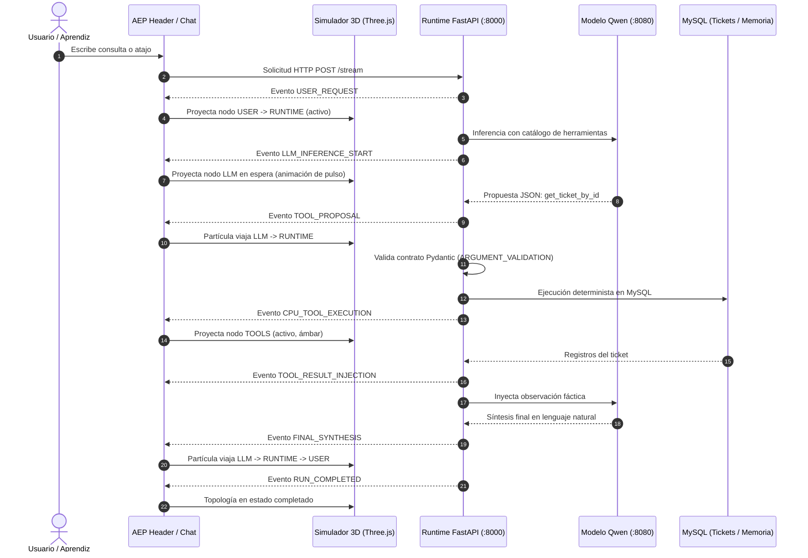

# AEP — Informe Final de Aprendizaje Interactivo y Observabilidad Agéntica

> **Módulo M05 — CASE OS / Agent Engineering Playground (AEP)**  
> **Fecha:** 12 de Octubre de 2026  
> **Estado:** Implementado, Auditado y Validado con Evidencias Automatizadas E2E  

---

## 1. Resumen ejecutivo

Este proyecto evoluciona **Agent Engineering Playground (AEP)** transformándolo de una interfaz de ejecución en un **laboratorio interactivo de observabilidad y aprendizaje profundo sobre agentes de Inteligencia Artificial**.

Bajo el principio curricular fundamental de que **AEP no representa cuatro agentes desconectados, sino un único agente que evoluciona progresivamente a través de las lecciones (v1 a v4)**, se implementaron dos experiencias complementarias de alto impacto pedagógico sin alterar la lógica de negocio ni simular razonamientos ficticios:

1. **Walkthrough interactivo («Explorar Playground»):** Un recorrido guiado paso a paso por toda la interfaz que resalta elementos reales mediante máscara de recorte y spotlight luminoso, explicando la función arquitectónica de cada panel e introduciendo enfoques específicos por versión agéntica.
2. **Agent Runtime Simulator («Abrir simulador»):** Un simulador inmersivo en Three.js proyectado en un modal responsivo que visualiza la topología soberana de nodos (**USER**, **RUNTIME**, **LLM**, **TOOLS**, **MEMORY**, **PLANNER**, **EXECUTOR**), animando flujos de energía sobre eventos observables reales (SSE) y diferenciando explícitamente qué propone el modelo LLM y qué valida y ejecuta el runtime en CPU.
3. **Integración profunda con Documentación Markdown:** Cada nodo y cada evento del simulador enlaza directamente con los 8 documentos pedagógicos sincronizados de `docs/aprendices/` a través de `LearnerGuideService` y `guides_manifest.json`.

---

## 2. Auditoría técnica y visual inicial

Antes de escribir el código, se ejecutó una inspección técnica y visual con Chromium en Playwright a través de cuatro viewports canónicos:

| Viewport | Ancho x Alto | Elementos auditados | Hallazgo principal |
|---|---|---|---|
| **Mobile S** | 360 × 800 | Header, selectores, tabs móviles, Chat | Header apila verticalmente; tabs móviles aíslan conversación de observabilidad. |
| **Mobile M** | 390 × 844 | Navegación, chips de prompt, Drawer | Interfaz táctil funcional; botón de guía y modal requieren ajuste de z-index (2000+). |
| **Tablet** | 768 × 1024 | Split secundario v3, Stepper, Avatar | Sub-barra en tableta para alternar entre Inspector y Memoria. |
| **Desktop** | 1440 × 900 | Grid completo, Three.js avatar, DAG | Vista panorámica óptima para el modal amplio del simulador. |

Documento de diseño arquitectónico entregado:  
[docs/architecture/AEP_INTERACTIVE_LEARNING_DESIGN.md](file:///c:/Users/YAMI/Documents/clase%20cfa%20lab03/docs/architecture/AEP_INTERACTIVE_LEARNING_DESIGN.md)

---

## 3. Arquitectura implementada: El simulador como proyección visual

La decisión de diseño central solicitada fue respetada con rigor:  
**El simulador es una proyección visual del runtime, no otro runtime disfrazado de Three.js.**

```mermaid
graph TD
    subgraph "FastAPI Backend (:8000)"
        SSE[SSE Event Stream]
    end

    subgraph "Frontend Services (Única Fuente de Verdad)"
        StreamSvc[AgentStreamService] -->|onEvent| EventStore[EventStoreService]
        EventStore --> Controller[PresentationControllerService]
        EventStore --> SimProj[SimulatorProjectionService]
        Controller -.->|mode: live / replay| SimProj
    end

    subgraph "Componentes de Presentación"
        SimProj --> SimModal[RuntimeSimulatorModalComponent (Three.js Graph)]
        EventStore --> ChatPanel[ChatPanelComponent]
        EventStore --> Inspector[RuntimeInspectorComponent]
        WalkSvc[WalkthroughService] --> WalkModal[WalkthroughOverlayComponent]
        GuideSvc[LearnerGuideService] --> GuideDrawer[LearnerGuideDrawerComponent]
    end

    SSE --> StreamSvc
    SimModal -.->|Clic en nodo o enlace| GuideDrawer
```

### Características de soberanía:
- **Sin peticiones duplicadas:** El simulador no realiza llamadas HTTP adicionales a FastAPI ni al LLM. Consume `EventStoreService` y `PresentationControllerService`.
- **Modo Live:** Se suscribe reactivamente a los eventos SSE en tránsito; si el usuario abre el simulador a mitad de una ejecución, reconstruye el estado actual y continúa en vivo.
- **Modo Replay:** Permite recorrer cualquier evento histórico sin reenviar datos al servidor ni alterar la base de datos MySQL.

---

## 4. Diagrama Mermaid de flujo de eventos observable



---

## 5. Mapa de componentes Angular

Los nuevos componentes se integraron siguiendo la arquitectura Angular 22 standalone, señales reactivas (`signal`, `computed`, `effect`) y tipado estricto:

| Componente / Servicio | Ubicación | Responsabilidad |
|---|---|---|
| `WalkthroughService` | [walkthrough.service.ts](file:///c:/Users/YAMI/Documents/clase%20cfa%20lab03/frontend/src/app/services/walkthrough.service.ts) | Máquina de estados del tour, avance, retroceso, persistencia en `localStorage`. |
| `WalkthroughOverlayComponent` | [walkthrough-overlay.component.ts](file:///c:/Users/YAMI/Documents/clase%20cfa%20lab03/frontend/src/app/components/walkthrough-overlay/walkthrough-overlay.component.ts) | Máscara de spotlight con recorte dinámico `getBoundingClientRect`, tarjeta flotante pedagógica y navegación accesible por teclado. |
| `SimulatorProjectionService` | [simulator-projection.service.ts](file:///c:/Users/YAMI/Documents/clase%20cfa%20lab03/frontend/src/app/services/simulator-projection.service.ts) | Proyecta eventos del `EventStore` a nodos 3D, calcula topologías por versión y prepara el detalle pedagógico. |
| `RuntimeSimulatorModalComponent` | [runtime-simulator-modal.component.ts](file:///c:/Users/YAMI/Documents/clase%20cfa%20lab03/frontend/src/app/components/runtime-simulator/runtime-simulator-modal.component.ts) | Modal responsivo con escena Three.js, partículas sobre curvas de Bézier, raycaster para clics en nodos, scrubber timeline y fallback 2D vectorial. |
| `HeaderComponent` | [header.component.ts](file:///c:/Users/YAMI/Documents/clase%20cfa%20lab03/frontend/src/app/components/header/header.component.ts) | Botones «Explorar Playground» y «Abrir simulador», badges de estado Live/Replay y atributos `data-tour`. |
| `App` | [app.ts](file:///c:/Users/YAMI/Documents/clase%20cfa%20lab03/frontend/src/app/app.ts) / [app.html](file:///c:/Users/YAMI/Documents/clase%20cfa%20lab03/frontend/src/app/app.html) | Coordinador raíz de vistas, drawers, modals y sincronización de identidad de versión. |

---

## 6. Diseño del grafo Three.js y topología por versiones

El grafo 3D posiciona los nodos soberanos en el espacio métrico cartesiano de la escena Three.js y filtra la visibilidad según la versión seleccionada:

### Nodos soberanos y posiciones:
- **USER:** `[-4.0, 0, 0]` — Cian (#38bdf8). Origen humano y receptor final.
- **RUNTIME:** `[-1.2, 0, 0]` — Esmeralda (#10b981). Centro orquestador soberano en CPU.
- **LLM:** `[1.6, 1.8, 0]` — Violeta Neón (#c084fc). Inferencia y generación probabilística.
- **TOOLS:** `[1.6, -1.8, 0]` — Ámbar (#f59e0b). Contratos deterministas y consultas en MySQL.
- **MEMORY:** `[-1.2, -2.6, 0]` — Índigo (#6366f1). Persistencia relacional de turnos y preferencias (v3/v4).
- **PLANNER:** `[4.2, 1.8, 0]` — Teal (#14b8a6). Grafo acíclico dirigido de meta y pasos (v4).
- **EXECUTOR:** `[4.2, -1.8, 0]` — Rosa/Carmesí (#f43f5e). Despachador de ejecutores especializados TOOL/RUNTIME/MODEL (v4).

### Topologías adaptativas:
- **Agent v1:** 4 nodos (`USER`, `RUNTIME`, `LLM`, `TOOLS`), 3 aristas.
- **Agent v2:** 4 nodos (`USER`, `RUNTIME`, `LLM`, `TOOLS`), aristas con indicador de ciclo recursivo.
- **Agent v3:** 5 nodos (`USER`, `RUNTIME`, `LLM`, `TOOLS`, `MEMORY`), conexión bidireccional de hidratación/persistencia.
- **Agent v4:** 7 nodos completos (`USER`, `RUNTIME`, `LLM`, `TOOLS`, `MEMORY`, `PLANNER`, `EXECUTOR`).

### Fallback 2D vectorial:
Si el navegador se ejecuta en un entorno sin soporte de aceleración WebGL (por ejemplo, entornos de prueba headless sin software rendering o GPUs bloqueadas), el componente detecta el fallo automáticamente y renderiza la **Topología 2D Vectorial** con tarjetas interactivas de nodos, garantizando cero pantallas en blanco.

---

## 7. Funcionamiento en modo LIVE

- **Sincronización en tiempo real:** Cuando el usuario envía una consulta en el chat, el backend emite eventos SSE. El simulador escucha `EventStoreService` y actualiza inmediatamente el nodo activo.
- **Inferencia en progreso:** Si el evento es `LLM_INFERENCE_START`, el simulador entra en estado `waiting`, mostrando el indicador flotante:  
  *«Esperando respuesta del modelo local (:8080)...»* con un spinner y pulso en el nodo LLM, sin inventar tokens ni pensamientos ficticios.
- **Flujo de partículas:** Al emitirse eventos de transición (`TOOL_PROPOSAL`, `CPU_TOOL_EXECUTION`, `FINAL_SYNTHESIS`), una esfera de energía recorre la curva de Bézier que une los dos nodos correspondientes.
- **Reconstrucción de estado:** Si el aprendiz abre el modal a mitad de una ejecución, el simulador toma los eventos acumulados hasta el momento y continúa animando en vivo.

---

## 8. Funcionamiento en modo REPLAY

- **Aislamiento total:** Pausar la visualización o inspeccionar eventos históricos no detiene ni afecta el stream del backend FastAPI.
- **Controles de transporte:**
  - `Reiniciar`: Vuelve al evento 0 (`USER_REQUEST`).
  - `Paso anterior / Paso siguiente`: Permite analizar cada evento paso a paso con las flechas del teclado o los botones.
  - `Play / Pausa`: Reproduce la secuencia a velocidad ajustable (`0.5x`, `1x`, `2x`).
  - `Volver a Live`: Restaura inmediatamente el seguimiento en tiempo real.
- **Scrubber interactivo:** Una barra inferior de marcadores permite saltar con un solo clic a cualquier evento específico (`TOOL_PROPO`, `ARGUMENT_V`, `CPU_TOOL_E`, etc.).

---

## 9. Integración con Documentación Markdown

Cada nodo 3D y cada tarjeta de evento ofrece acceso directo a la base curricular de CASE OS:
- **Pestaña Evento Observable:** Desglosa en lenguaje claro:
  - *Qué hizo el LLM:* «Propuso llamar a get_ticket_by_id con ticket_code: TICK-1001».
  - *Qué hizo el Runtime:* «Validó contrato Pydantic y ejecutó consulta en MySQL».
  - *Carga útil JSON real:* Visualizador de código formateado con los parámetros observables.
- **Pestaña Nodo Seleccionado:** Muestra el rol arquitectónico del componente, su principio pedagógico y un snippet de código real en Python.
- **Enlace contextual:** Un botón interactivo «Abrir catalogo-herramientas.md →» (o el documento correspondiente) abre el drawer de la Guía del Aprendiz posicionando la lectura exacta para el estudiante.

---

## 10. Cobertura pedagógica v1 a v4

| Versión | Capacidad | Visualización en el Simulador |
|---|---|---|
| **v1 — Tool Calling** | Propuesta y ejecución de una sola herramienta | Destaca el viaje `LLM -> RUNTIME -> TOOLS -> RUNTIME -> LLM`. Visualiza que el modelo propone y la CPU ejecuta. |
| **v2 — Agent Loop** | Bucle reactivo iterativo | Muestra iteraciones sucesivas sobre el bucle, preservando observaciones y respetando el presupuesto de parada. |
| **v3 — State & Memory** | Persistencia relacional en MySQL | Conexión activa con el nodo `MEMORY`. Muestra la hidratación previa y la persistencia del nuevo turno aislada por persona. |
| **v4 — Planning** | Grafo Acíclico Dirigido (DAG) | Nodos `PLANNER` y `EXECUTOR` activos. Visualiza cómo el plan descompone la meta antes de despachar herramientas y ejecutar replanning. |

---

## 11. Archivos creados y modificados

### Archivos creados:
1. `docs/architecture/AEP_INTERACTIVE_LEARNING_DESIGN.md` — Diseño de arquitectura técnica y visual.
2. `frontend/src/app/models/walkthrough.models.ts` — Pasos generales y específicos del walkthrough.
3. `frontend/src/app/services/walkthrough.service.ts` — Servicio gestor del recorrido guiado.
4. `frontend/src/app/services/walkthrough.service.spec.ts` — Pruebas unitarias del walkthrough.
5. `frontend/src/app/components/walkthrough-overlay/walkthrough-overlay.component.ts` — Componente visual con spotlight y tarjeta flotante.
6. `frontend/src/app/components/walkthrough-overlay/walkthrough-overlay.component.spec.ts` — Pruebas unitarias del overlay.
7. `frontend/src/app/models/simulator.models.ts` — Nodos, aristas, topologías y mapeos de eventos a roles pedagógicos.
8. `frontend/src/app/services/simulator-projection.service.ts` — Servicio de proyección visual sincronizado con `EventStore`.
9. `frontend/src/app/services/simulator-projection.service.spec.ts` — Pruebas unitarias de proyección y topologías.
10. `frontend/src/app/components/runtime-simulator/runtime-simulator-modal.component.ts` — Modal Three.js del simulador interactivo.
11. `frontend/src/app/components/runtime-simulator/runtime-simulator-modal.component.spec.ts` — Pruebas unitarias del modal.
12. `scratch/run_interactive_learning_e2e.py` — Script automatizado de pruebas E2E con Playwright.
13. `AEP_INTERACTIVE_LEARNING_REPORT.md` — Este informe integral de cierre.

### Archivos modificados:
1. `frontend/src/app/components/header/header.component.ts` — Botones «Explorar Playground» y «Abrir simulador», atributos `data-tour`, inputs/outputs.
2. `frontend/src/app/components/chat-panel/chat-panel.component.ts` — Atributos `data-tour="tour-chat-panel"` y `tour-chat-suggestions`.
3. `frontend/src/app/components/runtime-inspector/runtime-inspector.component.ts` — Atributos `data-tour="tour-inspector-header"`, `tour-decision-trace`, `tour-avatar-3d` y `tour-pipeline-stepper`.
4. `frontend/src/app/app.html` — Conexión de inputs/outputs del header, atributo `data-tour="tour-memory-panel"`, renderizado del modal del simulador y overlay del walkthrough.
5. `frontend/src/app/app.ts` — Inyección de `WalkthroughService` y `SimulatorProjectionService`, métodos de apertura y sincronización de versión.

---

## 12. Resultados de pruebas obligatorias

### 12.1. Pruebas Unitarias del Frontend (Vitest)
- **Suites ejecutadas:** 13 / 13 pasadas (100%).
- **Pruebas totales:** 101 / 101 pasadas (100%).
- **Cobertura nueva:**
  - `WalkthroughService`: 6 pruebas (navegación, pasos por versión, persistencia).
  - `WalkthroughOverlayComponent`: 5 pruebas (renderizado, teclado, cierre).
  - `SimulatorProjectionService`: 10 pruebas (topología v1-v4, mapeo de eventos, timeline, excerpts Markdown).
  - `RuntimeSimulatorModalComponent`: 7 pruebas (modal, tabs, fullscreen, atajos, fallback).

### 12.2. Pruebas Unitarias del Backend (Pytest)
- **Suites ejecutadas:** 11 archivos de prueba en `tests/unit/`.
- **Pruebas totales:** 78 / 78 pasadas (100%).
- **Garantía:** Cero regresiones en la lógica de negocio ni en los contratos de los agentes v1–v4.

### 12.3. Compilación de Producción de Angular
- `npm run build` completado exitosamente con código 0 en 3.59s.

---

## 13. Evidencia visual de Playwright E2E

Se ejecutó la prueba automatizada end-to-end con Playwright Chromium en modo Headless (`scratch/run_interactive_learning_e2e.py`), generando las siguientes capturas verificables en `scratch/interactive_learning_evidence/`:

1. `01_desktop_baseline.png` — Interfaz inicial de AEP en resolución de escritorio (1440x900).
2. `02_desktop_walkthrough_step1.png` — Walkthrough interactivo con bienvenida y tarjeta flotante.
3. `03_desktop_walkthrough_step2.png` — Spotlight recortado con halo cian sobre el selector de versiones.
4. `04_desktop_simulator_opened.png` — Modal del simulador 3D abierto con nodos Three.js en reposo.
5. `05_desktop_simulator_node_inspector.png` — Inspección del nodo TOOLS con documentación pedagógica y ejemplo en Python.
6. `06_desktop_prompt_executed.png` — Ejecución de consulta real sobre tickets en el chat e inspector.
7. `07_desktop_simulator_live_events.png` — Simulador en vivo con eventos reales del runtime y timeline poblada.
8. `08_desktop_simulator_replay_step.png` — Modo Replay interactivo con marcador activo y botón «Volver a Live».
9. `09_mobile_baseline.png` — Vista adaptativa en resolución móvil (390x844).
10. `10_mobile_walkthrough.png` — Walkthrough fijado en la zona inferior en pantalla móvil.
11. `11_mobile_simulator.png` — Simulador adaptado verticalmente en pantalla móvil sin scroll horizontal.

---

## 14. Limitaciones reales

1. **Topologías v5 y v6 no implementadas:** Siguiendo la restricción explícita del proyecto, no se crearon nodos ficticios para Human-in-the-Loop avanzado ni para Evaluación agéntica v6. La topología está preparada para extenderse limpiamente cuando se desarrollen dichas versiones.
2. **Contexto WebGL en Vitest jsdom:** Dado que el runner de pruebas unitarias Vitest en Node.js no incluye un canvas de aceleración 3D nativo, los tests unitarios verifican el fallback y la reactividad, mientras que la escena Three.js real es validada de forma end-to-end en Playwright Chromium.

---

## 15. Deuda técnica

- La advertencia de presupuesto de bundle de Angular indica que el tamaño inicial es de 1.29 MB (debido a la inclusión conjunta de Three.js y marked/dompurify en el chunk principal). En una fase futura de optimización, el simulador Three.js puede cargarse mediante `defer` o import dinámico (`loadComponent`).

---

## 16. Próximos pasos sugeridos

1. **Evolución a Agent v5 (Guardrails & Human-in-the-Loop):** Incorporar un nodo visual de interceptación (Guardrail Gate) y un estado de pausa de confirmación humana en el simulador.
2. **Evolución a Agent v6 (Observabilidad & Evaluación E2E):** Integrar métricas de costo por tokens y latencia visuales flotantes sobre los enlaces entre RUNTIME y LLM.
3. **Grabación de ejecuciones:** Permitir descargar un JSON de la traza de ejecución para que el instructor pueda compartir escenarios específicos con los aprendices.

---

*Fin del informe. Agent Engineering Playground (AEP) está listo para la formación práctica de aprendices.*
