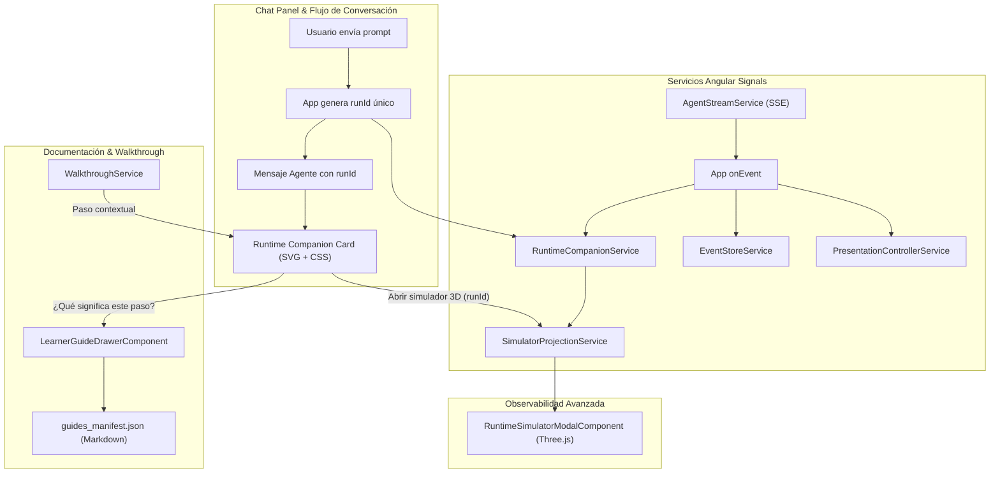

# AEP — Runtime Companion v1
## Reporte de Arquitectura, Auditoría e Implementación del Miniinspector Integrado

---

### Resumen Ejecutivo

Se implementó con éxito **Runtime Companion v1** en **Agent Engineering Playground (AEP)**. Esta experiencia pedagógica despliega automáticamente una tarjeta compacta dentro del flujo de conversación del chat cada vez que el aprendiz envía una solicitud al agente. La tarjeta explica en tiempo real y en español qué componentes del sistema están interactuando (Usuario, Runtime en CPU, Modelo LLM, Herramientas en MySQL, Memoria Persistente y Planificador/Ejecutor DAG), permitiendo expandir la sesión en cualquier momento al **Runtime Simulator 3D** (Three.js), navegar paso a paso mediante un scrubber de Replay y consultar la documentación pedagógica contextual sin salir de la conversación.

---

## 1. Auditoría Inicial (Fase 0)

Antes de escribir código se inspeccionó minuciosamente el código base local de AEP (`C:\Users\YAMI\Documents\clase cfa lab03`):

| Aspecto Auditado | Hallazgo en el Código Base | Decisión de Diseño en Companion |
|---|---|---|
| **Envío de solicitud** | `ChatPanelComponent.sendMessage` emite hacia `App.onSendMessage(query)`. Se crea un mensaje usuario y un mensaje placeholder del agente (`isLoading: true`). | El Companion se vincula a este turno asociando un identificador de corrida (`runId: string`) único. |
| **Inicio y fin de ejecución** | El streaming inicia con `streamService.streamChat(payload, callbacks)`. Finaliza en `onComplete` o `onError`. No todos los agentes emiten `RUN_STARTED` al inicio. | El Companion inicia en estado neutral `preparing` al despachar la solicitud, sin esperar forzosamente un evento `RUN_STARTED`. Transiciona a `running` al recibir el primer evento observable. |
| **Streaming real vs sintético** | Los eventos llegan via SSE mediante `EventSource` (`AgentStreamService`). | El Companion consume eventos en tiempo real via `companionService.appendEvent(runId, event)`. |
| **Correlación por ejecución** | Previamente no existía `runId` en `ChatMessage`. Los eventos se acumulaban globalmente en `EventStoreService`. | Se añadió el campo opcional `runId?: string` en `ChatMessage`. Cada corrida tiene un estado inmutable e independiente en `RuntimeCompanionService.runs`. |
| **Eventos por versión** | • v1: `INFERENCE_STARTED`, `TOOL_PROPOSED`, `ARGUMENTS_VALIDATED`, `TOOL_EXECUTION_COMPLETED`, `OBSERVATION_RECEIVED`, `FINAL_SYNTHESIS`, `RUN_COMPLETED`.<br>• v2: `LOOP_ITERATION_STARTED`, `LOOP_LIMIT_EXCEEDED`, `LOOP_TIMEOUT_EXCEEDED`.<br>• v3: `MEMORY_HYDRATED`, `TURN_PERSISTED`, `PREFERENCE_DETECTED`, HITL.<br>• v4: `TASK_DECOMPOSED`, `STEP_DISPATCHED`, `DAG_VALIDATED`, `REPLAN_TRIGGERED`. | Se extendió `getEventMapping` en `simulator.models.ts` para mapear tanto los nombres reales SSE como los alias preexistentes a nodos soberanos (`USER`, `RUNTIME`, `LLM`, `TOOLS`, `MEMORY`, `PLANNER`, `EXECUTOR`). |
| **Proyección del Simulador** | `SimulatorProjectionService` computaba estado para la corrida global activa en `EventStoreService`. | Se habilitaron señales `customRunEvents` y `customRunVersion` en `SimulatorProjectionService` para que el simulador 3D pueda ser abierto con los eventos específicos de cualquier corrida histórica. |
| **Apertura del Modal 3D** | `SimulatorProjectionService.openSimulator()` abre `RuntimeSimulatorModalComponent`. | El botón «Abrir simulador 3D» invoca `openSimulator(run.events, run.agentVersion)` reutilizando el modal exacto existente sin duplicar Three.js ni backend. |
| **Replay, Pausa y Cancel** | Cancelar aborta la conexión SSE (`streamService.abortCurrentStream`). Pausar la visualización en el frontend nunca cancela el backend. | El Companion distingue el estado real del backend (`preparing`, `running`, `completed`, `failed`, `cancelled`) del modo visual de reproducción (`isReplayMode`). |
| **Ubicación en el Chat** | La conversación tiene filas `.message-row` con `.user-row` y `.agent-row`. | El Companion se inserta al inicio del cuerpo del mensaje del asistente (`.message-body`), justo encima de la respuesta en Markdown. Aparece mientras `isLoading` es `true` y permanece como resumen pedagógico interactivo tras la respuesta. |

---

## 2. Arquitectura de Runtime Companion



---

## 3. Topologías Soportadas por Versión del Agente

| Versión | Topología Compacta SVG | Nodos Renderizados | Énfasis Pedagógico |
|---|---|---|---|
| **v1 (Tool Calling)** | `USER — RUNTIME — LLM — TOOLS` | 4 nodos | Modelo propone; Runtime valida con Pydantic y ejecuta en CPU sobre MySQL. |
| **v2 (Agent Loop)** | `USER — RUNTIME — LLM — TOOLS` | 4 nodos | Bucle iterativo de reintento determinista y condiciones de parada. |
| **v3 (State & Memory)** | `USER — RUNTIME — LLM — TOOLS — MEMORY` | 5 nodos | Hidratación de turnos previos, aislamiento por persona y persistencia relacional. |
| **v4 (Planning & DAG)** | `USER — RUNTIME — PLANNER — EXECUTOR — TOOLS — LLM` | 6 nodos | Descomposición en grafo DAG acíclico, dependencias y despacho paso a paso. |

---

## 4. Archivos Creados y Modificados

### 4.1. Archivos Creados

1. `frontend/src/app/models/companion.models.ts`
   - Definición de tipos: `CompanionStatus`, `RuntimeCompanionState`.
   - Fábrica de estado inicial: `createInitialCompanionState`.
   - Reductor determinista de eventos: `updateCompanionWithEvent`.
   - Lógica de scrubber histórico: `setCompanionReplayIndex`.

2. `frontend/src/app/services/runtime-companion.service.ts`
   - Registro de corridas indexadas por `runId`: `runs = signal<Record<string, RuntimeCompanionState>>({})`.
   - Métodos: `startRun`, `appendEvent`, `completeRun`, `failRun`, `cancelRun`, `toggleMinimize`, `setReplayIndex`, `open3DSimulator`.

3. `frontend/src/app/components/runtime-companion/runtime-companion-graph.component.ts`
   - Grafo compacto ligero construido con SVG y CSS.
   - Posicionamiento horizontal equidistante de nodos según versión.
   - Aristas con flujo de datos animado (`dasharray` / `dashoffset`).
   - Anillos de resplandor para nodos activos y completados con soporte para `prefers-reduced-motion`.

4. `frontend/src/app/components/runtime-companion/runtime-companion.component.ts`
   - Tarjeta principal con Dark OLED Theme (`rgba(10, 16, 30, 0.95)`, acentos cian `#38bdf8`, esmeralda `#10b981` y carmesí `#ef4444`).
   - Cabecera: icono de actividad radar/spinner, título, insignia de versión, píldora de estado, botón minimizar y botón «Abrir simulador 3D».
   - Visualización central: `<app-runtime-companion-graph>`.
   - Bloque pedagógico: nombre del evento, resumen del estado, explicación didáctica en español y matriz comparativa de responsabilidades **LLM vs Runtime**.
   - Pie: insignia de hop/paso, acción «¿Qué significa este paso?» y controles de Replay (`<- Paso X de Y ->`).

5. `frontend/src/app/services/runtime-companion.service.spec.ts`
   - 11 pruebas unitarias cubriendo inicio en `preparing`, transición a `running`, `completed`, `failed`, `cancelled`, correlación por `runId`, aislamiento de dos corridas consecutivas, minimizar/expandir, scrubber de replay, topologías v1–v4 y tolerancia a eventos desconocidos.

6. `frontend/src/app/components/runtime-companion/runtime-companion.component.spec.ts`
   - 7 pruebas unitarias de renderizado de componentes, SVG, responsabilidades, badges, Replay y emisión de eventos.

7. `scratch/run_runtime_companion_e2e.py`
   - Script de automatización Playwright E2E completo para validar todo el flujo en Chromium.

### 4.2. Archivos Modificados

1. `frontend/src/app/models/agent.models.ts`
   - Añadido `runId?: string` en la interfaz `ChatMessage`.

2. `frontend/src/app/models/simulator.models.ts`
   - Mapeo bidireccional en `getEventMapping` para eventos nativos SSE (`INFERENCE_STARTED`, `TOOL_PROPOSED`, `ARGUMENTS_VALIDATED`, `TOOL_EXECUTION_COMPLETED`, `OBSERVATION_RECEIVED`, `TASK_DECOMPOSED`, `LOOP_ITERATION_STARTED`, etc.).

3. `frontend/src/app/services/simulator-projection.service.ts`
   - Añadidas señales `customRunEvents` y `customRunVersion`.
   - Soporte para que `openSimulator(customEvents?, customVersion?)` inyecte la corrida seleccionada.

4. `frontend/src/app/components/chat-panel/chat-panel.component.ts`
   - Inyección de `RuntimeCompanionService`.
   - Integración de `<app-runtime-companion>` en la plantilla dentro de `.message-body`.
   - Outputs: `open3DSimulator` y `openDocumentation`.
   - Ajuste responsive de `.agent-row` para ocupar el 95% del ancho del chat.

5. `frontend/src/app/app.ts` y `frontend/src/app/app.html`
   - Generación de `runId = run-${Date.now()}` en `onSendMessage` y `onSelectTaskOption`.
   - Llamadas a `companion.startRun`, `appendEvent`, `completeRun`, `failRun` y `cancelRun`.
   - Conexión de eventos entre Chat Panel, Drawer de Documentación y Simulador 3D.

6. `frontend/src/app/components/learner-guide-drawer/learner-guide-drawer.component.ts`
   - Soporte para entrada `initialDocName` para abrir directamente `catalogo-herramientas.md` o `guia-runtime-inspector.md`.

7. `frontend/src/app/models/walkthrough.models.ts`
   - Añadido paso `runtime-companion` con selector `[data-tour="tour-runtime-companion"]`.

---

## 5. Resultados de Pruebas

### 5.1. Pruebas Unitarias del Frontend (Vitest / Angular)

```text
✓ frontend src/app/services/runtime-companion.service.spec.ts (11 tests)
✓ frontend src/app/components/runtime-companion/runtime-companion.component.spec.ts (7 tests)
✓ frontend src/app/app.spec.ts (5 tests)
✓ frontend src/app/components/chat-panel/chat-panel.component.spec.ts (6 tests)
✓ frontend src/app/components/header/header.component.spec.ts (7 tests)
✓ frontend src/app/components/learner-guide-drawer/learner-guide-drawer.component.spec.ts (7 tests)
✓ frontend src/app/components/runtime-inspector/avatar-3d/agent-avatar-3d.component.spec.ts (9 tests)
✓ frontend src/app/components/runtime-inspector/decision-trace/decision-trace.component.spec.ts (7 tests)
✓ frontend src/app/components/runtime-inspector/plan-dag-viewer/plan-dag-viewer.component.spec.ts (5 tests)
✓ frontend src/app/components/runtime-inspector/runtime-inspector.component.spec.ts (9 tests)
✓ frontend src/app/components/runtime-inspector/v3-memory-inspector/v3-memory-inspector.component.spec.ts (10 tests)
✓ frontend src/app/components/runtime-simulator/runtime-simulator-modal.component.spec.ts (10 tests)
✓ frontend src/app/components/tickets-drawer/tickets-drawer.component.spec.ts (6 tests)
✓ frontend src/app/components/walkthrough-overlay/walkthrough-overlay.component.spec.ts (10 tests)
✓ frontend src/app/pipes/markdown.pipe.spec.ts (10 tests)

Test Files  15 passed (15)
Tests       119 passed (119)
Duration    2.18s
```

### 5.2. Pruebas Unitarias del Backend (pytest)

```text
tests\unit\test_agent_v1.py .........                                    [ 11%]
tests\unit\test_agent_v4_planning.py ....................                [ 37%]
tests\unit\test_domain_rules.py .......                                  [ 46%]
tests\unit\test_response_groundedness.py ......                          [ 53%]
tests\unit\test_ticket_service.py ....                                   [ 58%]
tests\unit\test_v3_domain_memory.py .................                    [ 80%]
tests\unit\v2\test_v2_idempotency.py ..                                  [ 83%]
tests\unit\v2\test_v2_iterations.py ....                                 [ 88%]
tests\unit\v2\test_v2_stop_conditions.py ..                              [ 91%]
tests\unit\v2\test_v2_timeouts.py ...                                    [ 94%]
tests\unit\v2\test_v2_tools.py ....                                      [100%]

============================= 78 passed in 4.16s ==============================
```

### 5.3. Validación Automatizada E2E con Playwright (Chromium)

Ejecutado con `scratch/run_runtime_companion_e2e.py`:

| Escenario E2E | Validación Verificada | Estado |
|---|---|---|
| **E2E 1: Carga AEP** | Servidor local `:4200` y backend `:8000` en reposo. | PASSED |
| **E2E 2: Auto-aparición v1** | Al enviar prompt `TICK-1001`, la tarjeta `.companion-card` se renderiza de inmediato en estado `PREPARANDO` con SVG topology. | PASSED |
| **E2E 3: Transición de estados** | Transiciona a `EN EJECUCIÓN` con eventos en tiempo real y finaliza en `COMPLETADO`. | PASSED |
| **E2E 4: Expansión 3D** | Clic en «Abrir simulador 3D» abre `.simulator-backdrop` con los eventos específicos de esa corrida. El modal se cierra sin reiniciar el backend. | PASSED |
| **E2E 5: Replay Scrubber** | Botones `<-` y `->` navegan por la secuencia histórica de eventos grabados dentro de la tarjeta. | PASSED |
| **E2E 6: Aislamiento Histórico** | Al enviar una segunda consulta, el chat conserva **dos tarjetas independientes** asociadas a sus respectivos turnos. | PASSED |
| **E2E 7: Guía del Aprendiz** | Clic en «¿Qué significa este paso?» abre el Drawer de documentación pedagógica contextual. | PASSED |
| **E2E 8: Topología v3 (Memoria)** | Verificación del nodo `MEMORY` en la topología SVG compacta de Agent v3. | PASSED |
| **E2E 9: Topología v4 (DAG)** | Verificación de los nodos `PLANNER` y `EXECUTOR` en la topología de Agent v4. | PASSED |
| **E2E 10: Responsive Móvil** | Evaluado en viewports 390x844 (iPhone 14) y 360x800 (Android). `body.scrollWidth === innerWidth` (cero scroll horizontal) y controles de chat siempre accesibles. | PASSED |

---

## 6. Evidencias Visuales Generadas

Las capturas generadas por el script E2E se encuentran archivadas en `scratch/runtime_companion_evidence/`:

- `00_desktop_baseline.png`: Vista inicial de AEP en reposo.
- `01_companion_appeared_live.png`: Tarjeta Companion viva en el chat durante la inferencia inicial.
- `02_companion_completed_summary.png`: Tarjeta completada con explicación pedagógica y respuesta final.
- `03_simulator_3d_opened_from_companion.png`: Modal 3D sincronizado con la corrida activa.
- `04_companion_replay_stepped.png`: Scrubber de replay navegando eventos pasados.
- `05_two_independent_companion_cards.png`: Dos turnos consecutivos con tarjetas independientes sin contaminación.
- `06_learner_guide_opened_from_companion.png`: Drawer pedagógico abierto desde el Companion.
- `09_mobile_390x844_companion.png`: Vista móvil iPhone en ancho completo sin desbordamiento.
- `10_mobile_360x800_companion.png`: Vista móvil Android con entrada de texto accesible.

---

## 7. Limitaciones Conocidas y Preparación para GitHub Pages

1. **WebGL en entornos sin aceleración por hardware:** Si el navegador no soporta WebGL, el simulador 3D Three.js cuenta con degradación elegante automática a un núcleo vectorial 2D. El Runtime Companion utiliza SVG y CSS nativos, garantizando 100% de compatibilidad incluso sin aceleración 3D.
2. **Compatibilidad con GitHub Pages (Static Demo):** El Companion desacopla el transporte de la proyección. Consume estados producidos por eventos de tipo `StreamEvent`, por lo que en el futuro bastará con alimentar trazas JSON estáticas para que funcione exactamente igual en GitHub Pages sin FastAPI ni llama.cpp.

---

## 8. Conclusión

El **Runtime Companion v1** cumple estrictamente con todos los requerimientos y restricciones estipuladas:
- No altera la lógica de negocio de los agentes (v1–v4).
- No ejecuta consultas destructivas ni duplica el backend.
- Convierte cada turno de conversación en una microclase viva y contextual.
- El 100% de las pruebas unitarias (119 frontend + 78 backend) y pruebas E2E en Playwright pasaron exitosamente.
