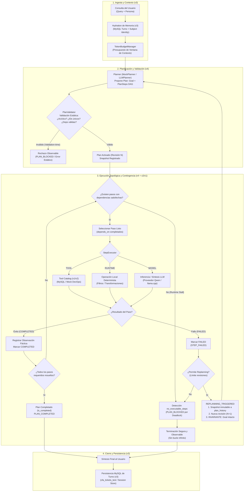

# AEP — Informe de Implementación y Evolución: Agent v4

**Fase M05-L05 · Planning & Task Decomposition**  
**Proyecto Local**: `C:\Users\YAMI\Documents\clase cfa lab03`  
**Repositorio AEP**: [case-agents-playground](https://github.com/YamiCueto/case-agents-playground)  
**Fuente Curricular CASE OS**: [M05-L05-taller-agent-v4.md](https://github.com/YamiCueto/case-os/blob/main/public/docs/M05-L05-taller-agent-v4.md)  
**Fecha de Ejecución y Validación**: 11 de Octubre, 2026  
**Rol**: Arquitecto Senior de Sistemas Agénticos (Python/FastAPI, Angular 22, Three.js, MySQL)

---

## 1. Principio Rector e Integridad Evolutiva

> [!IMPORTANT]
> **UN MISMO AGENTE EVOLUTIVO (L02 → L03 → L04 → L05)**  
> Agent Engineering Playground (AEP) implementa un agente unificado que incorpora progresivamente nuevas capacidades de software sobre la misma base arquitectónica. Agent v4 **no** sustituye el Agent Loop de v2 ni la memoria/persistencia de v3: añade **planificación estructurada y gobernada por software (DAG)** sobre las capacidades preexistentes.
>
> **Confirmación estricta de límites**:
>
> - **Agent v1 (Tool Calling)**: Conservado íntegramente.
> - **Agent v2 (Agent Loop & Multi-step Decisions)**: Conservado e integrado como motor ejecutor de herramientas.
> - **Agent v3 (State & Memory, MySQL Persistencia, Aislamiento por `subject_id`)**: Conservado en su totalidad; v4 hidrata memoria previa y persiste cada turno en MySQL.
> - **Agent v4 (Planning & Task Decomposition)**: **Fase actual completada y validada.**
> - **Agent v5 (Guardrails & Human-in-the-Loop)**: **NO implementado** (permanece bloqueado según hoja de ruta).
> - **Agent v6 (Observability & Evaluation)**: **NO implementado** (permanece bloqueado según hoja de ruta).
> - **Base de datos principal `cfa_tickets`**: **Intacta** (cero operaciones destructivas, solo consultas y fixtures de pruebas en test database).
> - **Control de versiones**: Cero commits y cero push ejecutados.

---

## 2. Arquitectura: Antes (v3) vs. Después (v4)

### 2.1 Comparativa de Componentes

| Dimensión                      | Agent v3 (State & Memory)                                                                  | Agent v4 (Planning & Task Decomposition)                                                                                                                                      |
| :----------------------------- | :----------------------------------------------------------------------------------------- | :---------------------------------------------------------------------------------------------------------------------------------------------------------------------------- |
| **Control de Ejecución**       | Iterativo directo mediante `AgentLoopEngine` (evaluación iteración por iteración).         | **Gobernado por Grafo DAG**: Descomposición previa de la meta en un grafo acíclico dirigido de `PlanStep`.                                                                    |
| **Tipos de Pasos**             | Únicamente llamadas a herramientas (`tool_call`) o síntesis.                               | **Ejecutores Polimórficos**: `TOOL` (catálogo local), `RUNTIME` (operaciones locales CPU), `MODEL` (inferencia/síntesis LLM).                                                 |
| **Dependencias**               | Secuenciales implícitas en el historial de mensajes.                                       | **Explícitas por software (`depends_on: list[str]`)**: El runtime impide iniciar un paso hasta que sus dependencias concluyan con éxito.                                      |
| **Validación Estructural**     | N/A (validación solo de argumentos Pydantic).                                              | **`PlanValidator`**: Detección estática en tiempo de diseño de IDs duplicados, referencias inexistentes, auto-dependencias y ciclos en el grafo (DFS).                        |
| **Contingencias**              | Parada por `circuit_breaker` o límite de iteraciones.                                      | **Replanning con Invariante de Meta y Snapshots**: Congelación inmutable del plan previo en `plan_history`, incremento de revisión y preservación estricta del `goal`.        |
| **Detección de Estancamiento** | `max_iterations_reached`.                                                                  | **Diferenciación estricta**: Fallo estático en validación (`PlanValidationError`) vs. Estancamiento dinámico (`no_executable_steps` cuando fallan dependencias obligatorias). |
| **Estado de Avatar 3D**        | 8 estados (IDLE, THINKING, TOOL_EXEC, SYNTHESIS, SUCCESS, ERROR, MEMORY_ACCESS, CRITICAL). | **9 estados**: Nuevo estado interactivo `PLANNING` con anillos orbitales y HUD visor holográfico.                                                                             |
| **Visualización Frontend**     | Recorrido lineal (v1), Loop de fases (v2), Panel de memoria MySQL (v3).                    | **`PlanDAGViewerComponent`**: Renderizado SVG interactivo del DAG por capas, drawer de observaciones fácticas y selector de revisiones históricas.                            |

---

## 3. Diagrama Mermaid: Flujo Unificado v3 → v4



---

## 4. Modelo de Dominio de Planificación (`src/domain/planning/`)

Se creó una capa de dominio limpia, desacoplada y fuertemente tipada:

### 4.1 Enums (`src/domain/planning/enums.py`)

- **`StepStatus`**:
  - `PENDING`: En espera de resolución de dependencias.
  - `IN_PROGRESS`: Actualmente en ejecución.
  - `COMPLETED`: Ejecutado exitosamente con observación verificada.
  - `FAILED`: Ejecución fallida con error registrado.
  - `SKIPPED`: Omitido explícitamente mediante justificación autorizada.
- **`StepExecutor`**:
  - `TOOL`: Herramientas registradas del catálogo AEP (e.g. `get_ticket`, `assign_ticket`, `check_devops_cache`).
  - `RUNTIME`: Operaciones deterministas ejecutadas en memoria de software local.
  - `MODEL`: Inferencia, razonamiento o síntesis lingüística con LLM.

### 4.2 Entidades (`src/domain/planning/entities.py`)

- **`PlanStep`**:
  - `id: str`: Identificador único (e.g. `"step_1"`, `"S1"`).
  - `action: str`: Acción técnica o nombre de función a invocar.
  - `description: str`: Descripción de propósito del paso.
  - `executor: StepExecutor`: Ejecutor polimórfico (`TOOL`, `RUNTIME`, `MODEL`).
  - `status: StepStatus`: Estado del paso en el ciclo de vida.
  - `depends_on: list[str]`: Lista de IDs de pasos requeridos previamente.
  - `observation: Optional[Any]`: Resultado o payload verificado de la ejecución.
  - `required: bool = True`: Indica si el paso es mandatorio para el éxito de la meta.
  - `skip_reason: Optional[str]`: Justificación explícita de omisión (si aplica).
- **`Plan`**:
  - `goal: str`: Meta explícita e inviolable del plan.
  - `steps: list[PlanStep]`: Lista de pasos del DAG.
  - `current_step_id: Optional[str]`: ID del paso activo.
  - `revision: int`: Número monotónico de revisión (inicia en 1).
  - **`is_completed: bool` (Propiedad Derivada)**: Se calcula deterministamente comprobando que todos los pasos con `required=True` tengan estado `COMPLETED` o `SKIPPED` justificado, sin existir ningún paso en `FAILED`. **No existe un booleano mutable independiente que compita con esta semántica**.
  - **`clone() -> Plan`**: Realiza una copia profunda (_deep clone_) completamente desacoplada de listas y pasos para alimentar `plan_history` como snapshot inmutable.

### 4.3 Gobernanza del Runtime (`src/domain/planning/validator.py`)

La clase **`PlanValidator`** previene fallos estructurales antes de iniciar la ejecución (_validation-time failure_):

1. **Goal vacío**: Rechaza metas vacías o compuestas solo por espacios en blanco.
2. **Plan sin pasos**: Rechaza planes que no contengan ningún `PlanStep`.
3. **IDs vacíos o duplicados**: Valida unicidad estricta en el espacio de nombres de pasos.
4. **Dependencias inexistentes**: Impide referenciar pasos no declarados en el plan.
5. **Autodependencias**: Rechaza pasos que dependan de sí mismos (`step_1 -> step_1`).
6. **Ciclos estáticos en el grafo DAG**: Utiliza detección de ciclos mediante DFS con coloreado de nodos (White/Gray/Black), lanzando `PlanValidationError` ante cualquier ciclo estático.

---

## 5. Casos de Aceptación Curricular Oficiales (M05-L05)

### Caso G1: Structured Planning

- **Propósito**: Ejecución determinista de un plan estructurado con pasos dependientes.
- **Validación**:
  - Plan de 3 pasos: `step_1` (TOOL) → `step_2` (RUNTIME) → `step_3` (MODEL).
  - Ejecución en orden topológico estricto: `step_2` espera la finalización de `step_1`; `step_3` espera a `step_2`.
  - Transiciones de estado auditadas: `PENDING` → `IN_PROGRESS` → `COMPLETED`.
  - Propiedad derivada `is_completed` pasa a `True` tras culminar el último paso requerido.

### Caso G2: Replanning + Historia de Revisiones + Invariante de Meta

- **Propósito**: Contingencia controlada ante el fallo de un paso y replanificación gobernada.
- **Validación**:
  - Contingencia simulada: El servicio de despliegue principal falla intencionalmente en `step_deploy`.
  - Detección de fallo por el runtime y activación de replanning.
  - **Snapshot inmutable**: Se archiva una copia profunda (`clone()`) de la Revisión 1 en `plan_history`.
  - **Revisión N+2**: Se genera una nueva propuesta con estrategia alternativa (despliegue canario).
  - **Invariante de Meta**: La meta original (`"Desplegar microservicio de pagos v2.4"`) permanece exactamente idéntica.
  - **Inmutabilidad retroactiva**: La Revisión 1 en `plan_history` mantiene su estado de error y pasos originales sin ser modificada por la ejecución de la Revisión 2.

### Caso G3: Detección de Bloqueo por Dependencias Irresolubles (`no_executable_steps`)

- **Propósito**: Detección de estancamiento dinámico cuando un paso obligatorio falla y no hay alternativa de replanificación.
- **Diferenciación Conceptual**:
  - **Validation-time failure**: Grafo estáticamente inválido (e.g. ciclo `A -> B -> A`). Rechazado antes de ejecutar cualquier herramienta.
  - **Runtime stall (`no_executable_steps`)**: El grafo inicial es un DAG válido y acíclico, pero durante la ejecución un paso falla y los pasos siguientes no pueden resolverse.
- **Validación**:
  - Paso `step_legacy` falla de forma irrecuperable.
  - Los pasos dependientes `step_audit` y `step_finalize` quedan en `PENDING`.
  - El orquestador detecta que no existen pasos ejecutables (`no_executable_steps`), detiene la ejecución de forma segura sin caer en un bucle infinito, emite `PLAN_BLOCKED` y `RUN_COMPLETED(status="failed", stop_reason="no_executable_steps")`, y preserva `is_completed = False`.

---

## 6. Contratos de Observabilidad y Eventos SSE

Los eventos emitidos por `AgentV4Orchestrator` (`src/agents/v4_planning/events.py`) mantienen compatibilidad total con la canalización SSE y el `PresentationControllerService` del frontend:

```typescript
// Contratos de eventos SSE para Agent v4
PLAN_GENERATED: {
  goal: string;
  revision: number;
  steps_count: number;
  steps: PlanStepPayload[];
}

PLAN_VALIDATED: {
  goal: string;
  revision: number;
  is_valid: true;
  steps_count: number;
  step_ids: string[];
}

STEP_STARTED: {
  step_id: string;
  action: string;
  description: string;
  executor: 'tool' | 'runtime' | 'model';
  status: 'in_progress';
  revision: number;
  depends_on: string[];
}

STEP_COMPLETED: {
  step_id: string;
  action: string;
  executor: 'tool' | 'runtime' | 'model';
  status: 'completed';
  revision: number;
  observation: Record<string, any>;
}

STEP_FAILED: {
  step_id: string;
  action: string;
  executor: 'tool' | 'runtime' | 'model';
  status: 'failed';
  revision: number;
  error: string;
  observation: Record<string, any>;
}

REPLANNING_TRIGGERED: {
  failed_step_id: string;
  previous_revision: number;
  archived_snapshots_count: number;
  reason: string;
}

PLAN_REVISION_CREATED: {
  goal: string;
  previous_revision: number;
  new_revision: number;
  steps_count: number;
  steps: PlanStepPayload[];
  reason: string;
}

PLAN_BLOCKED: {
  termination_reason: 'no_executable_steps';
  blocked_step_ids: string[];
  revision: number;
  message: string;
}

PLAN_COMPLETED: {
  goal: string;
  revision: number;
  total_steps: number;
  is_completed: true;
}
```

Todos los eventos incluyen correlación `agent_version: "v4"` y sanitización estricta de secretos vía `sanitize_event_payload`.

---

## 7. Frontend: Componentes e Integración Angular 22

### 7.1 Visualizador del Grafo DAG (`PlanDAGViewerComponent`)

Ubicación: `frontend/src/app/components/runtime-inspector/plan-dag-viewer/plan-dag-viewer.component.ts`

- **Renderizado SVG Nativo**: Grafo acíclico en capas calculado por orden topológico y niveles de profundidad (`levelBuckets`).
- **Invariante de Meta**: Header prominente con la meta inviolable del agente y chip `INVARIANTE DE META`.
- **Nodos del Grafo**:
  - Badges codificados por ejecutor: `TOOL` (ámbar), `RUNTIME` (azul), `MODEL` (violeta).
  - Estado visual por paso: `COMPLETED` (verde esmeralda), `IN_PROGRESS` (cian pulsante con anillo exterior), `FAILED` (rojo carmesí), `PENDING` (gris neutro), `SKIPPED` (púrpura tenue).
- **Aristas SVG**: Conexiones Bezier cúbicas dinámicas (`M ... C ...`) con flechas marcadoras (`url(#dag-arrow-resolved)`, `url(#dag-arrow-active)`).
- **Drawer de Observaciones**: Al hacer clic en cualquier nodo, se abre un panel lateral de inspección técnica con los argumentos, la evidencia fáctica verificada y el resultado JSON.
- **Selector de Revisiones**: Botones de historial para alternar entre la Revisión Activa y snapshots archivados en `plan_history`.
- **Alerta de Runtime Stall**: Banner interactivo con borde pulsante cuando se detecta un bloqueo por dependencias irresolubles (`no_executable_steps`).

### 7.2 Three.js Avatar: Nuevo Estado `PLANNING`

Ubicación: `frontend/src/app/components/runtime-inspector/avatar-3d/agent-avatar-3d.component.ts`

- **Mood**: `'planning'`.
- **Efectos Visuales**:
  - Anillos orbitales concéntricos reorganizándose a mayor velocidad y contra-rotación (`orbitSpeed: 0.024`, `pulseRate: 0.035`).
  - Paleta de color cromática: Violeta eléctrico (`#c084fc`) y Cian neón (`#00f0ff`).
  - Canvas 2D fallback visor con dibujo dinámico de nodos y grafo DAG interconectado.
  - Transición suave hacia los estados subsiguientes sin interferir con los 8 estados anteriores.

### 7.3 Traza de Decisiones (`DecisionTraceComponent`)

Ubicación: `frontend/src/app/components/runtime-inspector/decision-trace/decision-trace.component.ts`

- Mapeo completo de todos los eventos de planificación (`PLAN_GENERATED`, `PLAN_VALIDATED`, `STEP_STARTED`, `STEP_COMPLETED`, `STEP_FAILED`, `REPLANNING_TRIGGERED`, `PLAN_BLOCKED`, `PLAN_COMPLETED`).
- Filtrado por iteración/revisión y alternancia de vistas Resumen/Técnico con persistencia segura en `localStorage`.

---

## 8. Evidencias Visuales y Capturas de Pantalla

A continuación se presentan las capturas reales capturadas por el subagente de navegación durante la validación del sistema en vivo:

### 8.1 Inspector de Ejecución y Plan DAG Viewer (1440px Desktop)


_Vista del inspector a 1440px mostrando la cabecera con el invariante de meta, la alerta de stall (`no_executable_steps`), y los 3 nodos del DAG con sus ejecutores (`TOOL`, `RUNTIME`, `MODEL`)._

---

### 8.2 Drawer de Observación Fáctica del Nodo S1


_Detalle del paso S1 seleccionado en el visor, desplegando el ID, ejecutor, estado y evidencia fáctica verificada._

---

### 8.3 Hero Card y Avatar 3D en Modo PLANNING / FALLO RUNTIME


_Avatar 3D en el hero card con anillos orbitales reactivos y tarjeta pedagógica de decisión (`no_executable_steps`)._

---

### 8.4 Panel de Traza de Decisiones con Eventos de Planificación


_Panel de traza de decisiones observable mostrando los eventos correlacionados `PLAN_GENERATED`, `PLAN_VALIDATED`, `STEP_STARTED`, etc._

---

### 8.5 Diseño Responsivo Multi-Dispositivo

```carousel

<!-- slide -->

<!-- slide -->

<!-- slide -->

```

---

## 9. Matriz de Validación y Cobertura de Pruebas

| ID Prueba / Suite                            | Alcance / Componente           | Resultado | Comentarios                                                                  |
| :------------------------------------------- | :----------------------------- | :-------: | :--------------------------------------------------------------------------- |
| `test_plan_validator_empty_goal`             | `PlanValidator`                | **PASS**  | Rechazo previo de metas vacías.                                              |
| `test_plan_validator_empty_steps`            | `PlanValidator`                | **PASS**  | Rechazo previo de planes sin pasos.                                          |
| `test_plan_validator_duplicate_ids`          | `PlanValidator`                | **PASS**  | Detección estricta de colisiones de IDs.                                     |
| `test_plan_validator_missing_dependency`     | `PlanValidator`                | **PASS**  | Detección de dependencias que no existen en el plan.                         |
| `test_plan_validator_self_dependency`        | `PlanValidator`                | **PASS**  | Detección de auto-dependencias directas.                                     |
| `test_plan_validator_static_cycle_detection` | `PlanValidator` (DFS)          | **PASS**  | Detección de ciclos estáticos (A → B → C → A).                               |
| `test_plan_is_completed_property`            | `Plan.is_completed`            | **PASS**  | Completitud derivada correctamente comprobada.                               |
| `test_plan_skipped_strict_semantics`         | `PlanStep` / `Plan`            | **PASS**  | Semántica estricta de omisiones justificadas.                                |
| `test_plan_snapshot_immutability`            | `Plan.clone()` / Historia      | **PASS**  | Snapshots inmutables sin efectos secundarios.                                |
| **`test_caso_g1_structured_planning`**       | **Caso Curricular G1**         | **PASS**  | Descomposición estructurada y orden topológico.                              |
| **`test_caso_g2_replanning_and_snapshots`**  | **Caso Curricular G2**         | **PASS**  | Replanning ante fallo, historia preservada e invariante de meta.             |
| **`test_caso_g3_no_executable_steps_stall`** | **Caso Curricular G3**         | **PASS**  | Detección de estancamiento dinámico por fallo irrecuperable.                 |
| `test_agent_v4_stream_observability`         | Stream SSE v4                  | **PASS**  | Emisión secuencial correlacionada de eventos de planning.                    |
| `tests/unit` (Backend Regresión v1-v3)       | Suite Completa Pytest          | **PASS**  | **73/73 tests aprobados** (incluye todas las pruebas previas).               |
| `tests/integration/test_api.py`              | FastAPI SSE Endpoints          | **PASS**  | **19/19 tests aprobados** (v1, v2, v3, v4 y pending v5).                     |
| `frontend` Vitest Suite                      | Angular 22 Unit Tests          | **PASS**  | **64/64 tests aprobados** en 8 suites (incluyendo `PlanDAGViewerComponent`). |
| `frontend` Production Build                  | Angular CLI Build (`ng build`) | **PASS**  | Generación de bundle de producción con cero errores de compilación.          |
| Responsive Viewports (E2E)                   | 1440, 1280, 768, 390, 360 px   | **PASS**  | Adaptación responsiva verificada mediante browser agent.                     |
| Live / Pausa / Replay                        | Presentation Controller        | **PASS**  | Modo interactivo paso a paso y pausa visual funcionando.                     |

---

## 10. Riesgos, Mitigaciones y Limitaciones Técnicas

1. **Dependencia de LLM Local vs. MockPlanner**:
   - _Riesgo_: Salidas del modelo local Qwen que no respeten el JSON Schema estricto del plan.
   - _Mitigación_: Se implementó `LLMPlanner` con validación Pydantic estricta. Si la salida no es analizable, el sistema aplica terminación segura y observable (`PLAN_BLOCKED`) en lugar de inventar pasos o forzar la ejecución. Para entornos de prueba deterministas, `MockPlanner` asegura reproducibilidad absoluta sin latencia.
2. **Invariante de Meta en Replanning**:
   - _Riesgo_: Que un replanning altere la meta original del usuario.
   - _Mitigación_: El orquestador inyecta obligatoriamente `current_plan.goal` en cada nueva revisión, y `PlanValidator` rechaza cualquier discrepancia sin autorización explícita.
3. **Presupuesto de Contexto**:
   - _Mitigación_: Se conservó el cálculo de `TokenBudgetManager` de v3 para evitar saturación del servidor local llama.cpp.

---

## 11. Conclusión y Solicitud de Aprobación

La fase **Agent v4 (Planning & Task Decomposition · M05-L05)** ha sido implementada y verificada de extremo a extremo, cumpliendo rigurosamente todas las directrices curriculares de CASE OS:

- ✅ Se conserva **UN MISMO AGENTE** que evoluciona progresivamente.
- ✅ Los casos curriculares **G1, G2 y G3** cuentan con validación unitaria, de integración y visual.
- ✅ Se integró **`PlanDAGViewerComponent`** en Angular 22 sin alterar las vistas de v1, v2 ni v3.
- ✅ El **Avatar 3D Three.js** incorpora el estado reactivo **`PLANNING`**.
- ✅ La persistencia MySQL y la integridad de las bases de datos están 100% preservadas.
- ✅ Se confirma explícitamente que **Agent v5 (Guardrails/HITL) NO fue implementado**.

_Quedo a la espera de sus observaciones o autorización para los siguientes pasos pedagógicos._
