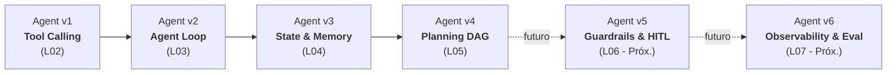

# Agent Engineering Playground (AEP) — Guía Pedagógica para Aprendices

¡Bienvenido al **Agent Engineering Playground (AEP)** de CASE Academy!

Este entorno de aprendizaje práctico acompaña el módulo **M05 de CASE OS** (*Agent Architecture & Engineering*). Aquí experimentarás de primera mano cómo un agente de inteligencia artificial evoluciona desde una simple llamada a herramienta hasta un sistema complejo de planificación y descomposición de tareas con grafos dirigidos.

---

## 1. Principio Fundamental: Un Mismo Agente en Evolución

> [!IMPORTANT]
> **AEP NO representa cuatro agentes independientes ni cuatro bots desconectados.**  
> Representa **un único agente que evoluciona incrementalmente** lección a lección. Cada versión incorpora una nueva capacidad arquitectónica de nivel industrial, conservando las fortalezas de las versiones anteriores:

### Tabla Comparativa de Capacidades Acumuladas

| Versión | Capacidad Clave Introducida | Estado en AEP | Qué conserva de la anterior | Qué NO tiene todavía |
|---|---|---|---|---|
| **Agent v1** | **Tool Calling** (invocación de herramientas con contratos Pydantic) | **Operativo (L02)** | Punto de partida: proponer ≠ ejecutar. | No tiene bucle iterativo (máximo 1 herramienta por run). |
| **Agent v2** | **Agent Loop** (bucle iterativo con presupuesto y condiciones de parada) | **Operativo (L03)** | Herramientas de v1, contratos Pydantic y validación. | No tiene memoria persistente entre conversaciones. |
| **Agent v3** | **State & Memory** (persistencia en MySQL, decisiones explícitas y aislamiento) | **Operativo (L04)** | Bucle y límites de v2, catálogo de herramientas de v1. | No planifica de forma estructurada (el bucle es reactivo). |
| **Agent v4** | **Planning & Task Decomposition** (grafos DAG, PlanValidator y replanning) | **Operativo (L05)** | Herramientas reales, memoria de turnos y validación de argumentos. | No tiene aprobación humana (HITL) previa ni guardrails éticos. |
| **Agent v5** | **Guardrails & Human-in-the-Loop (HITL)** | *Próximamente* | Toda la arquitectura de v1 a v4. | En desarrollo curricular (CASE OS L06). |
| **Agent v6** | **Observability & Evaluation** | *Próximamente* | Toda la arquitectura de v1 a v5. | En desarrollo curricular (CASE OS L07). |

---

## 2. Mapa de Documentación y Guías de Estudio

Explora las guías en el orden pedagógico recomendado:

1. 📘 [**Agent v1 — Tool Calling**](agent-v1-tool-calling.md): Descubre la separación fundamental entre el modelo LLM que propone y el runtime de CPU que valida y ejecuta.
2. 🔄 [**Agent v2 — Agent Loop**](agent-v2-agent-loop.md): Domina el ciclo de razonamiento iterativo, el presupuesto de ejecución y los mecanismos de parada.
3. 🧠 [**Agent v3 — State & Memory**](agent-v3-state-memory.md): Comprende la tríada pedagógica (RAM, memoria conversacional y memoria de decisiones) con persistencia en MySQL.
4. 🗺️ [**Agent v4 — Planning & Task Decomposition**](agent-v4-planning.md): Aprende a construir, validar y ejecutar planes estructurados mediante grafos acíclicos dirigidos (DAG).
5. 🧰 [**Catálogo de Herramientas**](catalogo-herramientas.md): Especificación exhaustiva de todas las herramientas de tickets reales y DevOps de laboratorio.
6. 🔬 [**Guía del Runtime Inspector**](guia-runtime-inspector.md): Manual visual para interpretar el avatar 3D, el stepper, la traza de decisiones, el visor DAG y el inspector de memoria.
7. 🛠️ [**Guía de Troubleshooting**](troubleshooting.md): Diagnóstico y resolución de incidencias comunes de conectividad, base de datos y ejecución agéntica.

---

## 3. Requisitos para Comenzar

Para trabajar en el laboratorio, asegúrate de tener la aplicación abierta en tu navegador:

- **URL de la Interfaz:** `http://localhost:4200`
- **Indicador de Conexión en Cabecera:** Verifica que el semáforo muestre:  
  `FastAPI :8000 • Modelo: Conectado • MySQL: Conectado`
- **Selector de Agente (`#agent-select`):** Escoge la versión correspondiente al taller que estás cursando (`Agent v1`, `Agent v2`, `Agent v3` o `Agent v4`).
- **Selector de Persona (`#persona-select`):** Selecciona tu identidad de simulación (por defecto **Carlos Mario Restrepo** - `usr_carlos`).

> [!TIP]
> **Panel de Tickets MySQL:** En la esquina superior derecha encontrarás el botón **Tickets MySQL**. Ábrelo en cualquier momento para contrastar los datos que el agente te proporciona contra los registros reales almacenados en la base de datos relacional.

---

## 4. Reglas de Oro para los Ejercicios Prácticos

1. **Prioriza consultas de lectura:** Todos los laboratorios guiados están diseñados con herramientas de solo lectura (`get_ticket_by_id`, `list_tickets`, `identify_overdue_tickets`).
2. **Atención con la herramienta `create_ticket`:** Esta herramienta inserta filas reales en la base de datos MySQL. **No la ejecutes como una prueba inocua**; utilízala únicamente cuando tu instructor lo indique explícitamente.
3. **No asumas razonamiento invisible:** Si la pantalla no muestra un evento o traza observable, no asumas que el modelo "pensó" algo en secreto. Basa todas tus deducciones en los eventos emitidos en el **Runtime Inspector**.
4. **Contrasta siempre con la realidad:** Los tickets de prueba iniciales son `TICK-1001` a `TICK-1005`. Verifica sus estados y fechas de SLA directamente en el cajón de base de datos.
5. **Aprende del error:** Un paso que falla (por ejemplo un ticket inexistente `TICK-9999`) no es una falla del sistema: es una oportunidad pedagógica para observar cómo el runtime maneja excepciones y previene alucinaciones.

¡Mucho éxito en tu aprendizaje en CASE Academy!
