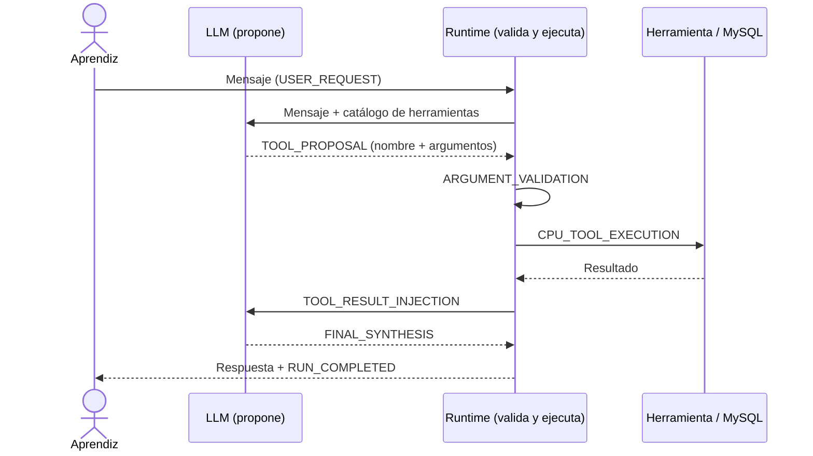

# Agent v1 — Tool Calling

> [Índice](README.md) · Siguiente: [Agent v2 — Agent Loop](agent-v2-agent-loop.md) · [Catálogo de herramientas](catalogo-herramientas.md) · [Guía del Runtime Inspector](guia-runtime-inspector.md) · [Troubleshooting](troubleshooting.md)

**Estado:** implementado y operativo en AEP. Es el punto de partida: el primer agente que puede usar herramientas.

## A. ¿Qué aprenderás?

**Objetivo.** Entender cómo un modelo de lenguaje puede *pedir* una acción (consultar un ticket) y cómo un programa que lo rodea (el **runtime**) la valida y la ejecuta de forma segura.

**Conceptos fundamentales**

| Concepto | En palabras sencillas |
|---|---|
| **LLM** | Lee tu mensaje y decide: responder directamente o *proponer* una llamada a herramienta. **No ejecuta nada.** |
| **Runtime** | El código de AEP. Valida la propuesta y ejecuta la herramienta. |
| **Catálogo de herramientas** | La lista de herramientas que el modelo conoce (ver [catálogo](catalogo-herramientas.md)). |
| **Argumentos estructurados** | Datos con forma fija (por ejemplo `ticket_code`) que valida el contrato de la herramienta (Pydantic). |
| **Observación / resultado** | Lo que devuelve la herramienta y que se entrega al modelo para redactar la respuesta. |

**Problema que resuelve.** Un modelo solo no conoce el estado real de tus tickets. Con *tool calling* puede apoyarse en datos reales de MySQL.

**Diferencia respecto a la versión anterior.** v1 es la primera versión: no hay versión anterior. Lo nuevo es la separación **proponer ≠ ejecutar**.



> [!NOTE]
> Si el modelo decide que no necesita herramientas, el flujo es más corto: `DIRECT_ANSWER` → `FINAL_SYNTHESIS`.

## B. Antes de comenzar

1. Abre AEP en `http://localhost:4200`.
2. Comprueba en la cabecera el indicador **FastAPI :8000 • Modelo: Conectado • MySQL: Conectado**. Si alguno dice "Sin conexión", ve a [troubleshooting](troubleshooting.md) o avisa al instructor.
3. En **Versión Agéntica** elige **Agent v1** (suele ser la opción por defecto).
4. En **Persona (Simulación)** elige **Carlos Mario Restrepo** (`usr_carlos`).
5. (Opcional) Abre **Tickets MySQL** para ver los tickets reales con los que compararás.

No necesitas instalar ni configurar nada más. Los tickets de ejemplo habituales son `TICK-1001` a `TICK-1005`, pero **los datos pueden variar** en tu entorno: contrasta siempre con el panel *Tickets MySQL*.

## C. ¿Qué puedo pedirle a este agente?

| Intención | Qué escribir | Herramienta / capacidad | Qué debería ocurrir |
|---|---|---|---|
| Consultar un ticket | `Consulta el ticket TICK-1001 y dime su estado` | `get_ticket_by_id` | Propuesta de herramienta con `ticket_code`, ejecución y respuesta con el estado real. |
| Detectar SLA vencidos | `Identifica los tickets vencidos según SLA` | `identify_overdue_tickets` | Lista de tickets vencidos (puede variar con la hora). |
| Filtrar tickets | `Lista los tickets con prioridad CRITICAL` | `list_tickets` (`priority`) | Lista filtrada; los argumentos dependen de cómo interprete el modelo. |
| Pregunta general | `¿Cuál es el procedimiento general para atender un incidente?` | Ninguna (respuesta directa) | `DIRECT_ANSWER`, sin ejecución de herramienta. |
| Ticket inexistente | `Consulta el ticket TICK-9999` | `get_ticket_by_id` | La herramienta devuelve `entidad_no_encontrada`; la respuesta debe reconocer que no existe. |

> [!WARNING]
> Existe `create_ticket`, que **escribe en MySQL**. Esta guía no la usa en ningún ejercicio. No pidas "crea un ticket" sin autorización del instructor.

No pidas escenarios DevOps (despliegues, incidentes): esas herramientas **no existen** en v1.

## D. Laboratorios guiados

### Laboratorio 1 — Primer contacto

- **Objetivo:** ver una respuesta que *no* usa herramientas.
- **Contexto:** el modelo puede contestar con conocimiento general.
- **Preparación:** servicios conectados, Agent v1, persona `usr_carlos`.
- **Prompt exacto:**

```prompt
¿Cuál es el procedimiento general para atender un incidente?
```

- **Pasos en la UI:** escribe el prompt en el chat, envía y observa el **Recorrido de ejecución**.
- **Comportamiento esperado:** respuesta en texto. El contenido exacto depende del modelo.
- **Evidencias observables:** `USER_REQUEST`, `MODEL_INFERENCE_1`, `DIRECT_ANSWER`, `FINAL_SYNTHESIS`, `RUN_COMPLETED`. No aparece `TOOL_PROPOSAL`.
- **Reflexión:** ¿qué diferencia hay entre esta respuesta y una basada en datos reales?
- **Criterio de éxito:** identificas que no hubo herramienta porque no hubo `TOOL_PROPOSAL` ni `CPU_TOOL_EXECUTION`.

### Laboratorio 2 — Capacidad principal: consultar un ticket

- **Objetivo:** observar el ciclo completo proponer → validar → ejecutar → sintetizar.
- **Contexto:** `get_ticket_by_id` consulta MySQL (lectura).
- **Preparación:** el ticket `TICK-1001` debe existir (compruébalo en *Tickets MySQL*).
- **Prompt exacto:**

```prompt
Consulta el ticket TICK-1001 y dime su estado
```

- **Pasos en la UI:** envía el prompt; haz clic en cada hop del recorrido; abre la pestaña **Herramientas** del detalle.
- **Comportamiento esperado:** el modelo propone `get_ticket_by_id` con `ticket_code = TICK-1001`; la respuesta refleja lo que muestra *Tickets MySQL*.
- **Evidencias:** `TOOL_PROPOSAL`, `ARGUMENT_VALIDATION` (válido), `CPU_TOOL_EXECUTION`, `TOOL_RESULT_INJECTION`, `FINAL_SYNTHESIS`, `RUN_COMPLETED` con `total_hops` y `tools_executed`.
- **Reflexión:** ¿quién decidió llamar a la herramienta y quién la ejecutó?
- **Criterio de éxito:** puedes señalar en el Inspector el evento de propuesta (modelo) y el de ejecución (runtime), y contrastar la respuesta con el panel de tickets.

### Laboratorio 3 — Combinar capacidades

- **Objetivo:** usar dos consultas relacionadas, una detrás de otra, en turnos distintos.
- **Contexto:** v1 ejecuta **una** herramienta por ejecución. Si necesitas dos datos, haces dos preguntas.
- **Preparación:** ninguna adicional.
- **Prompts exactos (en este orden):**

```prompt
Identifica los tickets vencidos según SLA
```

```prompt
Consulta el ticket TICK-1003 y dime su estado
```

- **Pasos en la UI:** envía el primer prompt; al terminar envía el segundo. Compara el recorrido de ambos.
- **Comportamiento esperado:** cada ejecución usa una herramienta distinta (`identify_overdue_tickets`, luego `get_ticket_by_id`). El resultado de la primera **no** se reutiliza automáticamente.
- **Evidencias:** en cada ejecución, `tools_executed` = 1. Si `TICK-1003` no figura como vencido en tu entorno, es porque el SLA depende de la fecha y los datos.
- **Reflexión:** ¿qué tendrías que hacer para resolver "dime los vencidos y el detalle del más antiguo" en una sola ejecución? (Pista: es lo que resuelve la v2.)
- **Criterio de éxito:** explicas por qué v1 necesitó dos ejecuciones.

### Laboratorio 4 — Resultado negativo o límite

- **Objetivo:** ver cómo se comporta el sistema ante un ticket inexistente.
- **Contexto:** un error de herramienta **no** es un fallo del sistema: es información que vuelve al modelo.
- **Preparación:** comprueba que `TICK-9999` **no** existe en *Tickets MySQL*.
- **Prompt exacto:**

```prompt
Consulta el ticket TICK-9999
```

- **Pasos en la UI:** envía; revisa la pestaña **Herramientas** (observación) y el JSON técnico.
- **Comportamiento esperado:** la herramienta devuelve un error de entidad no encontrada y la respuesta final debe indicarlo. La redacción depende del modelo; verifica que **no inventa** datos del ticket.
- **Evidencias:** `CPU_TOOL_EXECUTION` con resultado de error (`entidad_no_encontrada`).
- **Reflexión:** ¿cómo distingues un error de herramienta de una respuesta inventada?
- **Criterio de éxito:** encuentras el código de error en la observación y confirmas que la respuesta no afirma datos inexistentes.

### Laboratorio 5 — Análisis del Runtime Inspector

- **Objetivo:** leer una ejecución completa como un analista.
- **Contexto:** reutiliza la ejecución del laboratorio 2 (o repítela).
- **Preparación:** haber ejecutado `Consulta el ticket TICK-1001 y dime su estado`.
- **Prompt exacto:** el mismo del laboratorio 2.
- **Pasos en la UI:** (1) pulsa **Reproducir ejecución**; (2) avanza con *Paso siguiente*; (3) activa **Mostrar traza**; (4) revisa **Eventos Raw**.
- **Comportamiento esperado:** el replay recorre los mismos eventos sin volver a llamar al modelo ni a MySQL.
- **Evidencias:** orden `USER_REQUEST → MODEL_INFERENCE_1 → TOOL_PROPOSAL → ARGUMENT_VALIDATION → CPU_TOOL_EXECUTION → TOOL_RESULT_INJECTION → FINAL_SYNTHESIS → RUN_COMPLETED`.
- **Reflexión:** ¿qué eventos son del modelo y cuáles del runtime?
- **Criterio de éxito:** clasificas cada evento en *entrada*, *propuesta del modelo*, *validación*, *ejecución*, *observación* y *terminación*.

## E. ¿Qué NO hace esta versión?

> [!CAUTION]
> **Limitaciones reales de Agent v1**
>
> - **No tiene Agent Loop.** Ejecuta **una sola herramienta por ejecución** (si el modelo propusiera varias, solo se ejecuta la primera) y hace una segunda inferencia solo para redactar la respuesta. El bucle iterativo aparece en [v2](agent-v2-agent-loop.md).
> - **No recuerda conversaciones.** Cada mensaje se trata de forma independiente. La memoria persistente llega con [v3](agent-v3-state-memory.md).
> - **No planifica.** No descompone un objetivo en pasos con dependencias ([v4](agent-v4-planning.md)).
> - **No pide aprobación humana** ni tiene guardrails dedicados (futuro: v5).
> - **No tiene herramientas DevOps.** Solo las herramientas de tickets.

**Ejemplo:** `Compara el estado de TICK-1001 y TICK-1003` → v1 ejecutará como máximo una consulta; la comparación completa no es fiable.

## F. ¿Qué debo observar en el Runtime Inspector?

| Tipo | Evento v1 | Qué significa |
|---|---|---|
| Entrada del usuario | `USER_REQUEST` | Tu mensaje llegó al runtime. |
| Propuesta del modelo | `MODEL_INFERENCE_1`, `TOOL_PROPOSAL` / `DIRECT_ANSWER` | El modelo propone una herramienta o responde directo. |
| Validación del runtime | `ARGUMENT_VALIDATION` | Comprueba los argumentos contra el contrato. |
| Ejecución de herramienta | `CPU_TOOL_EXECUTION` | El runtime ejecuta (no el modelo). |
| Observación recibida | `TOOL_RESULT_INJECTION` | El resultado se entrega al modelo. |
| Terminación | `FINAL_SYNTHESIS`, `RUN_COMPLETED` | Respuesta final y resumen (`total_hops`, `tools_executed`). |

El Inspector muestra hasta **7 hops**. No existe aquí persistencia ni plan. No se muestra el razonamiento privado del modelo. Más detalle en la [guía del Inspector](guia-runtime-inspector.md).

> [!NOTE]
> Si `ARGUMENT_VALIDATION` indica argumentos inválidos, el runtime igualmente invoca la ejecución y esta devuelve un error (`parametros_invalidos`/`error_validacion`). Obsérvalo en la pestaña *Herramientas*.

## G. Errores frecuentes

| Síntoma | Qué significa | Qué revisar | ¿Instructor? |
|---|---|---|---|
| Cabecera con "Modelo: Sin conexión" | El servidor del modelo (:8080) no responde. | Esperar y reintentar; ver [troubleshooting](troubleshooting.md). | Si persiste más de 1–2 minutos. |
| `entidad_no_encontrada` | El ticket no existe. | Código correcto en *Tickets MySQL*. | No. |
| `parametros_invalidos` / `error_validacion` | El modelo generó argumentos con formato incorrecto. | Repite con un prompt más explícito (incluye el código completo, `TICK-1001`). | Si se repite siempre. |
| `herramienta_no_encontrada` | El modelo pidió una herramienta inexistente. | Mira el catálogo. | No, es un límite del modelo. |
| Respuesta sin herramienta cuando esperabas datos | El modelo respondió directo. | Reformula mencionando el ticket concreto. | No. |
| Respuesta lenta | El modelo local es pequeño. | Espera. | Si supera 1–2 min. |

## H. Reto autónomo

Sin pedir al agente nada de escritura, diseña **tres prompts** que provoquen respectivamente: (a) `list_tickets` con un filtro de estado, (b) `identify_overdue_tickets`, (c) una respuesta directa sin herramienta. Para cada uno predice los eventos que verás **antes** de ejecutarlo y compara después. Anota un caso en el que el modelo eligió una herramienta distinta a la esperada y explica por qué podría haber ocurrido.

**Qué aprendiste que no existía antes:** el patrón proponer → validar → ejecutar → observar. En v2 ese patrón se repetirá en un bucle.
