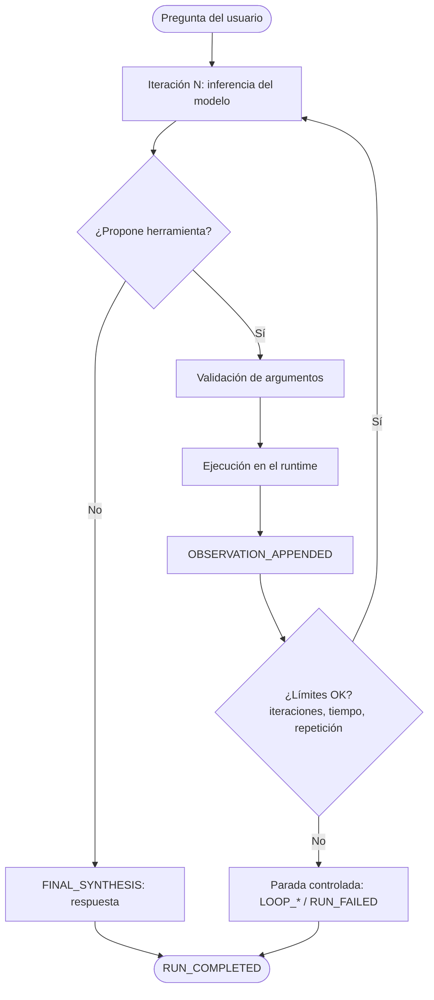

# Agent v2 — Agent Loop

> [Índice](README.md) · Anterior: [Agent v1](agent-v1-tool-calling.md) · Siguiente: [Agent v3](agent-v3-state-memory.md) · [Catálogo de herramientas](catalogo-herramientas.md) · [Guía del Runtime Inspector](guia-runtime-inspector.md) · [Troubleshooting](troubleshooting.md)

**Estado:** implementado y operativo. Es el **mismo agente** de v1, ahora capaz de repetir el ciclo *proponer → validar → ejecutar → observar* varias veces.

## A. ¿Qué aprenderás?

**Objetivo.** Entender cómo un agente combina varias observaciones antes de responder, y por qué un bucle necesita **límites** (presupuesto) y **condiciones de parada**.

| Concepto | En palabras sencillas |
|---|---|
| **Iteración** | Una vuelta del bucle: el modelo mira lo que hay y decide. |
| **Observación** | El resultado de una herramienta, que se añade al contexto para la siguiente decisión. |
| **Presupuesto de ejecución** | Límites del runtime: **máximo 5 iteraciones**, **60 s** de tiempo global, 30 s por inferencia y 15 s por herramienta (valores por defecto del código). |
| **Condición de parada** | El motivo por el que el bucle termina: `final_answer`, `max_iterations_reached`, `global_timeout`, `inference_timeout`, `tool_timeout`, `repetitive_tool_call`, `fatal_error`, `client_cancelled`. |
| **Detección de ciclos** | Si el modelo repite exactamente la misma llamada (mismo nombre y mismos argumentos) en iteraciones consecutivas, el runtime detiene el bucle con `repetitive_tool_call`. |

**Problema que resuelve.** En v1 una pregunta que necesita dos datos exigía dos ejecuciones. En v2 el agente puede resolver varias consultas en una sola.

**Diferencia con v1.** v1: una herramienta y una respuesta. v2: **una secuencia** de llamadas y observaciones, con control del runtime.



> [!NOTE]
> En una misma iteración el modelo puede proponer **más de una** herramienta. En nuestras pruebas, la consulta de comparación de dos tickets produjo dos llamadas en la iteración 1 y la síntesis en la iteración 2.

## B. Antes de comenzar

1. Abre `http://localhost:4200` y comprueba **FastAPI :8000 • Modelo: Conectado • MySQL: Conectado**.
2. En **Versión Agéntica** elige **Agent v2**.
3. En **Persona (Simulación)** elige **Carlos Mario Restrepo** (`usr_carlos`).
4. Abre **Tickets MySQL** para contrastar datos. Los datos pueden variar entre entornos.

No necesitas nada más. Esta versión usa las mismas herramientas de tickets que v1 (ver [catálogo](catalogo-herramientas.md)).

## C. ¿Qué puedo pedirle a este agente?

| Intención | Qué escribir | Herramienta / capacidad | Qué debería ocurrir |
|---|---|---|---|
| Comparar dos tickets | `Consulta TICK-1001 y TICK-1003 y compara su prioridad` | `get_ticket_by_id` (×2) | Dos llamadas (en la misma iteración o en iteraciones sucesivas) y una síntesis comparativa. |
| Listar y filtrar | `Lista los tickets OPEN y dime cuáles están vencidos` | `list_tickets` + `identify_overdue_tickets` | Varias observaciones y una respuesta que las cruza. |
| Consulta simple | `Consulta el ticket TICK-1001 y dime su estado` | `get_ticket_by_id` | Una llamada y una síntesis (2 iteraciones). |
| Ticket inexistente | `Consulta el ticket TICK-9999` | `get_ticket_by_id` | La observación trae un error; la respuesta debe reconocerlo. |

> [!WARNING]
> `create_ticket` **escribe en MySQL**. No se usa en esta guía. Si el instructor la usa, las herramientas mutativas tienen medidas de idempotencia, pero el ticket creado es real.

No pidas escenarios DevOps (incidentes, despliegues): **no existen** en v2.

## D. Laboratorios guiados

### Laboratorio 1 — Primer contacto

- **Objetivo:** ver una ejecución de v2 con una sola herramienta.
- **Contexto:** compara con el laboratorio 2 de v1.
- **Preparación:** `TICK-1001` existe (verifícalo en *Tickets MySQL*).
- **Prompt exacto:**

```prompt
Consulta el ticket TICK-1001 y dime su estado
```

- **Pasos en la UI:** envía; en el Inspector abre **Recorrido del bucle v2**; selecciona cada iteración.
- **Comportamiento esperado:** una iteración con la herramienta y otra con la síntesis.
- **Evidencias:** `RUN_STARTED`, `ITERATION_STARTED`, `TOOL_CALL_PROPOSED`, `ARGUMENTS_VALIDATED`, `TOOL_EXECUTION_COMPLETED`, `OBSERVATION_APPENDED`, `FINAL_SYNTHESIS`, `RUN_COMPLETED` (`stop_reason: final_answer`).
- **Reflexión:** ¿qué hizo el modelo en la segunda iteración?
- **Criterio de éxito:** identificas que la segunda iteración consume la observación y produce la respuesta.

### Laboratorio 2 — Capacidad principal: varias llamadas

- **Objetivo:** observar una secuencia de llamadas.
- **Contexto:** dos tickets, una pregunta.
- **Preparación:** `TICK-1001` y `TICK-1003` existen.
- **Prompt exacto:**

```prompt
Consulta TICK-1001 y TICK-1003 y compara su prioridad
```

- **Pasos en la UI:** envía; revisa la pestaña **Herramientas** del detalle; observa cuántas llamadas hubo y en qué iteración.
- **Comportamiento esperado:** dos llamadas a `get_ticket_by_id` y una comparación final. El reparto en iteraciones depende del modelo.
- **Evidencias:** dos eventos `TOOL_CALL_PROPOSED` y `OBSERVATION_APPENDED`; `stop_reason: final_answer`.
- **Reflexión:** ¿qué habría pasado en v1 con esta pregunta?
- **Criterio de éxito:** cuentas las llamadas y verificas que la comparación coincide con *Tickets MySQL*.

### Laboratorio 3 — Combinación de capacidades

- **Objetivo:** que el agente combine una lista y un análisis de SLA.
- **Contexto:** `list_tickets` + `identify_overdue_tickets`.
- **Preparación:** al menos un ticket `OPEN`.
- **Prompt exacto:**

```prompt
Lista los tickets OPEN y dime cuáles están vencidos
```

- **Pasos en la UI:** envía; en la pestaña **Herramientas** compara las dos observaciones.
- **Comportamiento esperado:** dos herramientas distintas y una respuesta que cruza ambas. La lista exacta depende de los datos y de la hora (SLA).
- **Evidencias:** dos `OBSERVATION_APPENDED` con herramientas diferentes.
- **Reflexión:** ¿cómo supo el agente que necesitaba una segunda herramienta?
- **Criterio de éxito:** explicas cuál observación aportó "OPEN" y cuál "vencido".

### Laboratorio 4 — Resultado negativo

- **Objetivo:** ver cómo el bucle trata un error de herramienta.
- **Contexto:** el error vuelve como observación, no rompe el bucle.
- **Preparación:** `TICK-9999` no existe.
- **Prompt exacto:**

```prompt
Consulta el ticket TICK-9999
```

- **Pasos en la UI:** envía; revisa la observación en **Herramientas** y el `stop_reason` en el evento final.
- **Comportamiento esperado:** la herramienta devuelve un error de entidad no encontrada; la respuesta informa que no existe. Ejecución terminada con `final_answer` (el error se manejó).
- **Evidencias:** `TOOL_EXECUTION_COMPLETED` con error; `RUN_COMPLETED` `completed`.
- **Reflexión:** ¿por qué un error de herramienta no es lo mismo que `RUN_FAILED`?
- **Criterio de éxito:** distingues "herramienta falló" de "ejecución falló".

> [!NOTE]
> Los **límites del bucle** (`max_iterations_reached`, `global_timeout`, `repetitive_tool_call`) están cubiertos por pruebas automáticas del proyecto, pero **no hay un prompt fiable para provocarlos desde la UI**, porque dependen de cómo se equivoque el modelo. Si los ves, anota el `stop_reason`; no es un fallo tuyo.

### Laboratorio 5 — Análisis del Runtime Inspector

- **Objetivo:** reconstruir el bucle a partir de los eventos.
- **Contexto:** usa la ejecución del laboratorio 2.
- **Preparación:** haberla ejecutado.
- **Prompt exacto:** el del laboratorio 2.
- **Pasos en la UI:** (1) **Reproducir ejecución**; (2) avanza por fases; (3) cambia entre **Macro** y **Micro** en la traza; (4) mira el chip de decisión del ciclo ("El bucle continúa" / "Terminación normal").
- **Comportamiento esperado:** el replay no vuelve a llamar al modelo.
- **Evidencias:** fases: Inferencia → Propuesta → Validación → Ejecución → Inyección de observación → Decisión del ciclo → Síntesis.
- **Reflexión:** ¿en qué iteración decidió el runtime que el bucle terminaba y por qué?
- **Criterio de éxito:** dibujas la secuencia de iteraciones con sus eventos.

## E. ¿Qué NO hace esta versión?

> [!CAUTION]
> **Limitaciones reales de Agent v2**
>
> - **No tiene memoria persistente.** No recuerda conversaciones anteriores ni preferencias; eso llega con [v3](agent-v3-state-memory.md).
> - **No planifica por adelantado.** Decide paso a paso (reactivo); no construye un plan con dependencias ([v4](agent-v4-planning.md)).
> - **No tiene aprobación humana (HITL)** ni guardrails dedicados (futuro: v5).
> - **No es ilimitado:** corta por iteraciones, tiempo o repetición.
> - **No tiene herramientas DevOps.**

**Ejemplo:** pregunta `Consulta el ticket TICK-1001` y luego `¿y su prioridad?`. Como no hay memoria, el segundo mensaje no tiene contexto del primero.

## F. ¿Qué debo observar en el Runtime Inspector?

| Tipo | Eventos | Significado |
|---|---|---|
| Entrada | `RUN_STARTED` | Comienza la ejecución. |
| Propuesta del modelo | `MODEL_INFERENCE_STARTED/COMPLETED`, `TOOL_CALL_PROPOSED` | El modelo propone. |
| Validación | `ARGUMENTS_VALIDATED` | El runtime comprueba argumentos. |
| Ejecución | `TOOL_EXECUTION_STARTED/COMPLETED` | El runtime ejecuta. |
| Observación | `OBSERVATION_APPENDED` | El resultado entra al contexto. |
| Estado del ciclo | `ITERATION_STARTED/COMPLETED` | Fronteras de cada vuelta. |
| Terminación | `FINAL_SYNTHESIS`, `RUN_COMPLETED`, y si aplica `LOOP_LIMIT_EXCEEDED`, `LOOP_REPETITION_DETECTED`, `LOOP_TIMEOUT_EXCEEDED`, `RUN_FAILED`, `RUN_CANCELLED` | Cómo y por qué terminó (`stop_reason`). |

La traza tiene vistas **Macro** (por iteración) y **Micro** (por fase). No hay eventos de memoria ni de plan. No se expone el razonamiento privado del modelo.

## G. Errores frecuentes

| Síntoma | Qué significa | Qué revisar | ¿Instructor? |
|---|---|---|---|
| `max_iterations_reached` | Se agotaron las iteraciones permitidas. | Reformula con una pregunta más acotada. | Si ocurre en consultas simples. |
| `repetitive_tool_call` | El modelo repitió la misma llamada y el runtime cortó el ciclo. | Es un mecanismo de protección, no un fallo tuyo. | Si ocurre siempre. |
| `global_timeout` / `inference_timeout` / `tool_timeout` | Se superó un tiempo límite. | Estado del modelo y de MySQL en la cabecera. | Si se repite. |
| `argumentos_invalidos` en una observación | El modelo generó argumentos incorrectos; el bucle puede reintentar. | Pestaña Herramientas. | No, salvo repetición. |
| `no_autorizado` | La persona activa no puede ejecutar esa acción. | Persona seleccionada. | Sí, si es inesperado. |
| `entidad_no_encontrada` | Ticket inexistente. | *Tickets MySQL*. | No. |

## H. Reto autónomo

Formula una pregunta que requiera **tres** datos distintos de tickets (por ejemplo, tres códigos o una lista más un análisis). Antes de ejecutar, predice: ¿cuántas iteraciones? ¿cuántas herramientas? Ejecuta y compara. Luego responde: ¿qué límite del bucle te preocuparía más si la pregunta necesitara veinte datos?

**Qué aprendiste que no existía en v1:** el bucle con observaciones, el presupuesto de ejecución y las condiciones de parada.
