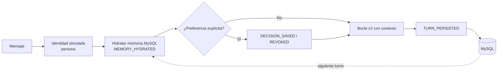

# Agent v3 — State & Memory

> [Índice](README.md) · Anterior: [Agent v2](agent-v2-agent-loop.md) · Siguiente: [Agent v4](agent-v4-planning.md) · [Catálogo de herramientas](catalogo-herramientas.md) · [Guía del Runtime Inspector](guia-runtime-inspector.md) · [Troubleshooting](troubleshooting.md)

**Estado:** implementado y operativo. Conserva el bucle de v2 (mismas herramientas, mismos límites) y añade **estado y memoria persistida en MySQL**.

## A. ¿Qué aprenderás?

**Objetivo.** Distinguir entre el estado temporal de una ejecución, la memoria conversacional y las **decisiones explícitas** que el agente conserva entre turnos y entre conversaciones.

| Concepto | En palabras sencillas |
|---|---|
| **Estado temporal** | Lo que el agente "tiene en la cabeza" durante una ejecución (en RAM); se pierde al terminar. |
| **Memoria conversacional** | Los últimos turnos de una conversación guardados en MySQL (hasta 20 recientes se recuperan). |
| **Decisión explícita** | Una preferencia que **tú declaras** ("recuerda que mi canal preferido: email"), con clave y valor. Se guarda, se versiona y se puede revocar. |
| **Recuperación contextual** | Al inicio de cada turno el runtime recupera turnos y decisiones (evento `MEMORY_HYDRATED`) y los incluye en el contexto. |
| **Presupuesto de contexto** | El modelo tiene una ventana limitada; el runtime recorta el historial para que quepa. |
| **Aislamiento por usuario** | Las decisiones y conversaciones pertenecen a una persona. Otra persona no las ve y no puede usar tu `conversation_id`. |

> [!IMPORTANT]
> **Memoria del agente ≠ memoria del modelo.** El modelo (Qwen) no recuerda nada entre llamadas: cada inferencia empieza de cero. Lo que parece "memoria" es el **runtime** leyendo MySQL y colocando ese contenido en el mensaje que le envía al modelo. Si borras la decisión de MySQL, el modelo "olvida" porque ya no se le entrega.

**Problema que resuelve.** En v2 cada mensaje era independiente. En v3 el agente puede mantener continuidad y respetar preferencias.

**Diferencia con v2.** Se añaden hidratación, persistencia de turnos, decisiones explícitas, identidad de usuario y presupuesto de contexto.

> [!NOTE]
> **Regla de frescura:** el agente está diseñado para **volver a consultar** los datos operativos (por ejemplo, el estado de un ticket) con herramientas, y usar el historial solo para entender referencias ("ese ticket"). Los resultados anteriores de herramientas no se inyectan como verdad.



## B. Antes de comenzar

1. Abre `http://localhost:4200` y verifica **FastAPI • Modelo • MySQL: Conectado**. **MySQL es imprescindible** en esta versión.
2. Selecciona **Agent v3**.
3. Elige la persona **Carlos Mario Restrepo** (`usr_carlos`). Para el ejercicio de aislamiento también usarás **Laura** (`usr_laura`).
4. Localiza el panel **Estado y Memoria (MySQL)** (tercera columna en escritorio; pestaña **Memoria** en móvil; botón *Estado y memoria* en tableta).
5. **No cambies de persona ni de versión entre los turnos de un mismo ejercicio**: eso reinicia el Inspector (el chat se conserva por persona, pero conviene mantener el flujo).

> [!WARNING]
> Los laboratorios de esta versión **escriben datos de laboratorio en MySQL** (turnos de conversación y decisiones). Son datos de práctica, no tickets. Al terminar, **revoca** tus preferencias con el último prompt de cada ejercicio. Los turnos guardados permanecen; avisa al instructor si necesitas limpiarlos.

## C. ¿Qué puedo pedirle a este agente?

| Intención | Qué escribir | Herramienta / capacidad | Qué debería ocurrir |
|---|---|---|---|
| Guardar una preferencia | `Recuerda que mi canal preferido: email` | Decisión explícita (`preferred_channel`) | `DECISION_SAVED`; el panel de memoria muestra 1 decisión activa. |
| Verificar la memoria | `¿Cuál es mi canal preferido?` | Memoria (`MEMORY_HYDRATED`) | El agente responde con el valor guardado, sin herramientas. |
| Revocar | `Olvida mi canal preferido: email` | Revocación | `DECISION_REVOKED`; ya no hay decisiones activas. |
| Consultar un ticket | `¿Cuál es el estado de TICK-1001?` | `get_ticket_by_id` | Vuelve a consultar MySQL (no usa memoria para el estado). |
| Varias consultas | `Consulta TICK-1001 y TICK-1003 y compara su prioridad` | Bucle v2 | Igual que v2, más eventos de memoria. |

Las preferencias se detectan por frases explícitas (por ejemplo "recuerda que", "prefiero", "siempre", "a partir de ahora") junto con una clave y un valor; la revocación, por palabras como "olvida", "revoca", "elimina". El agente **no** guarda sensibles (claves/contraseñas) ni convierte inferencias del modelo en preferencias.

## D. Laboratorios guiados

### Laboratorio 1 — Primer contacto

- **Objetivo:** ver el estado inicial de la memoria.
- **Contexto:** primera ejecución con v3.
- **Preparación:** servicios conectados, persona `usr_carlos`.
- **Prompt exacto:**

```prompt
Hola, ¿qué puedes hacer por mí?
```

- **Pasos en la UI:** envía; observa `MEMORY_HYDRATED` y el panel **Estado y Memoria**.
- **Comportamiento esperado:** el panel muestra el identificador de conversación (CONV) y el número de turnos/decisiones hidratados. La respuesta depende del modelo.
- **Evidencias:** `MEMORY_HYDRATED`, `RUN_STARTED`, `FINAL_SYNTHESIS`, `RUN_COMPLETED`, `TURN_PERSISTED`.
- **Reflexión:** ¿qué se persistió al terminar y qué se perdió?
- **Criterio de éxito:** localizas el `conversation_id` y el evento `TURN_PERSISTED`.

### Laboratorio 2 — Capacidad principal: persistencia en dos turnos

- **Objetivo:** demostrar persistencia real de una decisión explícita.
- **Contexto:** guardarás una preferencia y la recuperarás en el turno siguiente.
- **Preparación:** persona `usr_carlos`; no cambies de persona entre turnos. Si ya existe una decisión `preferred_channel`, el panel la mostrará; se actualizará de versión.
- **Turno 1 — prompt exacto:**

```prompt
Recuerda que mi canal preferido: email
```

- **Turno 2 — prompt exacto (en el mismo chat):**

```prompt
¿Cuál es mi canal preferido?
```

- **Pasos en la UI:** envía el turno 1; verifica `DECISION_SAVED` y el panel; envía el turno 2; observa `MEMORY_HYDRATED`.
- **Comportamiento esperado:** en el turno 1 aparece una decisión `preferred_channel = EMAIL`. En el turno 2, `MEMORY_HYDRATED` indica 1 decisión activa (y 1 turno anterior) y la respuesta menciona EMAIL **sin llamar a herramientas**. El texto exacto depende del modelo.
- **Evidencias:** `DECISION_SAVED` (key, value, version) → `MEMORY_HYDRATED` con `active_decisions` → `TURN_PERSISTED`.
- **Reflexión:** ¿de dónde sacó el modelo la palabra "email" si no la recuerda?
- **Criterio de éxito:** señalas en `MEMORY_HYDRATED` la decisión que fue entregada al modelo. Termina con el laboratorio 5 para revocarla.

### Laboratorio 3 — Combinar memoria y herramientas

- **Objetivo:** ver que la memoria no sustituye a la consulta real de datos.
- **Contexto:** pregunta por un ticket tras haber guardado una preferencia.
- **Preparación:** `TICK-1001` existe; completa el laboratorio 2.
- **Prompt exacto:**

```prompt
¿Cuál es el estado de TICK-1001?
```

- **Pasos en la UI:** envía en la misma conversación; revisa la pestaña **Herramientas**.
- **Comportamiento esperado:** `get_ticket_by_id` se ejecuta (observación fresca) mientras la memoria se hidrata en paralelo. El estado mostrado coincide con *Tickets MySQL*.
- **Evidencias:** `MEMORY_HYDRATED` + `TOOL_CALL_PROPOSED` + `OBSERVATION_APPENDED` + `TURN_PERSISTED`.
- **Reflexión:** ¿por qué el estado de un ticket **no** debe guardarse como memoria?
- **Criterio de éxito:** muestras que el dato operativo viene de la herramienta y no del historial.

### Laboratorio 4 — Límites: aislamiento entre usuarios

- **Objetivo:** comprobar que otra persona no accede a tu memoria.
- **Contexto:** la decisión del laboratorio 2 pertenece a `usr_carlos`.
- **Preparación:** laboratorio 2 hecho y decisión activa. Cambia la persona a **Laura** (`usr_laura`).
- **Prompt exacto:**

```prompt
¿Cuál es mi canal preferido?
```

- **Pasos en la UI:** selecciona Laura, envía y observa el panel de memoria.
- **Comportamiento esperado:** `MEMORY_HYDRATED` muestra **0 decisiones activas** y el agente indica que no tiene esa información.
- **Evidencias:** `decisions_count: 0` en Laura frente a `1` en Carlos.
- **Reflexión:** ¿qué lo impide: el modelo o el runtime?
- **Criterio de éxito:** explicas que el aislamiento lo aplica el runtime al consultar MySQL por usuario.

> [!NOTE]
> La identidad es una **simulación de laboratorio** (no autenticación criptográfica). Si se intenta usar el `conversation_id` de otro usuario, el runtime emite un evento `ERROR` de acción no autorizada; esto se verificó con la API, pero la interfaz normal no permite pegar un identificador ajeno.

### Laboratorio 5 — Análisis del Runtime Inspector (y revocación)

- **Objetivo:** leer el panel de memoria y limpiar los datos del ejercicio.
- **Contexto:** después del laboratorio 2, con Carlos.
- **Preparación:** decisión `preferred_channel` activa.
- **Prompt exacto:**

```prompt
Olvida mi canal preferido: email
```

- **Pasos en la UI:** envía; revisa `DECISION_REVOKED`; después pregunta de nuevo `¿Cuál es mi canal preferido?`.
- **Comportamiento esperado:** `DECISION_REVOKED` y, en el turno siguiente, `MEMORY_HYDRATED` con 0 decisiones. El agente ya no puede indicar el canal.
- **Evidencias:** `DECISION_REVOKED` (`status: revoked`), `decisions_count: 0`. Mira también "Presupuesto de Contexto" y la línea de tiempo "Memoria Conversacional".
- **Reflexión:** ¿qué queda en MySQL después de revocar? (Los turnos siguen guardados; la decisión queda revocada.)
- **Criterio de éxito:** explicas la diferencia entre turno persistido y decisión activa.

## E. ¿Qué NO hace esta versión?

> [!CAUTION]
> **Limitaciones reales de Agent v3**
>
> - **No construye planes con dependencias (DAG).** El bucle sigue siendo reactivo ([v4](agent-v4-planning.md)).
> - **No tiene HITL de aprobación.** Existe código de reanudación (`decision_id`/`selected_value`) y paneles *Intervención Humana (HITL)* y *Tareas Pendientes*, pero **el agente actual nunca propone tareas pendientes**: los paneles aparecen normalmente vacíos. La aprobación humana real es futuro (v5).
> - **No es autenticación real:** la persona es simulada.
> - **No guarda lo que el modelo "cree"** ni secretos: solo preferencias explícitas y seguras.
> - **No recuerda resultados de herramientas** como datos válidos: los vuelve a consultar.
> - **El contexto es limitado:** el historial se recorta según el presupuesto.

**Ejemplo:** `Recuerda que TICK-1001 está resuelto` no hará que el agente confíe en eso: el estado se consulta con herramientas.

## F. ¿Qué debo observar en el Runtime Inspector?

| Tipo | Eventos | Significado |
|---|---|---|
| Recuperación | `MEMORY_HYDRATED` | Qué recuperó el runtime: `turns_count`, `decisions_count`, `active_decisions`. |
| Decisión | `DECISION_SAVED` / `DECISION_REVOKED` | Se guardó o revocó una preferencia (clave, valor, versión). |
| Bucle | Eventos de v2 | Igual que en [v2](agent-v2-agent-loop.md). |
| Persistencia | `TURN_PERSISTED` | El turno se almacenó (`conversation_id`, `turn_id`, `status: stored_in_mysql`). |

Panel **Estado y Memoria (MySQL)**: la *Tríada Pedagógica* (1. Estado de ejecución en RAM, 2. Memoria conversacional, 3. Memoria de decisiones), el **Presupuesto de Contexto** y *Reconciliación Requerida* (cuando aplica). **No** muestra la memoria interna del modelo ni razonamiento privado.

## G. Errores frecuentes

| Síntoma | Qué significa | Qué revisar | ¿Instructor? |
|---|---|---|---|
| "MySQL: Sin conexión" | No hay persistencia posible. | Cabecera; [troubleshooting](troubleshooting.md). | Sí. |
| El agente no recuerda | No se guardó decisión (frase no explícita) o cambiaste de persona. | Busca `DECISION_SAVED`; repite con la frase `Recuerda que mi canal preferido: email`. | No. |
| Evento `ERROR` de conversación | Intentaste usar una conversación de otro usuario. | Persona activa. | Si ocurre sin razón. |
| Memoria vacía en nueva conversación | Una conversación nueva no tiene turnos, pero **las decisiones persistentes sí se recuperan**. | `turns_count` vs `decisions_count`. | No. |
| Paneles HITL / Tareas vacíos | Comportamiento esperado: no hay tareas pendientes. | — | No. |
| Respuesta que "olvida" en conversación larga | El historial se recortó por presupuesto de contexto. | Panel de presupuesto. | No. |

## H. Reto autónomo

Diseña una secuencia de **tres turnos** que demuestre (1) que una decisión sobrevive a una **conversación nueva** de la misma persona, (2) que otra persona no la ve y (3) que tras revocarla desaparece. Escribe antes qué valores de `turns_count` y `decisions_count` esperas en cada `MEMORY_HYDRATED` y compáralos con los reales. Después explica en tus palabras por qué decir "el modelo se acuerda" es una simplificación incorrecta.

**Qué aprendiste que no existía en v2:** estado vs. memoria, decisiones explícitas versionadas y revocables, y aislamiento por usuario.
