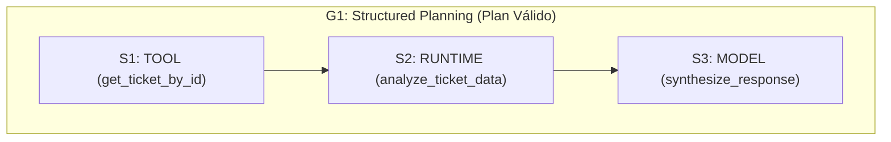
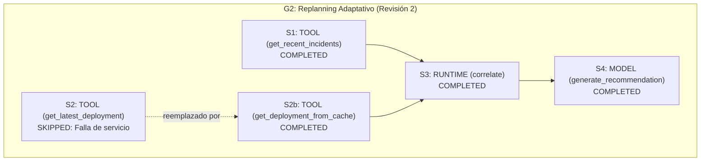

# Agent v4 — Planning & Task Decomposition

> [Índice](README.md) · Anterior: [Agent v3 — State & Memory](agent-v3-state-memory.md) · [Catálogo de herramientas](catalogo-herramientas.md) · [Guía del Runtime Inspector](guia-runtime-inspector.md) · [Troubleshooting](troubleshooting.md)

**Estado:** implementado y operativo en AEP. Es el **mismo agente** evolucionado, ahora capaz de construir y validar un **plan estructurado completo (DAG)** antes de ejecutar el primer paso.

---

## A. ¿Qué aprenderás?

### Objetivo
Comprender qué es la planificación formal en arquitecturas agénticas, cómo se descompone una meta global en pasos con dependencias explícitas, cómo se valida un plan antes de su ejecución y cómo el runtime maneja fallos mediante **Replanning adaptativo** o detención segura por **Runtime Stall**.

### Conceptos fundamentales

| Concepto | En palabras sencillas |
|---|---|
| **Meta global (`goal`)** | El objetivo inmutable que el agente debe satisfacer. La meta es un **invariante**: no se puede cambiar a mitad de camino. |
| **Paso del plan (`PlanStep`)** | Unidad mínima de trabajo estructurada: tiene identificador único (`id`), acción (`action`), descripción, ejecutor asignado, dependencias y estado (`pending`, `in_progress`, `completed`, `failed`, `skipped`). |
| **DAG (Grafo Acíclico Dirigido)** | La estructura del plan: los pasos son nodos y las dependencias (`depends_on`) son aristas dirigidas sin ciclos cerrados. Garantiza un orden topológico estricto de ejecución. |
| **Ejecutores soberanos** | Quién procesa cada paso: `TOOL` (herramienta externa de CPU/DB), `RUNTIME` (lógica de cómputo determinista sin modelo) o `MODEL` (síntesis y redacción estructurada). |
| **PlanValidator** | Compilador/guardián del plan: verifica estructura estática (sin ciclos, sin auto-dependencias, sin IDs duplicados) y semántica fáctica (herramientas y acciones registradas en el catálogo). Si falla, el plan es **rechazado** (`VALIDATION_ERROR`) antes de tocar cualquier recurso. |
| **G1: Structured Planning** | Hito curricular: generación de un grafo de pasos con dependencias y ejecución limpia secuencial. |
| **G2: Replanning** | Hito curricular: ante la falla de un paso con alternativa viable, el runtime archiva la Revisión 1 (snapshot inmutable), marca el paso original como `SKIPPED` con `skip_reason`, inserta el paso de respaldo y activa la Revisión 2 sin alterar la meta original. |
| **G3: Runtime Stall** | Hito curricular: ante la falla de un paso sin ruta de reemplazo, los pasos dependientes quedan bloqueados (`BLOCKED / DEP FAILED`). Al no existir pasos ejecutables, el runtime se detiene de forma segura con `stop_reason: no_executable_steps`. |

### ¿Qué problema resuelve?
En **Agent v2 y v3 (Agent Loop reactivo)**, el agente decidía *"qué hacer a continuación"* paso a paso después de cada observación. Si una tarea requería 4 pasos interdependientes, el bucle podía perder el rumbo, omitir verificaciones o quedar atrapado en ciclos. **Agent v4** introduce planificación anticipada: el modelo o planificador formula el grafo completo y el runtime lo ejecuta de forma determinista y auditable.

### Diferencia respecto a Agent v3
Agent v3 acumulaba observaciones en un bucle reactivo e hidrataba memoria MySQL. Agent v4 mantiene la persistencia de turnos de conversación de v3, pero **reemplaza el bucle reactivo por un orquestador de planes DAG** con validación formal, revisiones y trazabilidad topológica.





---

## B. Antes de comenzar

1. Abre AEP en tu navegador en `http://localhost:4200`.
2. Comprueba en la cabecera el indicador de tres vías: **FastAPI :8000 • Modelo: Conectado • MySQL: Conectado**.
3. En **Versión Agéntica** (`#agent-select`), selecciona **Agent v4 — Planning** (verás la etiqueta `[Operativo (L05)]`).
4. En **Persona (Simulación)** (`#persona-select`), selecciona **Carlos Mario Restrepo** (`usr_carlos`).
5. Abre el panel lateral **Tickets MySQL** para confirmar los tickets reales disponibles (`TICK-1001` a `TICK-1005`).

> [!NOTE]
> No necesitas instalar bibliotecas ni configurar bases de datos adicionales. Todo el entorno de ejecución corre en el stack local de AEP.

---

## C. ¿Qué puedo pedirle a este agente?

Las siguientes intenciones corresponden a rutas de planificación y herramientas **verificadas en el código** (`src/domain/planning/catalog.py`, `src/agents/v4_planning/executor.py` y `mock_planner.py`):

| Intención | Qué escribir | Herramientas / Ejecutores | Qué debería ocurrir |
|---|---|---|---|
| Diagnosticar ticket específico | `Diagnosticar ticket TICK-1001 y proponer plan` | S1: `TOOL (get_ticket_by_id)`<br/>S2: `RUNTIME (analyze_ticket_data)`<br/>S3: `MODEL (synthesize_response)` | Plan de 3 pasos. S1 consulta MySQL real; S2 analiza estado y SLA; S3 sintetiza el informe técnico y plan de contención. |
| Auditar tickets vencidos | `Revisar tickets vencidos por SLA y proponer plan` | S1: `TOOL (identify_overdue_tickets)`<br/>S2: `RUNTIME (verify_sla_compliance)`<br/>S3: `MODEL (synthesize_response)` | Plan de 3 pasos. Identifica tickets fuera de plazo en MySQL y estructura plan de reasignación. |
| Listar tickets activos | `Muéstrame los tickets activos` | S1: `TOOL (list_tickets)`<br/>S2: `RUNTIME (filter_active_tickets)`<br/>S3: `MODEL (synthesize_response)` | Plan de 3 pasos. Consulta lista de tickets, ejecuta paso de filtrado y sintetiza la lista. |
| Auditar despliegue e incidentes (DevOps) | `Auditar el último despliegue e incidentes recientes` | S1: `TOOL (get_recent_incidents)`<br/>S2: `TOOL (get_latest_deployment)`<br/>S3: `RUNTIME (correlate_incidents_with_deployment)`<br/>S4: `MODEL (generate_incident_recommendation)` | Plan de 4 pasos multi-dependencia. Usa herramientas DevOps de laboratorio (simuladas en `executor.py`) y genera recomendación de rollback. |
| Escenario de fallo / Límite (Runtime Stall) | `Diagnosticar ticket TICK-9999 y proponer plan` | S1: `TOOL (get_ticket_by_id)` (falla: entidad_no_encontrada)<br/>S2: `RUNTIME` (bloqueado)<br/>S3: `MODEL` (bloqueado) | S1 falla. Al no existir replanning alternativo para ticket inexistente, S2 y S3 quedan con dependencia insatisfecha. Ocurre un **Runtime Stall** seguro (`no_executable_steps`). |

> [!WARNING]
> Las herramientas DevOps (`get_recent_incidents`, `get_latest_deployment`, `get_deployment_from_cache`) utilizan **datos de laboratorio simulados**, no infraestructura real de servidores. Sirven para ejercitar la topología de dependencias múltiples (S3 depende de S1 y S2 simultáneamente).

---

## D. Laboratorios guiados

### Laboratorio 1 — Primer contacto: Diagnóstico de ticket con DAG
- **Objetivo:** Observar la formulación de un plan formal DAG, su validación previa y la ejecución ordenada por dependencias.
- **Contexto:** Se requiere diagnosticar el ticket de base de datos `TICK-1001`.
- **Preparación:** Verificar en **Tickets MySQL** que `TICK-1001` exista.
- **Prompt exacto:**
```prompt
Diagnosticar ticket TICK-1001 y proponer plan
```
- **Pasos en la UI:**
  1. Escribe el prompt en el chat y presiona Enviar.
  2. En el panel derecho (Inspector de ejecución), observa el título **Planificación DAG v4**.
  3. Observa la sección **Meta del Agente (Invariante)**: *"Diagnosticar ticket TICK-1001 y proponer plan de acción"*.
  4. Observa los tres nodos: S1 (`TOOL`), S2 (`RUNTIME`), S3 (`MODEL`).
  5. Haz clic en cada nodo del grafo para ver su panel de detalle (*Depende de*, *Acción*, *Evidencia Fáctica Verificada*).
- **Comportamiento esperado:** Los tres nodos pasan a verde (`COMPLETED`). La respuesta en el chat contiene el resumen técnico del incidente y el plan de contención inmediata.
- **Evidencias observables:** Secuencia de eventos SSE: `USER_REQUEST` → `MEMORY_HYDRATED` → `PLAN_GENERATED` → `PLAN_VALIDATED` → `STEP_STARTED (S1)` → `STEP_COMPLETED (S1)` → `STEP_STARTED (S2)` → `STEP_COMPLETED (S2)` → `STEP_STARTED (S3)` → `STEP_COMPLETED (S3)` → `PLAN_COMPLETED` → `FINAL_SYNTHESIS` → `RUN_COMPLETED` (`status: completed`, `stop_reason: plan_completed`).
- **Pregunta de reflexión:** ¿Por qué S2 esperó a que S1 terminara antes de comenzar su ejecución?
- **Criterio de éxito:** Confirmas en el visor que S2 declara `depends_on: ["S1"]` y que S2 recibió la observación de MySQL obtenida por S1.

---

### Laboratorio 2 — Capacidad principal: Auditoría de SLA con múltiples ejecutores
- **Objetivo:** Diferenciar el papel de los tres tipos de ejecutores (`TOOL`, `RUNTIME`, `MODEL`) dentro de un mismo plan.
- **Contexto:** Revisión global de cumplimiento de acuerdos de servicio en la mesa de ayuda.
- **Preparación:** Servicios conectados, Agent v4 seleccionado.
- **Prompt exacto:**
```prompt
Revisar tickets vencidos por SLA y proponer plan
```
- **Pasos en la UI:**
  1. Envía el prompt.
  2. Abre la pestaña **Herramientas** en el detalle técnico de S1: observa la llamada a `identify_overdue_tickets`.
  3. Haz clic en el nodo S2 (`RUNTIME`): observa que no invocó ningún modelo ni base de datos, sino la función interna `verify_sla_compliance`.
  4. Haz clic en el nodo S3 (`MODEL`): observa la plantilla estructurada de síntesis.
- **Comportamiento esperado:** El plan identifica los tickets vencidos en MySQL y genera un plan de acción para reasignación a soporte nivel 2.
- **Evidencias observables:** Eventos `STEP_COMPLETED` para cada nodo con ejecutor diferenciado (`TOOL`, `RUNTIME`, `MODEL`). El DAG muestra `PLAN VALIDADO • EN EJECUCIÓN` y finalmente `PLAN COMPLETADO`.
- **Pregunta de reflexión:** ¿Qué ventaja ofrece ejecutar S2 en el `RUNTIME` en lugar de pasárselo al modelo LLM?
- **Criterio de éxito:** Explicas que el runtime ejecuta cálculos deterministas con coste cero de tokens y 100% de fiabilidad algorítmica.

---

### Laboratorio 3 — Combinación y topología avanzada: Auditoría DevOps multi-dependencia
- **Objetivo:** Analizar un grafo donde un paso depende de **dos pasos previos en paralelo** (dependencia múltiple).
- **Contexto:** Incidente en pasarela de pagos tras un despliegue reciente de software.
- **Preparación:** Ninguna adicional (este escenario utiliza las herramientas de laboratorio DevOps).
- **Prompt exacto:**
```prompt
Auditar el último despliegue e incidentes recientes
```
- **Pasos en la UI:**
  1. Envía el prompt.
  2. Observa el grafo en el **Plan DAG Viewer**:
     - S1 (`TOOL`): `get_recent_incidents` (sin dependencias).
     - S2 (`TOOL`): `get_latest_deployment` (sin dependencias).
     - S3 (`RUNTIME`): `correlate_incidents_with_deployment` (**depende de S1 y S2**).
     - S4 (`MODEL`): `generate_incident_recommendation` (**depende de S3**).
  3. Haz clic en el nodo S3 y verifica en su tarjeta el campo **Depende de: S1, S2**.
- **Comportamiento esperado:** Los cuatro pasos se completan satisfactoriamente. S3 correlaciona el incidente `INC-881` con el despliegue `v3.1.2` de `billing-api`. S4 sintetiza la recomendación de rollback inmediato a `v3.1.1`.
- **Evidencias observables:** El DAG refleja 4 nodos completados. La respuesta final recomienda rollback explícito.
- **Pregunta de reflexión:** Si S1 se completara pero S2 fallara, ¿podría ejecutarse S3?
- **Criterio de éxito:** Identificas la condición de barrera: un nodo no se ejecuta hasta que **todas** sus dependencias alcancen el estado `COMPLETED`.

---

### Laboratorio 4 — Escenario límite y detección de fallo: Runtime Stall (G3)
- **Objetivo:** Observar una detención segura del runtime cuando un paso crítico falla y sus dependencias quedan insatisfechas sin ruta de replanning.
- **Contexto:** Solicitud de diagnóstico sobre un ticket que no existe en el sistema.
- **Preparación:** Confirmar en **Tickets MySQL** que `TICK-9999` **no** existe.
- **Prompt exacto:**
```prompt
Diagnosticar ticket TICK-9999 y proponer plan
```
- **Pasos en la UI:**
  1. Envía el prompt.
  2. Observa el flujo de ejecución en el Plan DAG Viewer:
     - S1 inicia (`STEP_STARTED`) e intenta ejecutar `get_ticket_by_id` con `TICK-9999`.
     - S1 falla (`STEP_FAILED`) debido a `entidad_no_encontrada`.
     - El runtime evalúa si existe una regla de replanning alternativa para este caso (no existe ruta alternativa para un ticket inexistente).
     - S2 y S3 permanecen en gris con la etiqueta **BLOQUEADO (DEP FAILED)**.
     - Aparece el banner de alerta ámbar/rojo: **Runtime Stall Detectado**.
  3. Lee la respuesta en el chat.
- **Comportamiento esperado:** El agente **no inventa** un ticket ni entra en un bucle infinito. Se detiene de forma limpia con mensaje: *"Ejecución detenida de forma segura (Runtime Stall): Un paso crítico falló y los pasos subsiguientes tienen dependencias insatisfechas sin ruta de replanning alternativa."*
- **Evidencias observables:**
  - Secuencia de eventos: `STEP_STARTED (S1)` → `STEP_FAILED (S1)` → `PLAN_BLOCKED` (`reason: no_executable_steps`) → `FINAL_SYNTHESIS` → `RUN_COMPLETED` (`status: failed`, `stop_reason: no_executable_steps`).
  - Nodos S2 y S3 muestran estado `pending` con razón `DEPENDENCY_FAILED`.
- **Pregunta de reflexión:** ¿Por qué un Runtime Stall es un comportamiento de seguridad deseable frente a un fallo silencioso?
- **Criterio de éxito:** Explicas cómo el runtime previene la propagación de datos corruptos o alucinaciones cuando una precondición falla.

---

### Laboratorio 5 — Análisis del Plan DAG Viewer y anatomía de Revisiones
- **Objetivo:** Inspeccionar las herramientas de auditoría visual de planes: revisiones, estados de paso y evidencias fácticas.
- **Contexto:** Análisis forense de la ejecución exitosa del Laboratorio 1 o 3.
- **Preparación:** Haber ejecutado el Laboratorio 1 (`Diagnosticar ticket TICK-1001 y proponer plan`).
- **Pasos en la UI:**
  1. Activa el botón **Pausar ⏸** o pulsa **Reproducir ejecución** en la barra superior.
  2. En el visor DAG, localiza el selector de revisiones: **Revisiones: Rev 1 (Activa)**.
  3. Haz clic en el nodo S1 (`TOOL`):
     - Lee la **Acción del Plan**: `get_ticket_by_id`.
     - Lee los **Argumentos Validados**: `{"ticket_code": "TICK-1001"}`.
     - Lee la **Evidencia Fáctica Verificada (Observación)**: el payload JSON devuelto por MySQL.
  4. Haz clic en el botón **Mostrar traza** en la cabecera del inspector para correlacionar los nodos del grafo con la traza cronológica de eventos.
- **Comportamiento esperado:** Puedes verificar paso a paso cómo cada nodo transformó la información y qué evidencia respaldó la decisión de darlo por completado.
- **Evidencias observables:** Concordancia exacta entre el estado del nodo (`status: completed`), la observación almacenada y el evento SSE correspondiente.
- **Pregunta de reflexión:** En caso de un replanning (G2), ¿qué ocurriría con la Revisión 1?
- **Criterio de éxito:** Explicas que la Revisión 1 se archiva como un snapshot inmutable en `plan_history`, manteniendo intacta la evidencia de auditoría de por qué se cambió de plan.

---

## E. ¿Qué NO hace esta versión?

> [!CAUTION]
> **Limitaciones reales y fronteras de Agent v4**
>
> - **NO tiene Human-in-the-Loop (HITL):** En v4 el plan se ejecuta automáticamente de inicio a fin. No existe una pausa para que un humano apruebe el plan antes de iniciar o autorice pasos mutativos individuales. El control HITL formal corresponde a **Agent v5 (Guardrails & HITL)**.
> - **NO tiene guardrails semánticos de seguridad de entrada/salida:** v4 valida sintáctica y contractualmente las herramientas con `PlanValidator`, pero no cuenta con escáneres de inyección de prompt o filtros de políticas éticas (v5).
> - **El replanning automático en vivo es acotado:** El motor de replanning (G2) cuenta con soporte formal para sustitución de servicios caídos (`get_latest_deployment` → `get_deployment_from_cache` con paso `SKIPPED` justificado). Si una herramienta falla y no hay regla de reemplazo en el catálogo, el sistema cae deliberadamente en Runtime Stall (G3).
> - **Las herramientas DevOps son de laboratorio:** `get_recent_incidents`, `get_latest_deployment` y `get_deployment_from_cache` devuelven registros simulados con fines de entrenamiento pedagógico. No conectan con Kubernetes, GitHub Actions o Datadog.
> - **Los pasos MODEL utilizan plantillas de síntesis deterministas:** En la implementación actual de laboratorio, los pasos `synthesize_response` generan respuestas mediante estructuras de plantilla controladas para garantizar reproducibilidad en clase.
> - **La meta (`goal`) no se puede modificar durante el replanning:** El plan puede cambiar sus pasos, dependencias o ejecutores, pero la meta inicial es un invariante sagrado.

---

## F. ¿Qué debo observar en el Runtime Inspector?

Cuando seleccionas **Agent v4**, el panel de la derecha se transforma en el **Visualizador de Planificación DAG**:

| Elemento visual | Qué representa | Cómo interpretarlo |
|---|---|---|
| **Meta del Agente (Invariante)** | La meta textual fijada al inicio. | Debe coincidir exactamente con tu intención y no cambiar durante revisiones. |
| **Nodos del grafo** | Cada paso individual (`S1`, `S2`, ...). | El color del borde y badge indica el ejecutor: `TOOL` (azul), `RUNTIME` (violeta), `MODEL` (verde). |
| **Badge de estado del nodo** | `completed` (verde), `in_progress` (azul pulsante), `pending` (gris), `failed` (rojo), `skipped` (ámbar), `blocked` (gris con aviso). | Muestra el progreso en tiempo real de la ejecución. |
| **Líneas de conexión** | Relaciones de dependencia (`depends_on`). | Un nodo downstream solo se activa cuando todos sus ancestros directos son `completed` (o `skipped` formalmente justificado). |
| **Selector de Revisiones** | Historial de versiones del plan (`Rev 1`, `Rev 2`). | Permite comparar el plan original con planes corregidos por replanning. |
| **Tarjeta de detalle del paso** | Formulario inferior al pulsar un nodo. | Muestra descripción, ejecutor, precondiciones, justificación de omisión y la observación fáctica. |
| **Banner Runtime Stall** | Alerta visual de bloqueo de ejecución. | Aparece si el plan no puede avanzar debido a pasos fallidos sin alternativa. |

### Eventos SSE de Agent v4 (orden cronológico típico)

```text
1. USER_REQUEST           -> Mensaje recibido del aprendiz
2. MEMORY_HYDRATED        -> Contexto y turnos previos leídos de MySQL
3. PLAN_GENERATED         -> Estructura preliminar del plan creada
4. PLAN_VALIDATED         -> PlanValidator certifica estructura y catálogo
5. STEP_STARTED (S1)      -> Inicio de ejecución del paso S1
6. STEP_COMPLETED (S1)    -> Observación fáctica capturada y registrada
   ... (pasos subsiguientes según dependencias) ...
7. PLAN_COMPLETED         -> Todos los pasos requeridos fueron completados
8. FINAL_SYNTHESIS        -> Síntesis grounded estructurada final
9. RUN_COMPLETED          -> Resumen global (status: completed/failed/rejected)
10. TURN_PERSISTED        -> Turno archivado en MySQL para memoria histórica
```

> [!NOTE]
> Si el plan fuera rechazado por el `PlanValidator` (p. ej. herramienta inexistente), se emitiría un evento `VALIDATION_ERROR` y el run terminaría en `rejected` sin emitir `PLAN_VALIDATED`.

---

## G. Errores frecuentes

| Error / Síntoma | Qué significa | Qué debes revisar | ¿Requiere al instructor? |
|---|---|---|---|
| `no_executable_steps` (Runtime Stall) | Un paso falló y los pasos restantes dependen de él sin que exista un plan de contingencia. | Revisa qué paso falló (color rojo). Por ejemplo, si buscaste un ticket inexistente (`TICK-9999`), el error es el resultado esperado. | No. Es un mecanismo de seguridad previsto. |
| `invalid_plan` o `VALIDATION_ERROR` | El plan generado no cumple las reglas estructurales (ciclo detectado, ID vacío, dependencia inexistente). | Revisa la pestaña de eventos raw para ver el código de rechazo del validador. | Si ocurre con un prompt estándar recomendado, sí. |
| `unknown_tool` | Un paso `TOOL` solicitó una herramienta no registrada en el catálogo. | Consulta el [catálogo de herramientas](catalogo-herramientas.md). | Solo si el modelo generó una herramienta fuera de catálogo. |
| `entidad_no_encontrada` en S1 | La herramienta de tickets no encontró el código en MySQL. | Verifica en el panel **Tickets MySQL** que el código exista. | No. |
| El DAG muestra un nodo en gris que nunca inicia | El nodo tiene dependencias que aún no han terminado o que fallaron. | Haz clic en el nodo y revisa su campo *Depende de*. | No. Es el comportamiento correcto de un DAG. |

---

## H. Reto autónomo

Diseña una consulta orientada a planificar la contención de un ticket crítico que combine:
1. Lectura del ticket de mayor severidad en el sistema (`TICK-1002` o `TICK-1003`).
2. Análisis de su SLA y tiempos de respuesta.
3. Generación de un plan de contingencia.

**Antes de pulsar Enviar:**
- Dibuja en papel el DAG que esperas ver: ¿cuántos pasos tendrá? ¿qué ejecutor le corresponde a cada uno? ¿qué dependencias deben existir?
- Ejecuta la consulta y compara tu dibujo con el grafo generado en el **Plan DAG Viewer**.
- Responde: ¿Por qué en un sistema crítico de producción bancaria o de salud es preferible tener un plan DAG validable antes de ejecutar acciones en lugar de permitir que un LLM decida libremente cada acción sobre la marcha?

---

**Resumen de la evolución agéntica:**
- **v1:** Tool Calling elemental (1 herramienta aislada).
- **v2:** Agent Loop reactivo (múltiples iteraciones paso a paso).
- **v3:** State & Memory persistente (continuidad y preferencias en MySQL).
- **v4:** Planning & Task Decomposition (grafo DAG anticipado, validación formal y tolerancia a fallos).
