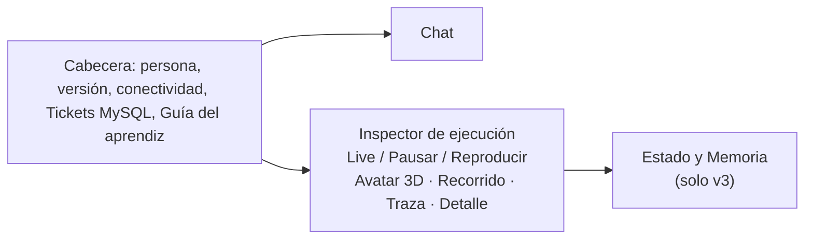

# Guía visual del Runtime Inspector

> Volver al [índice](README.md) · Relacionado: [catálogo de herramientas](catalogo-herramientas.md) · [troubleshooting](troubleshooting.md)

Esta guía describe **solo lo que existe en la interfaz actual** (`frontend/src/app/`). Para cada componente verás: qué representa, qué muestra, cómo leerlo, en qué versiones aparece y **qué no debes inferir**.

> [!IMPORTANT]
> El Inspector muestra eventos que **emite el runtime** (el programa que rodea al modelo). **No muestra el razonamiento interno del modelo.** Cuando veas "Inferencia observable", se trata de lo que el modelo devolvió (texto o una propuesta de herramienta), no de su "pensamiento".

## Mapa de la pantalla

En pantallas pequeñas los paneles se alternan con pestañas (**Conversación**, **Ejecución** y, en v3, **Memoria**). En tableta, v3 ofrece un selector "Vista secundaria".

---

## 1. Cabecera: versión, persona y conectividad

| Aspecto | Detalle |
|---|---|
| **Qué representa** | Los controles que definen *con qué agente* y *como quién* se ejecuta. |
| **Qué muestra** | Selector **Versión Agéntica** (`#agent-select`), selector **Persona (Simulación)** (`#persona-select`) y un indicador de estado: *FastAPI :8000 • Modelo: Conectado/Sin conexión • MySQL: Conectado/Sin conexión*. |
| **Cómo interpretarlo** | Antes de ejecutar, los tres servicios deben decir "Conectado". v1–v4 aparecen como *Operativo*; v5 y v6 aparecen como *Próximamente* y no se pueden usar. |
| **Versiones** | Todas. |
| **Qué NO inferir** | La persona es una **simulación de laboratorio**, no un inicio de sesión real. Cambiar de persona o de versión **reinicia** el Inspector y la reproducción (el chat se conserva por persona). Una persona distinta **no** limita la lectura de tickets: todos los roles pueden ver cualquier ticket. |

## 2. Chat

| Aspecto | Detalle |
|---|---|
| **Qué representa** | La conversación entre el aprendiz y el agente. |
| **Qué muestra** | Tus mensajes, la respuesta final del agente y atajos de consulta rápida (por ejemplo "Consulta el ticket TICK-1001 y dime su estado"). Hay un botón para detener la ejecución en curso. |
| **Cómo interpretarlo** | La respuesta del chat es la **síntesis final**. Para saber *cómo* se llegó a ella, mira el Inspector. |
| **Versiones** | Todas. |
| **Qué NO inferir** | Una respuesta fluida no prueba que se ejecutó una herramienta; puede haber sido una respuesta directa del modelo. Verifica en el Inspector que hubo evento de herramienta. Además, una tarjeta de atajo puede mencionar un nombre abreviado (`get_ticket`); el nombre real es `get_ticket_by_id`. |

## 3. Estado de ejecución: Live, Pausa visual y Reproducir

| Aspecto | Detalle |
|---|---|
| **Qué representa** | El modo en que *miras* una ejecución. |
| **Qué muestra** | Etiqueta **EN VIVO** (o **PAUSA VISUAL**), botón **Pausar ⏸ / Reanudar ▶**, botón **Reproducir ejecución**. En modo reproducción aparece **MODO REPRODUCCIÓN**, botón **Volver a Live** y una barra con *Reiniciar*, *Paso anterior*, *Reproducir/Pausar*, *Paso siguiente* y selector de **velocidad**. |
| **Cómo interpretarlo** | *Live*: la pantalla sigue los eventos conforme llegan. *Pausa visual*: congela **lo que ves**; el backend sigue ejecutando. *Reproducir*: recorre paso a paso los eventos **ya recibidos** de la última ejecución. |
| **Versiones** | Todas. |
| **Qué NO inferir** | Pausar **no detiene** al agente (para eso usa el botón de detener del chat). Reproducir **no vuelve a ejecutar** nada ni llama al modelo: solo reanima eventos guardados en el navegador. |

## 4. Avatar 3D

| Aspecto | Detalle |
|---|---|
| **Qué representa** | Una ilustración animada del estado general de la ejecución. |
| **Qué muestra** | Un avatar cuyo estado visual (reposo, activo, error, etc.) cambia según el paso actual. Está junto a la tarjeta "Componente Soberano", "Qué está ocurriendo" y "Por qué importa". |
| **Cómo interpretarlo** | Es apoyo visual para ubicar la fase. Los textos de la tarjeta (**Qué está ocurriendo** / **Por qué importa**) explican la fase seleccionada. |
| **Versiones** | Todas. |
| **Qué NO inferir** | El avatar **no es una señal técnica**: no indica emociones, confianza ni razonamiento del modelo. Si hay duda, confía en los eventos. |

## 5. Recorrido de ejecución (Timeline)

Es la línea de pasos que cambia según la versión.

| Versión | Componente | Qué muestra |
|---|---|---|
| v1 | **Recorrido de ejecución** | Hasta 7 *hops*: consulta, inferencia, propuesta de herramienta, validación, ejecución, inyección del resultado y síntesis final. Indicador `Hop N / 7`. |
| v2 | **Recorrido del bucle v2** | Iteraciones y fases: inferencia, propuesta de herramienta, validación, ejecución, inyección de observación, decisión del ciclo y síntesis. Indicador `Iteración N • Fase M`. |
| v3 | **Bucle y memoria v3** | El mismo bucle de v2 más el panel de memoria. |
| v4 | **Planificación DAG v4** | El visor del plan (sección 8). Indicador `Rev N • Paso Sx`. |

**Cómo interpretarlo:** haz clic en un hop, iteración o fase para ver su detalle. **Qué NO inferir:** la duración visual de cada tramo no es el tiempo real (revisa `durationMs` en la pestaña de Herramientas cuando exista).

## 6. Decision Trace (traza de decisiones)

| Aspecto | Detalle |
|---|---|
| **Qué representa** | Una lista cronológica de **decisiones observables** del runtime. |
| **Qué muestra** | Entradas por hop o iteración. En v2/v3 tiene vistas Macro y Micro. Se activa con el botón **Mostrar traza / Ocultar traza**. |
| **Cómo interpretarlo** | Distingue *quién decidió*: el modelo propone, el runtime valida y ejecuta. |
| **Versiones** | Todas. |
| **Qué NO inferir** | **No es el razonamiento privado del modelo.** Solo recoge decisiones expresadas como eventos del sistema. |

## 7. Detalle de la fase actual (4 pestañas)

Al seleccionar una fase aparece **Detalle de la Fase Actual** con un chip del tipo de evento y cuatro pestañas:

| Pestaña | Qué muestra | Cuidado al interpretar |
|---|---|---|
| **Inferencia observable** | Lo que el modelo devolvió (propuesta o texto) en esa fase. | No es su razonamiento interno. |
| **Herramientas** | Herramienta, argumentos, resultado (observación), duración, marcas de herramienta mutativa e idempotencia. | La marca *mutativa* avisa que podría modificar datos. |
| **Respuesta** | La respuesta sintetizada de la fase. | En v4, los pasos de síntesis usan plantillas deterministas. |
| **JSON técnico** | El evento crudo. | Puede contener campos que no necesitas; busca `type` y `payload`. |

Además, la pestaña superior **Eventos Raw (N)** lista todos los eventos recibidos, y **Hoja de Ruta v4..v6** muestra el plan curricular (v5 y v6 son futuras).

## 8. Plan DAG Viewer (solo v4)

| Aspecto | Detalle |
|---|---|
| **Qué representa** | El plan: un grafo dirigido sin ciclos donde cada nodo es un paso y las flechas son dependencias. |
| **Qué muestra** | "Visualizador de Planificación DAG", "Meta del Agente (Invariante)", leyenda de **ejecutores** (TOOL, RUNTIME, MODEL), el estado de cada paso, el selector **Revisiones** (Rev N Activa / Archivada), el detalle del paso (*Depende de*, *Justificación de Omisión*, *Evidencia Fáctica Verificada (Observación)*) y avisos de replanning o de **Runtime Stall**. |
| **Estados del plan** | `PLAN VALIDADO • EN EJECUCIÓN`, `PLAN COMPLETADO`, `RUNTIME STALL (no_executable_steps)`. |
| **Cómo interpretarlo** | Un paso `BLOQUEADO (DEP FAILED)` espera a un paso que falló. Si ningún paso puede avanzar, el runtime declara *stall* y termina. |
| **Versiones** | Solo v4. |
| **Qué NO inferir** | (1) El viewer **no distingue qué planificador generó el plan** (el del modelo o el determinista de respaldo). (2) Un plan *rechazado* por el validador **no se dibuja**: no habrá DAG, y el chat puede decir "Respuesta completada sin texto". (3) El indicador general de ejecución puede marcar "completada" aunque el plan haya fallado; confía en las etiquetas del DAG y en `RUN_COMPLETED.status`. |

## 9. Memory Inspector (solo v3)

| Aspecto | Detalle |
|---|---|
| **Qué representa** | El estado y la memoria que el agente conserva en MySQL. |
| **Qué muestra** | Título **Estado y Memoria (MySQL)**, el identificador de conversación (CONV), la "Tríada Pedagógica" (1. Estado de ejecución en RAM · 2. Memoria conversacional · 3. Memoria de decisiones), **Presupuesto de Contexto**, la línea de tiempo de **Memoria Conversacional**, decisiones activas y el aviso **Reconciliación Requerida** cuando aplica. También existen paneles *Intervención Humana (HITL)* y *Tareas Pendientes*. |
| **Cómo interpretarlo** | `MEMORY_HYDRATED` indica cuánto contexto se recuperó; `DECISION_SAVED` / `DECISION_REVOKED` muestran preferencias explícitas; `TURN_PERSISTED` confirma que el turno se guardó. |
| **Versiones** | Solo v3 (en v4 se persisten turnos, pero este panel no se muestra). |
| **Qué NO inferir** | (1) **No es la memoria interna del modelo.** (2) *Hitl/Tareas pendientes* normalmente aparecen vacíos: el agente actual no propone tareas pendientes; el HITL de aprobación pertenece a v5. (3) Los datos operativos (estado de un ticket) **no** se leen de la memoria: el agente debe volver a consultarlos. |

## 10. Panel "Tickets MySQL" y "Guía del aprendiz"

- **Tickets MySQL** (botón de la cabecera): muestra los tickets **reales** de la base de datos, con columna VENCIDO / En regla. Úsalo para **comprobar** lo que dice el agente. Es solo lectura.
- **Guía del aprendiz** (botón de la cabecera): abre esta documentación adaptada a la versión seleccionada, sin salir de AEP.

## Glosario rápido de eventos por versión

| Versión | Eventos principales |
|---|---|
| v1 | `USER_REQUEST`, `MODEL_INFERENCE_1`, `TOOL_PROPOSAL` o `DIRECT_ANSWER`, `ARGUMENT_VALIDATION`, `CPU_TOOL_EXECUTION`, `TOOL_RESULT_INJECTION`, `FINAL_SYNTHESIS`, `RUN_COMPLETED` |
| v2 | `RUN_STARTED`, `ITERATION_STARTED`, `MODEL_INFERENCE_STARTED/COMPLETED`, `TOOL_CALL_PROPOSED`, `ARGUMENTS_VALIDATED`, `TOOL_EXECUTION_STARTED/COMPLETED`, `OBSERVATION_APPENDED`, `ITERATION_COMPLETED`, `FINAL_SYNTHESIS`, `LOOP_*`, `RUN_COMPLETED/FAILED/CANCELLED` |
| v3 | Los de v2 + `MEMORY_HYDRATED`, `DECISION_SAVED`, `DECISION_REVOKED`, `TURN_PERSISTED` |
| v4 | `USER_REQUEST`, `MEMORY_HYDRATED`, `PLAN_GENERATED`, `PLAN_VALIDATED`, `STEP_STARTED/COMPLETED/FAILED`, `REPLANNING_TRIGGERED`, `PLAN_REVISION_CREATED`, `PLAN_BLOCKED`, `PLAN_COMPLETED`, `FINAL_SYNTHESIS`, `RUN_COMPLETED`, `TURN_PERSISTED` |
