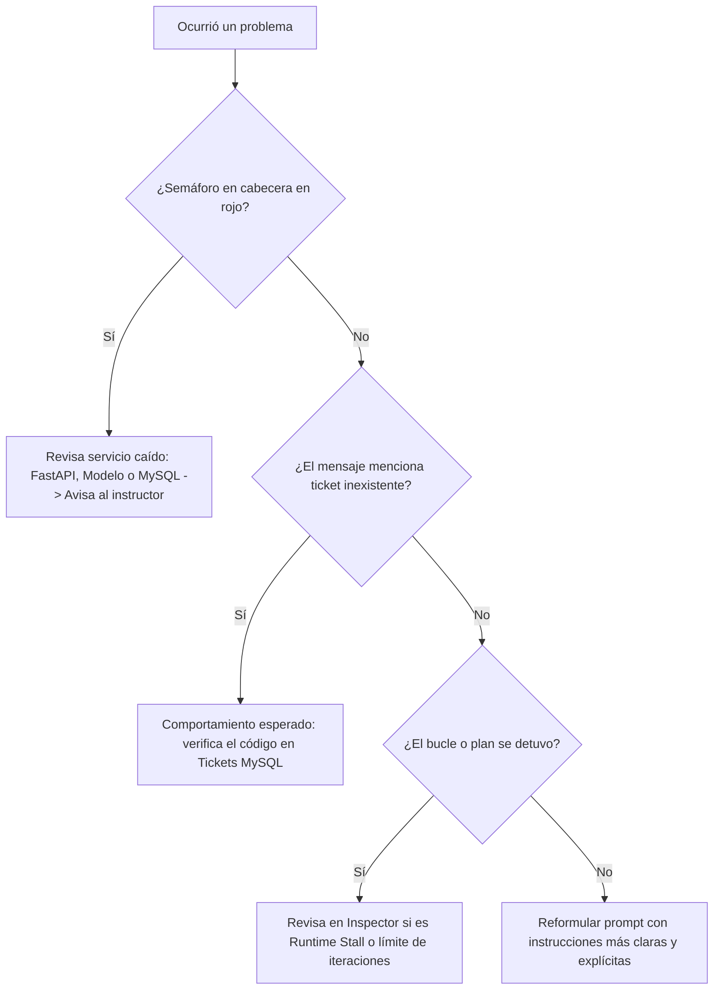

# Guía de Troubleshooting para Aprendices

> Volver al [índice](README.md) · [Catálogo de herramientas](catalogo-herramientas.md) · [Guía del Runtime Inspector](guia-runtime-inspector.md)

Esta guía recopila los problemas técnicos y situaciones límite reales que puedes encontrar al trabajar en **Agent Engineering Playground (AEP)**. Cada sección describe el síntoma visual, la causa interna verificada en el código y el procedimiento seguro para resolverlo.

---

## 1. Problemas de Conectividad y Servicios Base

### 1.1. Backend FastAPI Desconectado
- **Síntoma:** El indicador en la cabecera muestra `FastAPI :8000 • Sin conexión` o al enviar un mensaje el chat muestra *"Error de conexión al servidor"*.
- **Causa técnica:** El proceso del servidor FastAPI en el puerto 8000 no se está ejecutando o fue detenido.
- **Qué revisar:**
  1. Abre una pestaña del navegador en `http://localhost:8000/api/health`.
  2. Si no carga, el servicio está inactivo.
- **Solución segura:** Avisa al instructor para reiniciar el servicio backend en la terminal mediante `uvicorn src.api.main:app --port 8000 --reload`. No intentes modificar archivos de configuración.
- **¿Requiere instructor?:** Sí.

---

### 1.2. Servidor de Inferencia LLM Desconectado o Lento
- **Síntoma:** La cabecera muestra `Modelo: Sin conexión`, o una consulta tarda más de 60 segundos y termina con un error de timeout.
- **Causa técnica:** El servidor de inferencia local (llama.cpp u OpenAI compatible en el puerto 8080) está detenido, saturado de solicitudes o cargando los pesos del modelo Qwen.
- **Qué revisar:**
  1. Verifica si la cabecera pasa a color rojo o ámbar.
  2. Observa si el evento `MODEL_INFERENCE_STARTED` no emite `MODEL_INFERENCE_COMPLETED` tras 30 segundos.
- **Solución segura:** Espera 30 segundos y recarga la página. Si persiste, el instructor debe verificar que el proceso en el puerto 8080 responda a `GET http://localhost:8080/health`.
- **¿Requiere instructor?:** Si la desconexión dura más de 2 minutos, sí.

---

### 1.3. Base de Datos MySQL Desconectada
- **Síntoma:** La cabecera muestra `MySQL: Sin conexión`, el botón **Tickets MySQL** muestra una lista vacía o aparece el evento `excepcion_runtime` con error de conexión a base de datos.
- **Causa técnica:** El contenedor o servicio MySQL local no está corriendo o las credenciales del pool de conexiones no coinciden.
- **Qué revisar:** Comprueba el semáforo de conectividad en la barra superior.
- **Solución segura:** En Agent v1 y v2 sin herramientas aún puedes probar respuestas directas, pero **Agent v3 y v4 requieren MySQL estrictamente** para persistir turnos e hidratar memoria. Notifica al instructor para verificar el contenedor de base de datos.
- **¿Requiere instructor?:** Sí.

---

## 2. Errores de Ejecución de Herramientas (v1, v2, v3, v4)

### 2.1. Herramienta Desconocida (`herramienta_no_encontrada` / `unknown_tool`)
- **Síntoma:** En la pestaña **Herramientas** del Inspector aparece el código de error `herramienta_no_encontrada`. En Agent v4 el plan resulta rechazado con `unknown_tool`.
- **Causa técnica:** El modelo LLM inventó un nombre de herramienta que no existe en el catálogo formal (por ejemplo, propuso `buscar_ticket` en lugar de `get_ticket_by_id`, o `modificar_estado` que no está registrada).
- **Qué revisar:** Consulta el [catálogo de herramientas](catalogo-herramientas.md) para confirmar el nombre exacto de las herramientas operativas.
- **Solución segura:** Reformula la consulta al agente de forma más específica y directa (ej. *"Consulta el ticket TICK-1001 y dime su estado"*).
- **¿Requiere instructor?:** No, es parte del comportamiento probabilístico del modelo.

---

### 2.2. Argumentos Inválidos o Violación de Contrato Pydantic (`parametros_invalidos` / `error_validacion`)
- **Síntoma:** El evento `ARGUMENT_VALIDATION` muestra `is_valid: false`, o la observación de herramienta contiene un diccionario con `error: parametros_invalidos`.
- **Causa técnica:** El modelo propuso argumentos con nombres equivocados (p. ej. `id` en lugar de `ticket_code`) o valores con tipos de datos incorrectos que violan el esquema de validación Pydantic.
- **Qué revisar:** Abre la pestaña **Herramientas** en el Runtime Inspector y compara los argumentos propuestos con los requeridos en el catálogo.
- **Solución segura:** Vuelve a enviar la consulta indicando expresamente los parámetros (ej. *"Consulta el ticket con código TICK-1001"*).
- **¿Requiere instructor?:** No.

---

### 2.3. Ticket Inexistente (`entidad_no_encontrada`)
- **Síntoma:** La herramienta devuelve `error: entidad_no_encontrada` y el agente responde indicando que no encontró el registro.
- **Causa técnica:** Se solicitó un ticket que no existe en la base de datos MySQL (por ejemplo `TICK-9999`).
- **Qué revisar:** Abre el cajón **Tickets MySQL** en la cabecera y busca el código solicitado.
- **Solución segura:** Este comportamiento es **completamente normal y esperado**. Demuestra que el agente no inventa datos cuando la base de datos relacional no contiene el registro.
- **¿Requiere instructor?:** No.

---

### 2.4. Acción No Autorizada (`accion_no_autorizada` / `no_autorizado`)
- **Síntoma:** El evento de ejecución de herramienta o conversación devuelve un fallo de autorización.
- **Causa técnica:** La persona activa no cuenta con los permisos requeridos para esa operación, o intentó acceder al `conversation_id` de otro usuario.
- **Qué revisar:** Revisa qué persona tienes seleccionada en el selector superior (`#persona-select`).
- **Solución segura:** Si necesitas permisos administrativos o de supervisión, cambia a la persona correspondiente (`supervisor_juan` o `admin_sistema`) o regresa a `usr_carlos` para pruebas estándar de usuario.
- **¿Requiere instructor?:** No.

---

## 3. Problemas del Bucle del Agente (Agent v2 y v3)

### 3.1. Bucle Detenido por Límite de Iteraciones (`max_iterations_reached`)
- **Síntoma:** El evento final `RUN_COMPLETED` muestra `stop_reason: max_iterations_reached` y el agente no llega a emitir la respuesta final completa.
- **Causa técnica:** El agente consumió las 5 iteraciones asignadas en su presupuesto de ejecución sin decidir que la tarea estaba terminada.
- **Qué revisar:** Abre el Inspector en modo **Recorrido del bucle v2** y cuenta las iteraciones ejecutadas.
- **Solución segura:** Divide la pregunta en dos consultas más específicas. Evita prompts excesivamente amplios que requieran decenas de acciones simultáneas.
- **¿Requiere instructor?:** No.

---

### 3.2. Ciclo Repetitivo Detectado (`repetitive_tool_call`)
- **Síntoma:** El bucle se detiene abruptamente con el evento `LOOP_REPETITION_DETECTED` y `stop_reason: repetitive_tool_call`.
- **Causa técnica:** El modelo cayó en un ciclo infinito proponiendo exactamente la misma herramienta con los mismos argumentos en iteraciones consecutivas. El detector de ciclos del runtime cortó la ejecución para proteger los recursos.
- **Qué revisar:** Observa en la pestaña **Traza de decisiones** qué herramienta se repitió dos veces con idénticos argumentos.
- **Solución segura:** Envía una instrucción correctiva al agente aportando el dato que parecía faltarle.
- **¿Requiere instructor?:** No, es un mecanismo de seguridad protector del runtime.

---

### 3.3. Tiempos Límite Excedidos (`global_timeout`, `inference_timeout`, `tool_timeout`)
- **Síntoma:** La ejecución finaliza con `RUN_FAILED` indicando un timeout de inferencia o de herramienta.
- **Causa técnica:** Una llamada al modelo superó los 30 segundos, o la consulta a MySQL excedió los 15 segundos, o la ejecución total superó los 60 segundos.
- **Qué revisar:** Comprueba si la máquina host está experimentando alta carga de CPU/GPU.
- **Solución segura:** Vuelve a intentar la consulta cuando el equipo esté menos ocupado.
- **¿Requiere instructor?:** Si ocurre constantemente en consultas sencillas, sí.

---

## 4. Problemas de Estado y Memoria (Agent v3)

### 4.1. El Agente "Olvida" una Preferencia Previa
- **Síntoma:** Le preguntas por tu canal preferido y responde que no lo sabe, a pesar de que creías haberlo guardado.
- **Causa técnica:** Pueden existir tres motivos:
  1. **Frase no explícita:** El prompt inicial no usó marcadores de decisión explícita (como *"Recuerda que..."*, *"Mi preferencia es..."*), por lo que no se emitió el evento `DECISION_SAVED`.
  2. **Cambio de persona:** Cambiaste de `usr_carlos` a otra persona (`usr_laura`). La memoria está aislada por usuario en MySQL.
  3. **Revocación:** La decisión fue revocada previamente con una frase de olvido.
- **Qué revisar:** Abre el panel **Estado y Memoria (MySQL)** y verifica el número de decisiones activas (`decisions_count`).
- **Solución segura:** Envía un prompt explícito con formato clave/valor:  
  `Recuerda que mi canal preferido: email`
- **¿Requiere instructor?:** No.

---

### 4.2. Error de Conversación Ajena (Aislamiento de Identidad)
- **Síntoma:** Aparece un evento `ERROR` con código `accion_no_autorizada` al intentar continuar un chat.
- **Causa técnica:** Se envió una solicitud con un `conversation_id` perteneciente a otra persona. El runtime de v3 verifica la propiedad de la conversación y bloquea el acceso cruzado.
- **Solución segura:** Cambia de persona en el selector o inicia una nueva conversación limpia.
- **¿Requiere instructor?:** No.

---

## 5. Problemas de Planificación (Agent v4)

### 5.1. Runtime Stall (`no_executable_steps` / `PLAN_BLOCKED`)
- **Síntoma:** En el Plan DAG Viewer uno o más nodos se marcan en gris/rojo con la etiqueta **BLOQUEADO (DEP FAILED)**, aparece el banner **Runtime Stall Detectado** y el agente responde indicando que la ejecución se detuvo de forma segura.
- **Causa técnica:** Un paso del cual dependían otros pasos falló (`STEP_FAILED`), y no existe una regla de replanning alternativa en el catálogo para ese tipo de fallo. Para evitar actuar a ciegas, el runtime detiene la ejecución.
- **Qué revisar:** Identifica en el grafo el nodo de color rojo (`failed`). En su tarjeta de detalle lee el mensaje de error de la observación.
- **Solución segura:** Este es el **comportamiento curricular esperado (G3)** ante fallas irrecuperables. Para una ejecución exitosa, asegúrate de pedir diagnósticos sobre tickets existentes (`TICK-1001` a `TICK-1005`).
- **¿Requiere instructor?:** No.

---

### 5.2. Plan Rechazado por Validación (`VALIDATION_ERROR` / `invalid_plan`)
- **Síntoma:** No se dibuja ningún grafo en el visor DAG, el chat muestra *"Respuesta completada sin texto"* y en los eventos aparece `VALIDATION_ERROR` con estado `rejected`.
- **Causa técnica:** El `PlanValidator` detectó una violación estructural en el plan antes de ejecutarlo:
  - Ciclo estático en las dependencias (ej. S1 depende de S2 y S2 depende de S1).
  - Auto-dependencia (un paso depende de sí mismo).
  - Identificador de paso duplicado o vacío.
  - Dependencia que apunta a un paso inexistente.
  - Herramienta o acción no registrada en el catálogo.
- **Qué revisar:** Abre la pestaña **Eventos Raw** en el Inspector y examina el payload de `VALIDATION_ERROR`.
- **Solución segura:** Los planificadores estándar de AEP están programados para generar planes válidos. Si experimentas este rechazo con un prompt personalizado, simplifica tu solicitud.
- **¿Requiere instructor?:** Si ocurre con los prompts recomendados en la guía de v4, sí.

---

## 6. Cuadro Rápido de Decisión ante Incidencias

