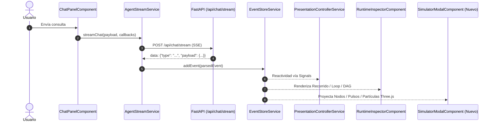
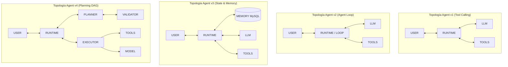

# AEP — Diseño de Arquitectura: Interactive Learning Simulator & Walkthrough

**Documento:** `docs/architecture/AEP_INTERACTIVE_LEARNING_DESIGN.md`  
**Proyecto:** Agent Engineering Playground (AEP)  
**Fecha:** 2026-10-12  
**Estado:** Aprobado / Fase 0 completada  

---

## 1. Resumen Ejecutivo y Misión

Este documento establece las bases arquitectónicas para transformar **Agent Engineering Playground (AEP)** en un laboratorio interactivo de observabilidad y aprendizaje profundo de agentes LLM, integrando dos experiencias de usuario sin alterar los orquestadores ni los contratos del backend:

1. **Walkthrough Interactivo («Explorar Playground»):** Un recorrido contextual paso a paso que atenúa la interfaz, resalta los componentes soberanos reales y guía al estudiante por las funcionalidades generales y específicas de cada versión agéntica.
2. **Agent Runtime Simulator («Abrir simulador»):** Un simulador visual interactivo basado en Three.js que proyecta en tiempo real las interacciones fácticas entre los nodos del runtime (**USER**, **LLM**, **RUNTIME**, **TOOLS**, **MEMORY**, **PLANNER**, **EXECUTOR**), sincronizado de forma estricta con los eventos SSE reales y con acceso inmediato a la documentación pedagógica Markdown contextual.

> [!IMPORTANT]
> **Principio de Diseño Fundamental:**  
> El simulador es una **proyección visual del runtime**, NO un runtime alternativo ni una simulación inventada. Refleja fielmente los eventos emitidos por el backend de AEP, permitiendo la evolución transparente hacia **Agent v5 (Guardrails & HITL)** y **Agent v6 (Observability & Evaluation)**.

---

## 2. Auditoría Técnica de la Arquitectura Actual

### 2.1. Ingestión y Flujo de Eventos SSE


- **Servicio Ingestor:** `AgentStreamService` (`src/app/services/agent-stream.service.ts`) establece una conexión fetch con `ReadableStream` y decodifica fragmentos SSE `data: {...}` en UTF-8.
- **Manejo de Desconexión / Cancelación:** Posee un `AbortController` nativo. Si el usuario cancela la consulta, aborta la conexión HTTP de inmediato.
- **Almacenamiento Centralizado:** `EventStoreService` (`src/app/services/event-store.service.ts`) almacena `events = signal<StreamEvent[]>([])` como única fuente de verdad en el cliente. **No se debe crear un segundo store.**
- **Control de Reproducción:** `PresentationControllerService` (`src/app/services/presentation-controller.service.ts`) gobierna los modos `live` y `replay`, pausas visuales (`isVisualPaused`), velocidades (`0.5x`, `1x`, `2x`) y estados de humor del avatar Three.js.

### 2.2. Inventario de Eventos Reales por Versión

| Versión | Eventos Emitidos por el Backend |
|---|---|
| **Agent v1** | `USER_REQUEST`, `MODEL_INFERENCE_1`, `TOOL_PROPOSAL` (o `DIRECT_ANSWER`), `ARGUMENT_VALIDATION`, `CPU_TOOL_EXECUTION`, `TOOL_RESULT_INJECTION`, `FINAL_SYNTHESIS`, `RUN_COMPLETED` |
| **Agent v2** | `RUN_STARTED`, `ITERATION_STARTED`, `MODEL_INFERENCE_STARTED`, `MODEL_INFERENCE_COMPLETED`, `TOOL_CALL_PROPOSED`, `ARGUMENTS_VALIDATED`, `TOOL_EXECUTION_STARTED`, `TOOL_EXECUTION_COMPLETED`, `OBSERVATION_APPENDED`, `ITERATION_COMPLETED`, `FINAL_SYNTHESIS`, `LOOP_REPETITION_DETECTED`, `LOOP_LIMIT_EXCEEDED`, `LOOP_TIMEOUT_EXCEEDED`, `RUN_COMPLETED`, `RUN_FAILED`, `RUN_CANCELLED` |
| **Agent v3** | Todos los eventos de v2 + `MEMORY_HYDRATED`, `DECISION_SAVED`, `DECISION_REVOKED`, `PENDING_TASK_PROPOSED`, `PENDING_TASK_RESOLVED`, `TASK_RECOVERY_REQUIRED`, `TURN_PERSISTED` |
| **Agent v4** | `USER_REQUEST`, `MEMORY_HYDRATED`, `PLAN_GENERATED`, `PLAN_VALIDATED`, `STEP_STARTED`, `STEP_COMPLETED`, `STEP_FAILED`, `REPLANNING_TRIGGERED`, `PLAN_REVISION_CREATED`, `PLAN_BLOCKED`, `PLAN_COMPLETED`, `FINAL_SYNTHESIS`, `RUN_COMPLETED`, `TURN_PERSISTED` |

### 2.3. Correlación y Robustez de Eventos
- Los eventos contienen `execution_id`, `correlation_id`, `hop_number` (en v1), `iteration_index` y `phase` (en v2/v3), y `step_id` (en v4).
- Si los eventos llegan con retraso o agrupados, `EventStoreService` procesa de forma incremental e idempotente sin colapsar la vista gracias a `computed()` signals de Angular.

---

## 3. Auditoría Visual Multidispositivo (Playwright Chromium)

Se ejecutó una inspección visual automatizada en cuatro viewports clave:

```text
mobile_360:   360 x 800 px  (Smartphones compactos)
mobile_390:   390 x 844 px  (Dispositivos móviles estándar)
tablet_768:   768 x 1024 px (Tablets en orientación vertical)
desktop_1440: 1440 x 900 px (Monitores de escritorio estándar)
```

### Hallazgos de la Auditoría Visual:
1. **Header:** En móviles (<768px), los selectores de versión y persona se apilan correctamente; el botón «Tickets MySQL» y el nuevo botón «Guía del aprendiz» se adaptan sin desbordamiento.
2. **Navegación Móvil:** La barra segmentada inferior (`Conversación`, `Ejecución`, `Memoria`) permite alternar paneles en pantallas estrechas.
3. **Inspector y Avatar 3D:** En móviles y tablets, el avatar Three.js escala su contenedor mediante `ResizeObserver` sin deformar el aspect ratio. Cuando WebGL no está disponible, el fallback 2D vectorial entra en acción transparentemente.
4. **Plan DAG Viewer (v4):** Los nodos del grafo y las revisiones son legibles en escritorio y tablet; en móviles requieren desplazamiento horizontal suave en la tarjeta del stepper.
5. **Drawer de la Guía del Aprendiz:** Abre fluidamente a pantalla completa en móviles y como panel lateral de 900 px en escritorio, cerrando limpiamente con la tecla `Escape`.

---

## 4. Propuesta de Arquitectura: Walkthrough Interactivo

### 4.1. Concepto y Experiencia
Se implementará un servicio singleton `WalkthroughService` y un overlay declarativo de alta fidelidad con directivas de target `data-tour="id"`.
- **Botón de Activación:** «Explorar Playground» en el header junto al botón de la guía.
- **Persistencia Local:** `localStorage.getItem('aep_tour_completed')` registra si el usuario ya vio el tour.
- **Navegación:** Botones *Anterior*, *Siguiente*, *Omitir*, *Finalizar* y atajos de teclado (`Flecha izquierda`, `Flecha derecha`, `Esc`).

### 4.2. Pasos Estructurados por Versión

```mermaid
graph LR
    P1[1. Bienvenida AEP] --> P2[2. Selector Versiones]
    P2 --> P3[3. Selector Persona]
    P3 --> P4[4. Chat & Prompts]
    P4 --> P5[5. Inspector Ejecución]
    P5 --> P6[6. Avatar 3D]
    P6 --> P7[7. Stepper / Timeline]
    P7 --> P8[8. Traza Decisiones]
    P8 --> P9[9. Controles Live/Replay]
    P9 --> P10[10. Guía del Aprendiz]
```



- **Pasos Específicos según Versión Activa:**
  - **v1:** Foco en validación Pydantic y separación modelo/runtime.
  - **v2:** Foco en contador de iteraciones, presupuesto y parada por ciclos.
  - **v3:** Foco en panel de memoria MySQL y aislamiento entre identidades.
  - **v4:** Foco en nodos del DAG, dependencias y revisiones de replanning.

---

## 5. Propuesta de Arquitectura: Agent Runtime Simulator (Three.js)

### 5.1. Topología del Grafo de Nodos por Versión

El simulador renderiza una escena 3D ortográfica/perspectiva ligera con nodos soberanos esféricos/cilíndricos y aristas conectivas dinámicas:



### 5.2. Estados Visuales de Nodos y Partículas
Cada nodo cuenta con 4 estados visuales claros:
- **`idle`:** Reposo (halo atenuado, color base grisáceo/azulado).
- **`active`:** Operación en curso (halo pulsante, color temático encendido).
- **`completed`:** Paso finalizado con éxito (resplandor esmeralda).
- **`error` / `blocked`:** Fallo o bloqueo (resplandor carmesí o ámbar).

**Flujo de Partículas (Shader o Point Cloud):**
Cuando ocurre un evento observable (p. ej. `TOOL_PROPOSAL`), una ráfaga de partículas luminosas viaja a lo largo de la arista desde `LLM` hacia `RUNTIME`. Cuando el runtime ejecuta la herramienta (`CPU_TOOL_EXECUTION`), las partículas viajan hacia `TOOLS`, retornando con la observación hacia `RUNTIME`.

### 5.3. Modos de Operación
1. **Modo LIVE:** Escucha en tiempo real `eventStore.events()` y anima el nodo activo correspondiente al último evento recibido.
2. **Modo REPLAY:** Se enlaza con `presentationControllerService` para avanzar o retroceder paso a paso con velocidades `0.5x`, `1x`, `2x`.

---

## 6. Vinculación Contextual con Documentación Markdown

Al hacer clic en cualquier nodo 3D o en cualquier evento de la línea de tiempo del simulador, el panel lateral derecho del simulador muestra la explicación contextual cargada desde `docs/aprendices/*.md` mediante `LearnerGuideService`:

| Elemento Seleccionado | Sección Markdown Asociada | Concepto Explicado al Aprendiz |
|---|---|---|
| **Nodo LLM** | `agent-v1-tool-calling.md §A` | El modelo de lenguaje propone herramientas o sintetiza; no ejecuta código directamente. |
| **Nodo RUNTIME** | `agent-v2-agent-loop.md §A/E` | El orquestador soberano en Python: valida contratos Pydantic, controla el presupuesto y detiene ciclos. |
| **Nodo TOOLS** | `catalogo-herramientas.md §1` | Herramientas registradas en MySQL (`get_ticket_by_id`, `list_tickets`, `create_ticket`). |
| **Nodo MEMORY** | `agent-v3-state-memory.md §A` | Tríada pedagógica: RAM vs. memoria conversacional vs. decisiones persistidas en base de datos. |
| **Nodo PLANNER** | `agent-v4-planning.md §A/F` | Formulación del grafo DAG, dependencias y cálculo topológico antes de la ejecución. |
| **Nodo EXECUTOR** | `agent-v4-planning.md §A` | Despacho a ejecutores especializados: `TOOL` (CPU/DB), `RUNTIME` (algoritmo interno) y `MODEL` (plantilla/síntesis). |

---

## 7. Decisiones Técnicas y Gestión de Riesgos

1. **Gestión de Memoria WebGL:** El simulador Three.js se destruye limpiamente al cerrar el modal (desechando geometrías, materiales, texturas y cancelando `requestAnimationFrame`) para evitar fugas de memoria o conflicto con el avatar 3D existente.
2. **Accesibilidad y `prefers-reduced-motion`:** Si el sistema operativo del usuario tiene activada la reducción de movimiento, las partículas continuas se reemplazan por transiciones discretas de color y opacidad.
3. **No interferencia con Chat ni SSE:** El simulador actúa como un visor pasivo reactivo a las señales de `EventStoreService`. No añade listeners duplicados al flujo fetch ni altera los turnos del chat.

---

*Diseño aprobado para implementación.*
