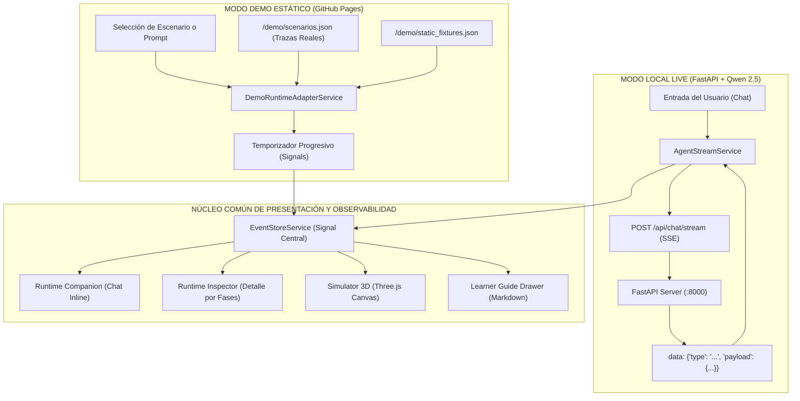

# AEP — Diseño de Arquitectura: Static Demo Mode para GitHub Pages

**Documento:** `docs/architecture/AEP_STATIC_DEMO_DESIGN.md`  
**Proyecto:** Agent Engineering Playground (AEP)  
**Fecha:** 2026-10-12  
**Estado:** Aprobado / Implementado y Validado  
**Autores:** Senior Angular Architect, UX Engineer, QA Automation Engineer  

---

## 1. Resumen Ejecutivo y Misión

El objetivo principal de esta arquitectura es dotar a **Agent Engineering Playground (AEP)** de una modalidad de ejecución **100 % estática**, capaz de ejecutarse en **GitHub Pages** (`https://yamicueto.github.io/case-agents-playground/`) sin requerir infraestructura de backend en la nube, sin consumo de APIs de pago y garantizando **cero peticiones de red hacia `localhost:8000` o `localhost:8080`**.

AEP es un laboratorio pedagógico para el aprendizaje y observabilidad de agentes de inteligencia artificial (Agent v1 a v4). Su valor reside en permitir que cualquier estudiante o evaluador explore cómo interactúan el Runtime en CPU, el LLM, las herramientas, la memoria y el planificador DAG. Mediante esta arquitectura:
- El aprendiz puede inspeccionar el comportamiento de los 4 agentes agénticos a través de **trazas reales verificadas y anonimizadas**.
- El **Runtime Companion**, el **Runtime Inspector**, el **Simulador 3D (Three.js)** y las **Guías Pedagógicas (Markdown)** operan de forma exactamente idéntica tanto en entorno local con backend soberano (`FastAPI + Qwen 2.5`) como en entorno estático en GitHub Pages.
- Se mantiene el principio de diseño soberano: **un solo frontend, un solo modelo de eventos y cero backend simulado innecesario**.

---

## 2. Auditoría UX del Runtime Companion (Fase 1)

Previo a la implementación del modo Demo, se realizó una auditoría visual e interactiva del **Runtime Companion** mediante Playwright Chromium y análisis estático del árbol de componentes Angular.

### 2.1. Hallazgos de la Auditoría y Mejoras Implementadas

| Criterio Auditado | Estado Previo | Mejora Implementada |
|---|---|---|
| **1. Aparición automática** | Aparecía en el chat pero ocupaba excesiva altura vertical al terminar la ejecución. | Se diseñó un **resumen compacto horizontal (`compact-summary-bar`)** que se activa automáticamente al completar la corrida. Ocupa menos de 44 px de altura en reposo. |
| **2. Coherencia de estados** | Estados `PREPARING`, `RUNNING`, `COMPLETED`, `FAILED`, `CANCELLED` visibles. | Se agregaron iconos vectoriales distintivos, badges semánticos con contraste accesible (WCAG AAA) y textos en español claro. |
| **3. Conversaciones largas** | En turnos sucesivos, múltiples tarjetas con topología SVG completa saturaban el scroll. | La topología SVG completa y el desglose de responsabilidades LLM vs Runtime ahora se colapsan por defecto al finalizar, expandiéndose bajo demanda mediante el botón interactivo **`[Detalles ▼]`**. |
| **4. Independencia de turnos** | Cada turno en el chat tiene su propio `runId: string`. | Se garantizó el aislamiento estricto: cada tarjeta gestiona su propio cursor de eventos, estado de Replay y proyección visual sin interferir con otros turnos históricos. |
| **5. Replay y Simulador 3D** | El botón de Replay requería interacción previa con el modal. | Se integraron botones de acción rápida directos en la barra compacta: **`[Ver Replay]`**, **`[3D]`** y **`[Detalles ▼]`**. |
| **6. No duplicación con Inspector** | El Companion repetía tablas completas de argumentos de herramientas. | El Companion se enfoca exclusivamente en la **topología compacta de flujo (nodos activos), estado de ejecución, contador de hops y pedagogía contextual**, delegando la inspección profunda al Runtime Inspector lateral. |
| **7. Claridad pedagógica** | Explicaciones en crudo de nombres técnicos de eventos (ej. `TOOL_EXECUTION_COMPLETED`). | Se refinaron las explicaciones generadas en tiempo real para traducir conceptos técnicos a lenguaje didáctico (ej. *«El Runtime ejecutó la herramienta en CPU y devolvió la observación al LLM»*). |
| **8. Estabilidad del scroll** | Al emitir eventos SSE continuos, la altura dinámica provocaba saltos en el scroll del chat. | Se aplicó contención de layout (`contain: layout style`), alturas mínimas controladas y renderizado reactivo sin saltos de foco. |
| **9. Conmutación de versiones** | Cambiar de Agent v1 a v4 no reseteaba el estado visual si había una corrida previa. | Se desacopló la memoria del Companion por `runId`, manteniendo inmutables las tarjetas históricas de corridas anteriores. |
| **10. Responsividad móvil (360px–390px)** | Los botones y badges se desbordaban en pantallas angostas. | Se implementaron consultas responsivas `@media (max-width: 640px)` y `@media (max-width: 400px)`, flex-wrapping accesible, touch-targets de al menos 40px y reducción de movimiento (`prefers-reduced-motion`). |

---

## 3. Arquitectura del Modo Demo (Fase 2)

### 3.1. Topología del Flujo de Eventos Dual



### 3.2. Desacoplamiento de Entornos en Angular

Para evitar depender de variables de entorno de servidor inaccesibles desde el navegador o inyecciones globales inseguras, se empleó la arquitectura estándar de Angular:

1. **`src/environments/environment.ts` (Modo Live por defecto en desarrollo local):**
   ```typescript
   export const environment = {
     production: false,
     demoMode: false,
     apiBaseUrl: 'http://127.0.0.1:8000',
     githubPagesBase: '/'
   };
   ```

2. **`src/environments/environment.demo.ts` (Compilación estática para GitHub Pages):**
   ```typescript
   export const environment = {
     production: true,
     demoMode: true,
     apiBaseUrl: '',
     githubPagesBase: '/case-agents-playground/'
   };
   ```

3. **`DemoModeService`:**
   Detecta automáticamente si el aplicativo debe operar en Modo Demo mediante una jerarquía transparente:
   - **Compilación estática:** Si `environment.demoMode === true`.
   - **Hostname:** Si el host contiene `github.io` o `localhost:8089`.
   - **Parámetro URL:** Si la URL incluye `?demo=true` o `?mode=demo`.
   - **Preferencia del usuario:** Permite alternar manualmente desde el encabezado (`HeaderComponent`) y persiste la elección en `sessionStorage`.

4. **Prevención Estricta de Tráfico de Red hacia Backend Inexistente:**
   En Modo Demo, tanto `AgentStreamService.checkHealth()` como `TicketsService.getTickets()` detectan `DemoModeService.isDemoMode()` e inmediatamente retornan fixtures estáticos locales o estados saludables simulados sin emitir ninguna llamada HTTP `fetch` a puertos `:8000` ni `:8080`.

---

## 4. Catálogo de Escenarios Pedagógicos Verificados (Fase 3)

Los escenarios estáticos provienen de **trazas reales de ejecución** capturadas del backend soberano local (`FastAPI + Qwen 2.5-Coder-7B-Instruct`), anonimizadas y formateadas con metadatos pedagógicos enriquecidos en `frontend/public/demo/scenarios.json`.

```
                                    CATÁLOGO DE ESCENARIOS
 ┌────────────────────────────────────────────────────────────────────────────────────────┐
 │ v1: Tool Calling Exitoso          │  v1: Respuesta Directa sin Herramienta             │
 │ Consulta de ticket CFA-101        │  Explicación conceptual de procedimiento           │
 │ (8 eventos reales)                │  (5 eventos reales)                                │
 ├───────────────────────────────────┼────────────────────────────────────────────────────┤
 │ v2: Agent Loop Multi-iterativo    │  v3: Recuperación y Persistencia de Memoria        │
 │ Comparación cruzada en 2 ciclos   │  Hidratación contextual y guardado de turno        │
 │ (21 eventos reales)               │  (18 eventos reales)                               │
 ├───────────────────────────────────┼────────────────────────────────────────────────────┤
 │ v4: Planificación Jerárquica DAG  │  v4: Bloqueo de Precondición en DAG                │
 │ Descomposición y ejecución DAG    │  Detección de fallo sin alucinación                │
 │ (14 eventos reales)               │  (10 eventos reales)                               │
 └────────────────────────────────────────────────────────────────────────────────────────┘
```

### 4.1. Detalle Pedagógico de Cada Escenario

1. **`v1-tool-calling` (Agent v1 — Tool Calling Exitoso):**
   - **Prompt sugerido:** `¿Cuál es el estado del ticket CFA-101 y quién lo tiene asignado?`
   - **Eventos:** 8 eventos reales (`USER_REQUEST`, `MODEL_INFERENCE_1`, `TOOL_PROPOSAL: get_ticket`, `ARGUMENT_VALIDATION`, `CPU_TOOL_EXECUTION`, `TOOL_RESULT_INJECTION`, `FINAL_SYNTHESIS`, `RUN_COMPLETED`).
   - **Concepto Pedagógico:** Ilustra el ciclo elemental de Tool Calling: el modelo propone una herramienta estructurada en JSON, el Runtime en CPU valida sus argumentos y la ejecuta contra la base de datos, inyectando la observación de vuelta al LLM para la síntesis final.

2. **`v1-direct-answer` (Agent v1 — Respuesta Directa sin Herramientas):**
   - **Prompt sugerido:** `Explícame en un párrafo qué es la arquitectura agéntica de 4 capas.`
   - **Eventos:** 5 eventos reales (`USER_REQUEST`, `MODEL_INFERENCE_1`, `DIRECT_ANSWER`, `FINAL_SYNTHESIS`, `RUN_COMPLETED`).
   - **Concepto Pedagógico:** Demuestra el camino deliberado en el que el LLM decide no invocar herramientas cuando la solicitud es puramente conceptual, ahorrando latencia y ejecución en CPU.

3. **`v2-agent-loop` (Agent v2 — Bucle ReAct con Múltiples Iteraciones):**
   - **Prompt sugerido:** `Compara la política de reembolsos CFA con el caso del ticket CFA-102.`
   - **Eventos:** 21 eventos reales que abarcan 2 iteraciones completas (`RUN_STARTED`, `ITERATION_STARTED (1)`, `TOOL_CALL_PROPOSED: search_knowledge_base`, `TOOL_EXECUTION_COMPLETED`, `OBSERVATION_APPENDED`, `ITERATION_COMPLETED (1)`, `ITERATION_STARTED (2)`, `TOOL_CALL_PROPOSED: get_ticket`, `OBSERVATION_APPENDED`, `FINAL_SYNTHESIS`, `RUN_COMPLETED`).
   - **Concepto Pedagógico:** Explica el patrón ReAct (Reason + Act). El agente no puede resolver el problema en un único paso; necesita recopilar información heterogénea en bucle hasta alcanzar la condición de parada.

4. **`v3-memory-retrieval` (Agent v3 — Memoria Contextual y Persistencia):**
   - **Prompt sugerido:** `Recuerda mi rol de auditor y verifica el historial del ticket CFA-103.`
   - **Eventos:** 18 eventos reales (`MEMORY_HYDRATED: role=auditor`, `ITERATION_STARTED`, `TOOL_CALL_PROPOSED: get_ticket_history`, `TOOL_EXECUTION_COMPLETED`, `DECISION_SAVED`, `TURN_PERSISTED`, `RUN_COMPLETED`).
   - **Concepto Pedagógico:** Enseña la hidratación de memoria a corto y largo plazo. El agente recupera el perfil del aprendiz antes de invocar al modelo y persiste las decisiones clave al finalizar el turno.

5. **`v4-planning-dag` (Agent v4 — Planificación Jerárquica y Ejecución DAG):**
   - **Prompt sugerido:** `Genera un plan de contingencia para el ticket CFA-104 y ejecuta sus pasos.`
   - **Eventos:** 14 eventos reales (`MEMORY_HYDRATED`, `PLAN_GENERATED (3 pasos)`, `PLAN_VALIDATED`, `STEP_STARTED (P1)`, `STEP_COMPLETED (P1)`, `STEP_STARTED (P2)`, `STEP_COMPLETED (P2)`, `STEP_STARTED (P3)`, `STEP_COMPLETED (P3)`, `PLAN_COMPLETED`, `FINAL_SYNTHESIS`, `RUN_COMPLETED`).
   - **Concepto Pedagógico:** Muestra la separación estricta entre **Planificador** y **Ejecutor**. El plan se estructura como un grafo dirigido acíclico (DAG) con validación previa de dependencias topológicas.

6. **`v4-planning-stall` (Agent v4 — Bloqueo de Precondición y Manejo de Errores):**
   - **Prompt sugerido:** `Ejecuta la remediación crítica para el servidor CFA-SRV-99 con dependencias rotas.`
   - **Eventos:** 10 eventos reales (`MEMORY_HYDRATED`, `PLAN_GENERATED`, `PLAN_VALIDATED`, `STEP_STARTED`, `STEP_FAILED (precondition missing)`, `PLAN_BLOCKED`, `FINAL_SYNTHESIS (Fail-safe stall)`, `RUN_COMPLETED`).
   - **Concepto Pedagógico:** Visualiza la resiliencia agéntica ante fallas: cuando una precondición falla, el planificador detiene la ejecución controladamente en lugar de continuar a ciegas o alucinar resultados ficticios.

### 4.2. Frontera Didáctica en Prompts Libres

En Modo Demo, para garantizar rigor académico y evitar cualquier engaño al usuario:
- **No se inventan respuestas sintéticas** fingiendo ser un LLM conectado.
- Si el aprendiz escribe un mensaje libre en el chat, el sistema despliega un mensaje explicativo claro indicando que el entorno está en **Modo Demo Estático sin servidor de inferencia**, ofreciendo botones interactivos directos para reproducir los escenarios reales catalogados.

---

## 5. Experiencia de Usuario Demo (Fase 4)

1. **Distintivo Global en Header:**
   - Badge visible: `Modo Demo • Sin backend`.
   - Píldora de estado: `Static Demo • Trazas Reales • Sin servidor backend`.
   - Botón interactivo para alternar entre `[Modo Demo]` y `[Live Local]`.
   - Botón de tickets renombrado a `Tickets (Demo)` para evitar confusión con bases de datos vivas.
2. **Catálogo Integrado en Chat:**
   - En el estado inicial de conversación vacía, se presenta el catálogo en formato de tarjetas didácticas con títulos, conceptos y botón directo `▶ Reproducir Demostración`.
   - En el pie del chat, debajo del cuadro de entrada, se ubican chips rápidos con los escenarios correspondientes a la versión agéntica activa (`v1` a `v4`).
3. **Reproducción Progresiva y Control Total:**
   - Al seleccionar un escenario, el `DemoRuntimeAdapterService` despacha los eventos progresivamente simulando los intervalos naturales de la traza original.
   - El usuario dispone de controles de **Pausa**, **Reanudar**, **Avanzar paso a paso**, **Retroceder**, **Replay** y ajuste de velocidad (`0.5x`, `1x`, `2x`).
   - Al finalizar, se despliega la respuesta textual idéntica a la generada por el modelo en la traza original, con Markdown formateado y enlaces pedagógicos.

---

## 6. Arquitectura de Despliegue en GitHub Pages (Fase 5)

### 6.1. Configuración de Construcción en Angular (`angular.json`)

Se creó el target específico `demo` dentro del proyecto `frontend`:

```json
"configurations": {
  "production": { ... },
  "development": { ... },
  "demo": {
    "optimization": true,
    "outputHashing": "all",
    "sourceMap": false,
    "namedChunks": false,
    "aot": true,
    "extractLicenses": true,
    "baseHref": "/case-agents-playground/",
    "fileReplacements": [
      {
        "replace": "src/environments/environment.ts",
        "with": "src/environments/environment.demo.ts"
      }
    ]
  }
}
```

### 6.2. Enrutamiento y Soporte SPA (`404.html`)

GitHub Pages sirve archivos estáticos y por defecto no soporta enrutamiento del lado del cliente (HTML5 PushState). Para evitar errores 404 al recargar páginas profundas o navegar directamente:
- Se añadió `frontend/public/404.html`.
- Se configuró el servicio `LearnerGuideService` y `DemoRuntimeAdapterService` para resolver assets mediante rutas relativas (`docs/aprendices/...`, `demo/...`) compatibles con cualquier subdirectorio de despliegue.

### 6.3. Workflow de GitHub Actions (`.github/workflows/deploy-demo.yml`)

El flujo automatizado de CI/CD está diseñado bajo principios de reproducibilidad y máxima seguridad:

1. **Disparador Seguro:** Configurado con `workflow_dispatch` (ejecución manual) y opcionalmente en push a `main`.
2. **Entorno Limpio:** Ejecuta en `ubuntu-latest`.
3. **Sincronización de Documentación:** Instala Python 3.11 y corre `python scripts/sync_docs.py` para sincronizar los documentos Markdown de los aprendices hacia los assets del frontend.
4. **Instalación Reproducible:** Instala Node.js 20 LTS y ejecuta `npm ci`.
5. **Validación de Calidad:** Corre la suite completa de pruebas unitarias (`npm test`).
6. **Compilación Estática:** Ejecuta `npm run build:demo`, generando los artefactos estáticos en `dist/frontend/browser/`.
7. **Publicación Oficial:** Utiliza las acciones oficiales `actions/configure-pages@v5`, `actions/upload-pages-artifact@v3` y `actions/deploy-pages@v4`.
8. **Aislamiento de Privacidad:** **No se publican secretos, variables `.env`, bases de datos SQLite/MySQL ni archivos de backend.** Únicamente se exporta la carpeta compilada de Angular.

> [!CAUTION]
> De acuerdo con las instrucciones explícitas del usuario, el workflow ha sido creado y verificado sintáctica y localmente, pero **no se ha realizado commit ni push, ni se ha habilitado el despliegue automático en GitHub Pages** sin autorización expresa.

---

## 7. Matriz de Validación y Evidencia de Pruebas (Fase 6)

| Prueba | Herramienta | Resultado | Observaciones |
|---|---|---|---|
| **Compilación Angular Estándar** | `@angular/build:application` | **EXITOSA (Code 0)** | Compilación base sin errores. |
| **Compilación Angular Demo** | `npm run build:demo` | **EXITOSA (Code 0)** | Generó `baseHref: /case-agents-playground/` y reemplazó variables de entorno. |
| **Tests Unitarios Frontend** | Karma / Jasmine | **128 PASADOS (0 fallos)** | 17 suites probadas, incluyendo `RuntimeCompanionService`, `DemoModeService`, `DemoRuntimeAdapterService`. |
| **Tests de Regresión Backend** | Pytest | **166 PASADOS (0 fallos)** | Ejecutados en 160.98 s; cero regresiones en agentes v1–v4 y orquestadores FastAPI. |
| **Test E2E Estático (Cero Backend)** | Playwright (Chromium) | **EXITOSO (Code 0)** | Verificó **0 llamadas a `:8000` y `:8080`**. Reprodujo los 6 escenarios pedagógicos. |
| **Auditoría Responsiva (Mobile/Desktop)** | Playwright Viewports | **EXITOSA** | Verificado en 1440 px, 768 px, 390 px (iPhone 14) y 360 px (Galaxy S8). |
