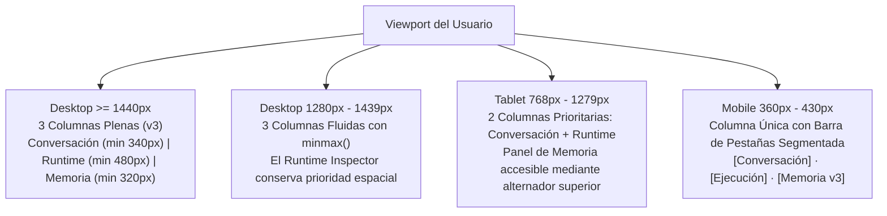
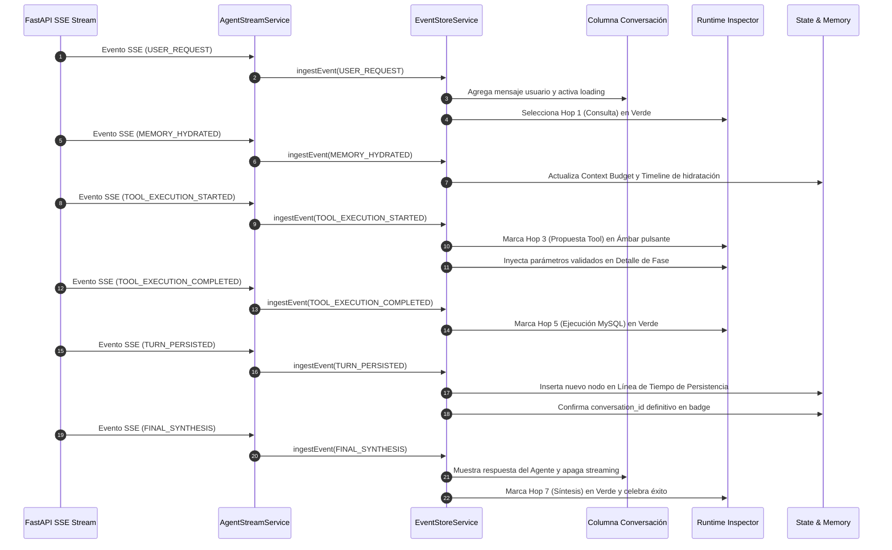

# Agent Engineering Playground (AEP) — Contrato Oficial de Diseño UX/UI

**Versión:** 1.0 Oficial (Integración Google Stitch)  
**Estado:** Aprobado para Implementación (Fase UI-2 completada; pendiente autorización UI-3)  
**Idioma Oficial de la Interfaz:** Español (`es`, formato regional `es-CO` / `es-ES`)  
**Pila Tecnológica:** Angular 22 Standalone, FastAPI SSE, MySQL (SQLAlchemy/Alembic), llama.cpp + Qwen local, Three.js WebGL, Vitest, Playwright.

---

## 1. Contexto Arquitectónico y Pedagógico

El **Agent Engineering Playground (AEP)** es un laboratorio de observabilidad interactivo y banco de pruebas pedagógico concebido para estudiantes, ingenieros e investigadores que analizan y deconstruyen el ciclo de vida de los agentes de inteligencia artificial en tiempo real.

A diferencia de los paneles administrativos tradicionales o interfaces genéricas de chat tipo SaaS, el AEP es un instrumento de **ingeniería de agentes** donde cada destello lumínico, indicador de estado, transición de fase y nodo de memoria representa un hecho verificado en el runtime de backend.

### Progresión de Lecciones y Modos Agénticos

El sistema soporta una progresión pedagógica estricta estructurada en versiones de agentes:

```
┌──────────────────────────────────────────────────────────────────────────────────┐
│                   PROGRESIÓN PEDAGÓGICA DEL PLAYGROUND (AEP)                     │
├─────────────────────────┬──────────────────────────┬─────────────────────────────┤
│ Agent v1 — Tool Calling │ Agent v2 — Agent Loop    │ Agent v3 — State & Memory   │
│ (Lección 02)            │ (Lección 03)             │ (Lección 04)                │
├─────────────────────────┼──────────────────────────┼─────────────────────────────┤
│ • 7 fases deterministas │ • Bucle dinámico ReAct   │ • Persistencia en MySQL     │
│ • Inferencia única      │ • Múltiples iteraciones  │ • Hidratación de turnos     │
│ • Validación Pydantic   │ • Ejecución secuencial   │ • Preferencias explícitas   │
│ • Ejecución y síntesis  │ • Detección de ciclos    │ • Presupuesto de contexto   │
│ • Visualización lineal  │ • Visualización de bucle │ • Proyección dual v2 + v3   │
└─────────────────────────┴──────────────────────────┴─────────────────────────────┘
  [Futuras lecciones: v4 Guardrails & HITL | v5 Multi-Agent Swarm | v6 Adaptive Orchestration]
```

1. **Agent v1 — Tool Calling (Lección 02)**: Ejecución determinista estructurada en un recorrido de 7 fases secuenciales (*Hops*): Consulta → Inferencia 1 → Propuesta de Herramienta → Validación Pydantic → Ejecución MySQL → Inyección de Contexto → Síntesis Final.
2. **Agent v2 — Agent Loop (Lección 03)**: Razonamiento cíclico dinámico con control de iteraciones, evaluación de herramientas, observación y criterios de parada o agotamiento de presupuesto de bucle.
3. **Agent v3 — State & Memory (Lección 04 — Fase actual)**: Extensión del bucle agéntico con persistencia real en MySQL, hidratación de conversaciones previas por persona simulada, gobierno de preferencias explícitas (ámbitos de sesión y persistente), recálculo heurístico de presupuesto de tokens (*Context Budget*) y estabilidad de sesión.
4. **Agent v4 a v6 (Hoja de ruta pedagógica)**: Versiones futuras reservadas para Guardrails & HITL profundo, orquestación multagente y flujos adaptativos.

---

## 2. Fuentes, Prioridad de Decisión y Veracidad de Datos

### Jerarquía de Fuentes de Verdad

Para evitar contradicciones visuales o distorsiones de la arquitectura real, se establece el siguiente orden estricto de precedencia:

1. **Prioridad 1 — Integridad Funcional y Contratos del Backend**:
   Los contratos de FastAPI (`POST /api/chat/stream`), los eventos SSE generados por el orquestador (`src/agents/v3_state_and_memory/orchestrator.py`), el esquema de base de datos en MySQL y los servicios de infraestructura existentes son soberanos. La interfaz jamás debe simular estados inexistentes ni inventar contratos técnicos.
2. **Prioridad 2 — Referencia Visual Original (`docs/design/image.png/screen.png`)**:
   Define la composición estética, la jerarquía visual de 3 columnas para v3, la atmósfera *dark premium* y la presencia del avatar sobre plataforma luminosa.
3. **Prioridad 3 — Prototipo y Especificación Google Stitch (`docs/design/aep_desktop_workspace_agent_v3_state_memory/`)**:
   Proporciona el desglose estructural de componentes, la escala tipográfica y la paleta cromática expandida en HTML/CSS.
4. **Prioridad 4 — Tokens Implementados en UI-2 (`frontend/src/styles.css`)**:
   Variables CSS nativas consolidadas y verificadas con pruebas automatizadas en Vitest (42/42) y Angular CLI Build.

### Veracidad de Datos (Telemetry Integrity)

Queda estrictamente prohibida la «ficción decorativa»:

| Elemento Visual | Clasificación | Regla de Presentación |
| :--- | :--- | :--- |
| **Pestaña «Inferencia observable»** | Evidencia real | **Nunca mostrar ni simular razonamiento interno del LLM.** Solo presentar los eventos emitidos por el runtime y los argumentos validados de las herramientas. |
| **Presupuesto de Contexto** | Métricas del backend | Los recuentos numéricos provienen de `TokenBudgetManager`. Los valores heurísticos deben portar obligatoriamente la pastilla visible `[ESTIMADO]`. |
| **Identificador de Conversación** | Confirmado por MySQL | Solo mostrar el badge `CONV: conv_...` cuando FastAPI haya emitido `MEMORY_HYDRATED` o `TURN_PERSISTED`. Si no hay turno activo, mostrar «Sin conversación activa». |
| **Decisiones Persistentes** | Registros en MySQL | Renderizar únicamente preferencias activas recuperadas de la base de datos con su ámbito real (`PERSISTENT` o `SESSION`) y número de versión (`v1`, `v2`). |
| **Avatar Three.js** | Estado del runtime | Su animación, color de visor y pulso del pedestal reflejan el estado real de la inferencia (`running`, `completed`, `failed`), sin bucles decorativos desacoplados. |

---

## 3. Identidad Visual y Design System

La estética del AEP es un **entorno de laboratorio oscuro de alta tecnología (Dark Premium Workbench)** que combina superficies navy profundas con acentos cromáticos de significado semántico preciso.

### 3.1 Comparación de Tokens: Google Stitch vs. Implementación UI-2

Stitch generó prototipos basados en Tailwind CDN. La implementación oficial del monorepo reside en variables CSS semánticas en `frontend/src/styles.css`, garantizando cero dependencias externas y compatibilidad hacia atrás:

| Concepto de Diseño | Token en Google Stitch | Token Oficial Implementado (`styles.css`) | Valor HEX / RGBA | Propósito Semántico |
| :--- | :--- | :--- | :--- | :--- |
| **Fondo Canvas** | `--aep-canvas` / `brand-bg` | `--bg-canvas` / `--surface-base` | `#070b14` | Fondo midnight profundo del viewport. |
| **Fondo Panel** | `--aep-panel` / `brand-surface` | `--bg-panel` / `--surface-panel` | `#0d1527` | Fondo estructural de columnas principales. |
| **Superficie Cabecera** | `bg-[#090F1E]` | `--bg-surface` | `#0f192e` | Cabecera superior y tarjetas secundarias. |
| **Tarjeta Base** | `--aep-card` / `brand-card` | `--bg-card` / `--surface-card` | `#131d35` | Tarjetas de contenido, mensajes y métricas. |
| **Tarjeta Hover** | `--aep-card-elevated` | `--bg-card-hover` | `#192644` | Estado interactivo al posar el cursor. |
| **Tarjeta Elevada** | `bg-[#1C2C54]` | `--bg-card-elevated` | `--1a2747` | Mensajes de usuario y modales. |
| **Superficie Código** | `--aep-code-surface` | `--bg-code` | `#0a0f1d` | Bloque oscuro del visor de JSON técnico. |
| **Borde Sutil** | `--aep-border-subtle` | `--border-subtle` | `rgba(56, 189, 248, 0.08)` | Delimitador sutil de paneles. |
| **Borde Estándar** | `brand-border` | `--border-default` | `rgba(56, 189, 248, 0.16)` | Borde de tarjetas y contenedores de chat. |
| **Borde Destacado** | `--aep-border-focus` | `--border-prominent` | `rgba(56, 189, 248, 0.28)` | Contornos de tarjetas activas en ejecución. |
| **Acento Cyan** | `--aep-cyan` / `brand-cyan` | `--accent-cyan` / `--accent-cyan-neon` | `#38bdf8` / `#00f0ff` | Inferencia activa, hops en curso, foco. |
| **Halo Cyan** | `--aep-cyan-glow` | `--accent-cyan-glow` | `0 0 16px rgba(56, 189, 248, 0.28)` | Resplandor del pedestal 3D y fase activa. |
| **Acento Emerald** | `--aep-emerald` | `--accent-emerald` / `--accent-emerald-bright` | `#10b981` / `#34d399` | Persistencia en MySQL, hops completados, Live. |
| **Acento Amber** | `--aep-amber` | `--accent-amber` / `--accent-amber-bright` | `#f59e0b` / `#fbbf24` | Propuesta de herramienta, tool calls, advertencia. |
| **Acento Violet** | `--aep-violet` | `--accent-violet` / `--accent-violet-bright` | `#a855f7` / `#c084fc` | Hidratación de memoria, sesión, replay. |
| **Acento Carmesí / Coral**| `--aep-rose` | `--accent-crimson` / `--accent-coral` | `#ef4444` / `#f43f5e` | Errores, fallos en runtime, consulta en budget. |

### 3.2 Escala Tipográfica

El sistema utiliza dos familias tipográficas:
- **Interfaz y Lectura**: `'IBM Plex Sans'`, -apple-system, sans-serif (legibilidad técnica óptima).
- **Telemetría y Código**: `'JetBrains Mono'`, ui-monospace, monospace (alineación tabular de números, JSON y parámetros).

| Nivel Semántico | Fuente | Tamaño | Peso | Interlineado | Tracking | Aplicación en la Interfaz |
| :--- | :--- | :--- | :--- | :--- | :--- | :--- |
| **Display / Título App** | Sans | `15px` / 0.95rem | 700 | `20px` | -0.01em | Logo y título en encabezado principal. |
| **Cabecera de Columna** | Sans | `13px` / 0.82rem | 600 | `18px` | 0.00em | Títulos «Conversación», «Inspector de ejecución». |
| **Fase Activa Hero** | Sans | `15px` / 0.95rem | 700 | `20px` | +0.01em | Título «HOP 3 - PROPUESTA TOOL». |
| **Cuerpo de Mensaje** | Sans | `12.5px` / 0.78rem | 400 | `18px` | 0.00em | Mensajes de chat del usuario y del agente. |
| **Etiqueta Mono / Badges**| Mono | `10.5px` / 0.66rem | 600 | `14px` | +0.02em | Badges de estado, versiones, tags de tools. |
| **Bloque de Código** | Mono | `11.5px` / 0.72rem | 400/500 | `17px` | 0.00em | Visor JSON formateado y números de línea. |
| **Métrica Numérica** | Mono | `11px` / 0.70rem | 600 | `15px` | 0.00em | Desglose de tokens y límites de contexto. |

### 3.3 Radios, Sombras y Elevaciones

- **Radios de curvatura**:
  - `var(--radius-xs)`: `4px` (insignias compactas, chips de línea).
  - `var(--radius-sm)`: `6px` (botones secundarios, selectores, pestañas).
  - `var(--radius-md)`: `10px` (tarjetas interiores, burbujas de chat, visor de código).
  - `var(--radius-lg)`: `14px` (paneles principales de columna).
  - `var(--radius-full)`: `9999px` (pastillas de estado, avatares circulares).
- **Elevaciones y Sombras**:
  - `var(--shadow-card)`: `0 2px 8px rgba(0, 0, 0, 0.35)` (superficie flotante estándar).
  - `var(--shadow-md)`: `0 4px 12px rgba(0, 0, 0, 0.4)` (tarjetas elevadas de chat).
  - `var(--shadow-lg)`: `0 12px 24px rgba(0, 0, 0, 0.5)` (paneles de control desplegables).

### 3.4 Accesibilidad y Reducción de Movimiento

1. **Ratios de Contraste WCAG 2.1 AA**:
   - Texto principal (`--text-primary: #f8fafc`) sobre tarjeta base (`--bg-card: #131d35`): **13.8:1** (supera el estándar AAA de 7:1).
   - Texto secundario (`--text-secondary: #94a3b8`) sobre tarjeta base: **6.5:1** (supera el estándar AA de 4.5:1).
   - Texto de acento cyan (`--text-cyan: #38bdf8`) sobre superficie oscura: **8.2:1**.
2. **Navegación por Teclado y Foco Visible**:
   Todos los elementos interactivos cuentan con la directiva `:focus-visible`:
   ```css
   :focus-visible {
     outline: 2px solid var(--accent-cyan);
     outline-offset: 2px;
     box-shadow: 0 0 0 4px rgba(56, 189, 248, 0.2);
   }
   ```
3. **Preferencia de Reducción de Movimiento (`prefers-reduced-motion: reduce`)**:
   Anula transiciones y animaciones continuas en canvas y CSS, convirtiendo pulsos en estados visuales estáticos definidos.

---

## 4. Arquitectura Visual Responsive por Versión Agéntica

### 4.1 Principio de Diseño con CSS Grid y Breakpoints Basados en Contenido

Quedan descartados los anchos porcentuales rígidos (`30% / 43% / 27%`) que comprimen el Runtime Inspector en pantallas medianas. Se establece una cuadrícula dinámica mediante `CSS Grid` y la función `minmax()`:

```css
/* Disposición para Agent v3 (3 Columnas de Primer Nivel) */
.workspace-grid-v3 {
  display: grid;
  grid-template-columns: minmax(340px, 1fr) minmax(460px, 1.4fr) minmax(320px, 0.9fr);
  gap: var(--space-3);
  height: calc(100vh - 56px);
  overflow: hidden;
  padding: var(--space-3);
}

/* Disposición para Agent v1 y Agent v2 (2 Columnas Optimizadas) */
.workspace-grid-v1-v2 {
  display: grid;
  grid-template-columns: minmax(360px, 1fr) minmax(600px, 2.2fr);
  gap: var(--space-3);
  height: calc(100vh - 56px);
  overflow: hidden;
  padding: var(--space-3);
}
```

### 4.2 Matriz de Comportamiento por Dispositivo



1. **Desktop (>= 1280px)**:
   - **Agent v3**: Tres columnas independientes de primer nivel visibles en simultáneo. Cada columna dispone de su propio scroll vertical (`overflow-y: auto`), manteniendo la cabecera global y el compositor fijos.
   - **Agent v1 y v2**: La columna de Estado y Memoria no se renderiza. El Runtime Inspector ocupa todo el espacio derecho disponible (~70%), otorgando amplitud para observar los 7 hops y los bucles de iteración.
2. **Tablet (768px a 1279px)**:
   - Disposición en 2 columnas: Conversación a la izquierda e Inspector a la derecha.
   - En Agent v3, la barra de herramientas del inspector ofrece el selector `[Vista Dual | Solo Loop | Solo Memoria]`, permitiendo alternar o deslizar el panel de memoria sin comprimir el escenario Three.js.
3. **Mobile (360px a 430px)**:
   - Una sola columna vertical con ancho `100%` y altura controlada (`height: 100dvh`).
   - Barra de navegación fija con pastillas: `[ Conversación ]` · `[ Ejecución ]` · `[ Memoria ]` (solo visible en v3).
   - Sin desplazamiento horizontal (`overflow-x: hidden` estructural verificado sin truncar controles).
   - El compositor de chat permanece anclado en la zona inferior con botones táctiles de al menos `44px` de altura para ergonomía táctil.

---

## 5. Contrato y Catálogo de Componentes Angular

Se mapean los componentes existentes en `frontend/src/app` con la nueva experiencia visual:

### 5.1 Encabezado Superior (`app-header`)

- **Archivo**: [header.component.ts](file:///c:/Users/YAMI/Documents/clase%20cfa%20lab03/frontend/src/app/components/header/header.component.ts)
- **Responsabilidad**: Identidad de la plataforma, telemetría de servicios de infraestructura, selectores de contexto y controles globales de reproducción.
- **Elementos Visibles**:
  1. *Identidad*: Logotipo poligonal AEP en verde esmeralda con resplandor suave, título «Agent Engineering Playground» y pastilla cyan «Entorno Local».
  2. *Telemetría*: Indicadores de conexión en vivo con puntos luminosos: `FastAPI: 8000 · Modelo: Conectado · MySQL: Conectado`.
  3. *Selector de Persona*: Pastilla estilizada con avatar circular, etiqueta «Persona (Simulación)», nombre «Carlos Mario Restrepo · USER» y flecha desplegable.
  4. *Selector de Versión*: Pastilla con icono de robot, etiqueta «Versión Agéntica» y desplegable «Agent v3 — State & Memory (L04)».
  5. *Controles de Reproducción*: Reubicados desde el inspector a la esquina superior derecha del header:
     - Badge verde esmeralda pulsante `● EN VIVO`.
     - Botón `⏸ Pausar` (activa la pausa visual sin bloquear el backend).
     - Botón `↺ Replay` (inicia el recorrido histórico paso a paso).
- **Datos Reales Requeridos**: `health()` de FastAPI, `personas()`, `agents()`, `selectedPersona()`, `selectedAgentId()`, `controller.mode()`, `controller.isVisualPaused()`.

### 5.2 Columna de Conversación (`app-chat-panel`)

- **Archivo**: [chat-panel.component.ts](file:///c:/Users/YAMI/Documents/clase%20cfa%20lab03/frontend/src/app/components/chat-panel/chat-panel.component.ts)
- **Responsabilidad**: Historial conversacional interactivo, estado de la persona simulada y emisión de consultas hacia el agente.
- **Elementos Visibles**:
  1. *Cabecera del Chat*: Título «Conversación», badge verde «v3 · State & Memory» y botón secundario `↺ Nueva conversación`.
  2. *Burbujas de Usuario*: Tarjetas oscuras elevadas (`#1c2c54`) con avatar de usuario a la derecha, nombre `usr_carlos` y hora de emisión (`8:05 PM`).
  3. *Burbujas del Agente*: Tarjetas en `#131d35` con avatar cyan de robot a la izquierda, título `Agente de Soporte`, hora y formato Markdown completo con resaltado de tickets y estados.
  4. *Indicador de Procesamiento*: Cuando el agente está respondiendo, muestra un pulso cyan activo y la fase actual en curso (ej. `tool_call_started: get_ticket`).
  5. *Pastillas de Consulta Rápida*: Hilera horizontal fija sobre el compositor con accesos contextuales de un clic: `[TICK-1001]`, `[Ver comentarios]`, `[Asignar a técnico]`, `[SLA y vencimiento]`, `[Conceptual (Sin Tools)]`.
  6. *Compositor*: Textarea expandible con atajo `Enter` para enviar, botón de adjunto/limpieza a la izquierda y botón de acción principal `Enviar` en cyan brillante con icono de avión de papel.
- **Datos Reales Requeridos**: `messages()`, `isStreaming()`, `activeStep()`, evento `sendMessage`, evento `stopStream`.

### 5.3 Columna Central — Inspector de Ejecución (`app-runtime-inspector`)

- **Archivo**: [runtime-inspector.component.ts](file:///c:/Users/YAMI/Documents/clase%20cfa%20lab03/frontend/src/app/components/runtime-inspector/runtime-inspector.component.ts)
- **Responsabilidad**: Protagonista visual del Playground. Muestra en tiempo real la cognición, el bucle agéntico, el estado de las herramientas y la evidencia técnica.
- **Subcomponentes y Secciones**:
  1. *Cabecera del Inspector*: Título «Inspector de ejecución», pastilla de versión `v3`, conmutador de visualización `[Vista Dual | Solo Loop | Solo Memoria]` y enlace secundario a eventos crudos `Eventos Raw (18)`.
  2. *Bloque Hero Superior (Dos Columnas Internas)*:
     - **Izquierda**: Escenario Three.js con el avatar robot AEP sobre pedestal lumínico.
     - **Derecha**: Tarjeta de fase activa con indicador `EN PROGRESO` en ámbar, título principal en negrita `HOP 3 - PROPUESTA TOOL`, descripción legible, caja con icono `Componente Soberano: Qwen 3.5 4B (llama.cpp)` y recuadro explicativo `Qué está ocurriendo: El LLM evalúa el contexto acumulado y decide invocar la herramienta get_ticket`.
  3. *Pipeline / Stepper de Ejecución*:
     - En **v1**: Componente `app-journey-flow` renderizando las 7 fases horizontales conectadas con esferas verdes con checkmark para completadas, anillo cyan brillante con pulso para la fase activa y esferas neutras para pendientes.
     - En **v2 y v3**: Componente `app-v2-loop-flow` renderizando las iteraciones del bucle, inferencias y llamadas a herramientas.
  4. *Detalle de la Fase Actual & Visor de Código*:
     - Cabecera con título «Detalle de la Fase Actual» y badge del evento activo (`TOOL_CALL_PROPOSED`).
     - Barra de subpestañas: `[ Inferencia observable | Llamada a Herramienta (activa) | Respuesta | JSON Técnico ]`.
     - Bloque de visualización de código en `#0a0f1d` con números de línea alineados y resaltado de sintaxis JSON (`tool_name`, `parameters`, `reasoning`, `confidence`).

### 5.4 Columna Derecha — Inspector de Estado y Memoria (`app-v3-memory-inspector`)

- **Archivo**: [v3-memory-inspector.component.ts](file:///c:/Users/YAMI/Documents/clase%20cfa%20lab03/frontend/src/app/components/runtime-inspector/v3-memory-inspector/v3-memory-inspector.component.ts)
- **Responsabilidad**: Visualización exclusiva de la persistencia relacional en MySQL, hidratación de contexto y presupuesto de tokens del Agent v3.
- **Secciones Visibles**:
  1. *Cabecera de Columna*: Título «Estado y memoria», badge morado `v3` y botón de expandir.
  2. *Context Budget (Presupuesto de Contexto)*:
     - Cabecera con título, pastilla azul `ESTIMADO` y texto `Límite: 4,096 tokens`.
     - Barra segmentada multicolor continua: Verde (Sistema 482) → Morado (Decisiones 312) → Azul (Historial hidratado 1,120) → Rosa (Consulta actual 270) → Gris oscuro (Disponible 1,912).
     - Resumen numérico: `2,184 / 4,096` tokens utilizados.
     - Leyenda en cuadrícula de 2 columnas con viñetas de colores y números exactos alineados a la derecha.
  3. *Decisiones Persistentes*:
     - Título «Decisiones Persistentes (2)» y enlace `+2 históricas`.
     - Tarjetas individuales con icono temático (base de datos verde para `PERSISTENT`, usuario morado para `SESSION`), nombre de clave en monospace (`idioma_respuesta`, `nivel_detalle`), pastilla de versión (`v1`) y descripción del valor activo.
  4. *Memoria Conversacional (Timeline)*:
     - Título «Memoria Conversacional» e insignia `4 turnos en contexto`.
     - Timeline vertical con línea conectora continua:
       - Nodo 1 (Azul): `MEMORY_HYDRATED` a las `8:05:12 PM`. Detalle: «Se recuperaron 3 turnos previos y 2 decisiones desde MySQL».
       - Nodo 2 (Verde): `TURN_PERSISTED · Turno #1` a las `8:05:15 PM`. Detalle: «Consulta inicial del usuario guardada en base de datos».
       - Nodo 3 (Cyan): `TURN_PERSISTED · Turno #2` a las `8:05:48 PM`. Detalle: «Respuesta del agente con estado del ticket».
  5. *Tareas Pendientes (HITL)*:
     - Cabecera «Tareas Pendientes (0)».
     - Tarjeta limpia con borde punteado sutil, icono de bandeja y texto «No hay tareas pendientes en este momento», manteniendo la infraestructura HITL lista sin forzar interacción pedagógica prematura.

---

## 6. Especificación de Animaciones y Three.js

El Playground evoluciona el núcleo esférico actual hacia el **Robot Holográfico AEP** que aparece en la referencia visual, conservando el renderizador Three.js y sin recurrir a imágenes estáticas ni archivos externos.

```
┌──────────────────────────────────────────────────────────────────┐
│                   COMPOSICIÓN DEL AVATAR THREE.JS                │
├──────────────────────────────────────────────────────────────────┤
│                                                                  │
│            (•‿•)   <-- Cabeza ovoide + Visor curvado con         │
│           [ AEP ]       Dynamic CanvasTexture (Ojos/boca cyan)   │
│           /|   |\  <-- Torso cápsula blanco perla + Placa AEP    │
│            |___|   <-- Brazos y piernas compactas en reposo      │
│          ========= <-- Pedestal cilíndrico oscuro                │
│         (  ◉   ◉  ) <-- Anillos concéntricos lumínicos emisivos  │
│        ~~~~~~~~~~~~~ <-- Halo de luz + Partículas ascendentes    │
│                                                                  │
└──────────────────────────────────────────────────────────────────┘
```

### 6.1 Composición Geométrica Matemática (Zero External Models)

1. **Plataforma Lumínica (Pedestal Stage)**:
   - Base cilíndrica oscura (`CylinderGeometry(1.2, 1.3, 0.2, 32)`) en material metálico negro grafito.
   - Dos anillos concéntricos toroidales (`TorusGeometry`) con `MeshBasicMaterial` o `MeshStandardMaterial` emisivo en cyan (`#00f0ff`).
   - Nube de partículas ascendentes suaves (`Points` con `BufferGeometry` de 48 partículas) simulando un haz de luz vertical.
2. **Cuerpo del Robot (Pod Capsule)**:
   - Torso construido con `CapsuleGeometry(0.35, 0.4, 16, 32)` en blanco perla con acabado suave PBR (`roughness: 0.18`, `metalness: 0.12`).
   - Placa circular pectoral en el pecho con textura procedural vectorial que muestra el emblema «AEP».
3. **Cabeza y Visor Interactivo**:
   - Cabeza redondeada ovoide (`SphereGeometry` con escala Y sutil de `0.92`).
   - Visor frontal curvado negro brillante azabache (`roughness: 0.05`).
   - Auriculares cilíndricos laterales en las orejas con pequeños aros de luz cyan.
   - **Dynamic CanvasTexture**: Las expresiones del robot (ojos circulares cyan brillantes, parpadeo y sonrisa arqueada) se dibujan en un `HTMLCanvasElement` oculto de 256×128 px vinculado como `CanvasTexture`. Esto permite parpadear de forma determinista y cambiar la expresión según el estado del agente sin ningún costo poligonal.

### 6.2 Presupuesto de Rendimiento y Ciclo de Vida

- **Presupuesto poligonal estricto**: Máximo 2,500 vértices en total para toda la escena.
- **Iluminación**: 1 luz ambiental tenue (`0.6`) + 1 luz puntual en el pedestal (`0x00f0ff`, intensidad 2.5) proyectada hacia arriba + 1 luz direccional superior tenue (`0xffffff`, intensidad 0.8).
- **Consumo de recursos**: No se fuerza un bucle ciego de 60 FPS si el agente está en reposo; se aplica modulación de cuadros o renderizado bajo demanda cuando la escena no experimente variaciones.
- **Protocolo de Destrucción Obligatorio (`ngOnDestroy`)**:
  ```typescript
  cleanupThree(): void {
    if (this.animationFrameId) {
      cancelAnimationFrame(this.animationFrameId);
    }
    this.resizeObserver?.disconnect();
    
    // Recorrer el grafo y liberar memoria de GPU
    this.scene?.traverse((obj) => {
      if (obj instanceof THREE.Mesh) {
        obj.geometry?.dispose();
        if (Array.isArray(obj.material)) {
          obj.material.forEach((m) => m.dispose());
        } else if (obj.material) {
          obj.material.dispose();
        }
      }
    });
    this.dynamicCanvasTexture?.dispose();
    this.renderer?.dispose();
  }
  ```

### 6.3 Respuesta Reactiva a Eventos del Runtime

| Estado del Agente | Expresión del Visor | Color del Pedestal | Movimiento |
| :--- | :--- | :--- | :--- |
| **En Espera (Idle)** | Ojos circulares abiertos con parpadeo cada 4s | Cyan tenue (`#00f0ff` al 30%) | Respiración vertical flotante (`Math.sin(time * 1.5) * 0.04`). |
| **Inferencia Activa (`running`)** | Ojos atentos con pulso | Cyan neón intenso con halo activo | Giro leve de cabeza hacia el inspector de hops. |
| **Ejecución de Herramienta (`tool`)** | Ojos concentrados | Ámbar brillante (`#f59e0b`) | Pulso rítmico en la base del pedestal. |
| **Completado / Respuesta (`completed`)**| Ojos en arco sonriente (Happy) | Verde esmeralda (`#10b981`) | Inclinación de asentimiento de cabeza. |
| **Error en Runtime (`failed`)** | Ojos en cruz o línea plana | Carmesí de alerta (`#ef4444`) | Base en rojo estático sin partículas. |

---

## 7. Política de Idioma — Español Primero

El Agent Engineering Playground está dirigido a la comunidad técnica hispanohablante. La experiencia visible debe ser **100% en español natural y profesional**, evitando calcos innecesarios del inglés.

### 7.1 Configuración Documental
- El documento HTML principal debe definir `lang="es"`.
- Los formatos de fecha y hora deben seguir la convención regional en español (ej. `8:05:12 p. m.` o `20:05:12`).
- Las cifras decimales y de millares deben respetar la puntuación correspondiente (`4.096 tokens` o `4,096 tokens`).

### 7.2 Glosario Oficial de Interfaz

| Término en Inglés (Prototipo/Código) | Término Oficial en Español (Interfaz Visible) | Contexto y Justificación |
| :--- | :--- | :--- |
| **Runtime Inspector** | **Inspector de ejecución** | Cabecera de la columna central de observabilidad. |
| **Execution Journey** | **Recorrido de ejecución** | Línea temporal pedagógica de los 7 hops. |
| **State & Memory** | **Estado y memoria** | Columna derecha y pestaña de persistencia. |
| **Context Budget** | **Presupuesto de contexto** | Sección de conteo y ventana de tokens. |
| **Memory Timeline** | **Línea de tiempo de memoria** | Histórico cronológico de persistencia relacional. |
| **Reasoning (Tab)** | **Inferencia observable** | **Sustitución obligatoria.** No simular razonamiento interno. |
| **Tool Calling / Tool Execution** | **Ejecución de herramienta** | Fase o subpestaña de invocación técnica. |
| **Synthesized Response** | **Respuesta sintetizada** | Subpestaña con el mensaje final del modelo. |
| **Raw Technical JSON** | **JSON técnico** | Subpestaña con el payload estructurado. |
| **Live** | **En vivo** | Modo de seguimiento en tiempo real. |
| **Replay** | **Reproducir ejecución** | Modo de inspección histórica paso a paso. |
| **Pause Visual** | **Pausar visualización** | Pausa del frontend sin alterar el backend. |
| **Hydrated History** | **Historial recuperado** | Turnos previos extraídos de MySQL. |
| **Active Decisions** | **Decisiones activas** | Preferencias gobernadas vigentes. |
| **Pending Tasks** | **Tareas pendientes** | Intervenciones humanas registradas. |
| **Send** | **Enviar** | Botón de despacho en el compositor de chat. |
| **New Conversation** | **Nueva conversación** | Botón de reinicio de sesión de chat. |

### 7.3 Excepciones Técnicas Permitidas
Se conservan sin traducción los conceptos canónicos de la literatura y nombres de código:
- Nombres de lecciones y arquitecturas: `Tool Calling`, `Agent Loop`, `State & Memory`.
- Identificadores de código: `ticket_id`, `TICK-1001`, `get_ticket`, `assign_ticket`.
- Eventos SSE: `MEMORY_HYDRATED`, `TURN_PERSISTED`, `TOOL_EXECUTION_STARTED`.
- Nombres de modelos: `Qwen 3.5 4B (llama.cpp)`.
- Ámbitos de memoria: `PERSISTENT`, `SESSION`.

---

## 8. Preparación para Futura Internacionalización (`es` / `en`)

Aunque la aplicación opera inicialmente solo en español, la arquitectura debe prepararse para soportar múltiples idiomas sin refactorizaciones traumáticas.

### Estrategia Recomendada para Angular 22
- **Enfoque basado en Signals y Catálogo Tipado**:
  Crear un servicio ligero `I18nService` (`frontend/src/app/services/i18n.service.ts`) que exponga un signal reactivo `currentLang = signal<'es' | 'en'>('es')` y un método puro `t(key: TranslationKey): string`.
- **Ventajas frente a librerías externas**:
  - Cero dependencias añadidas (evita bibliotecas pesadas o incompatibles con Angular standalone).
  - Tipado estricto en tiempo de compilación con TypeScript (`keyof typeof ES_DICTIONARY`).
  - Detección de cambios instantánea sin recarga de página mediante signals.
- **Persistencia**: Almacenamiento en `localStorage` con clave `aep_language_preference`, recurriendo a `'es'` por defecto.
- **Fechas y Números**: Uso exclusivo de la API nativa del navegador `Intl.DateTimeFormat(lang)` e `Intl.NumberFormat(lang)`, garantizando formateo automático según el idioma activo.

---

## 9. Contratos de Datos y Observabilidad SSE

Cada bloque de la interfaz se conecta directamente a los eventos reales emitidos por FastAPI mediante `EventStoreService` y `AgentStreamService`:



---

## 10. Matriz de Fidelidad Visual

| Elemento de la Interfaz | Referencia Original (`image.png`) | Prototipo Google Stitch (`code.html`) | Angular Existente (Pre-rediseño) | Contrato Final Aprobado (`DESIGN.md`) |
| :--- | :--- | :--- | :--- | :--- |
| **Estructura de Columnas (v3)** | 3 columnas equilibradas de ancho completo. | 3 columnas con Tailwind (`col-span-3`, `col-span-5`, `col-span-4`). | 2 paneles con splitter arrastrable; v3 subdividido internamente. | **3 columnas estructurales de primer nivel** con `CSS Grid` y `minmax()`. |
| **Cabecera y Telemetría** | Barra oscura con telemetría integrada, selectores y botones Live/Pause/Replay a la derecha. | Barra con clases Tailwind fijas y botones Pause/Replay. | Cabecera separada; controles de reproducción aislados en el inspector. | **Cabecera unificada** con telemetría en vivo y controles de reproducción a la derecha. |
| **Avatar del Agente** | Robot blanco/antracita sobre pedestal circular con aros de luz cyan. | SVG plano con aros circulares decorativos CSS. | Núcleo de reactor esférico con anillos toroidales abstractos. | **Robot procedural 3D en Three.js** sobre pedestal lumínico con visor dinámico CanvasTexture. |
| **Tarjeta de Fase Activa** | Panel hero al lado del avatar con título grande, badge y caja de componente. | Tarjeta flex a la derecha del SVG con etiqueta `EN PROGRESO`. | Tarjeta vertical simple colocada debajo del reactor. | **Hero integrado de dos columnas**: Avatar 3D a la izquierda y Fase Activa a la derecha. |
| **Stepper de Hops** | Nodos circulares conectados con esferas verdes de verificación y anillo cyan en activo. | Stepper horizontal con checks y línea continua conectora. | Stepper compacto con números pequeños sin resplandor. | **Stepper de alta fidelidad** con aros luminosos, checks en verde y pulso en la fase activa. |
| **Detalle de Fase & Código** | Pestañas superiores y bloque de código con numeración de líneas y syntax highlighting. | Pestañas `Razonamiento`, `Tool`, `Respuesta`, `JSON` con bloque `<pre>`. | Acordeón técnico colapsable al pie de página sin numeración de líneas. | **Tarjeta de Detalle de Fase** con pestaña **«Inferencia observable»**, subpestañas y visor de código numerado. |
| **Context Budget** | Barra segmentada continua multicolor con leyenda vertical tabular y tag ESTIMADO. | Barra segmentada con divs de porcentaje y leyenda en cuadrícula. | 4 tarjetas métricas horizontales con barra de 4 colores. | **Barra segmentada multicolor continua** con leyenda tabular y tag obligatorio `[ESTIMADO]`. |
| **Decisiones Persistentes** | Tarjetas con iconos coloreados (verde/morado), badges de ámbito y versión. | Tarjetas con tags `PERSISTENT` y `SESSION`. | Chips planos simples. | **Tarjetas estilizadas** con iconos de base de datos/usuario y badges de ámbito. |
| **Memoria Conversacional** | Timeline vertical continuo con nodos coloreados y timestamps claros. | Timeline con línea vertical discontinua a la izquierda. | Lista de nodos apilados. | **Línea de tiempo vertical continua** con eventos `MEMORY_HYDRATED` y `TURN_PERSISTED`. |
| **Tareas Pendientes** | Tarjeta limpia de estado vacío con checkmark discreto. | Tarjeta con icono de bandeja vacía. | Botones de selección HITL interactivos expuestos por defecto. | **Tarjeta limpia con estado sin tareas**, preservando la capacidad técnica sin forzarla. |
| **Idioma de la Interfaz** | Español en casi todos los textos. | Mezcla de español e inglés en etiquetas y componentes. | Mezcla con varios textos en inglés (`Runtime Inspector`, `Context Budget`). | **100% en español oficial**, preservando solo identificadores de código y nombres de lecciones. |

---

## 11. Roadmap de Implementación Incremental (UI-3 a UI-6)

La implementación se ejecutará en cuatro fases estrictas, validando en cada una la ausencia de regresiones en Vitest, Angular Build y backend:

```
┌─────────────────────────────────────────────────────────────────────────────┐
│                   ROADMAP DE IMPLEMENTACIÓN INCREMENTAL                     │
├───────────────┬───────────────────────────────┬─────────────────────────────┤
│ Fase          │ Alcance Principal             │ Entregables Verificables    │
├───────────────┼───────────────────────────────┼─────────────────────────────┤
│ **UI-3**      │ Layout Responsive & Header    │ • app.html reestructurado   │
│               │ Unificado                     │ • Header con Live/Pause     │
│               │                               │ • Grid CSS fluido minmax()  │
├───────────────┼───────────────────────────────┼─────────────────────────────┤
│ **UI-4**      │ Runtime Inspector & Avatar 3D │ • Robot Three.js procedural │
│               │                               │ • Stepper de Hops lumínico  │
│               │                               │ • Detalle e Inferencia obs. │
├───────────────┼───────────────────────────────┼─────────────────────────────┤
│ **UI-5**      │ State & Memory & Chat Panel   │ • Budget segmentado         │
│               │                               │ • Decisiones y Timeline     │
│               │                               │ • Chat con chips rápidos    │
├───────────────┼───────────────────────────────┼─────────────────────────────┤
│ **UI-6**      │ QA Visual, Playwright & Cierre│ • Pruebas en 5 resoluciones │
│               │                               │ • Vitest 42/42 + Build OK   │
│               │                               │ • Auditoría de español 100% │
└───────────────┴───────────────────────────────┴─────────────────────────────┘
```

### Detalle por Fase:

- **Fase UI-3 — Layout Responsive y Header Unificado**:
  - *Archivos*: `frontend/src/app/app.html`, `frontend/src/app/app.css`, `frontend/src/app/components/header/header.component.ts`.
  - *Acciones*: Implementar la cuadrícula CSS Grid de 3 columnas para v3 y 2 columnas para v1/v2; integrar los controles de ejecución en la cabecera; adaptar vista responsive para tablet y mobile.
  - *Condición de paso*: `npm test` aprobado y visualización correcta del grid en el navegador.
- **Fase UI-4 — Runtime Experience & Avatar 3D**:
  - *Archivos*: `frontend/src/app/components/runtime-inspector/avatar-3d/agent-avatar-3d.component.ts`, `frontend/src/app/components/runtime-inspector/runtime-inspector.component.ts`, `frontend/src/app/components/runtime-inspector/journey-flow/journey-flow.component.ts`, `frontend/src/app/components/runtime-inspector/technical-viewer/technical-viewer.component.ts`.
  - *Acciones*: Ensamblar el avatar robot Three.js con pedestal y visor reactivo; rediseñar la tarjeta hero de fase activa; estilizar el stepper de hops; integrar pestañas de detalle con «Inferencia observable» y resaltado de JSON con numeración de líneas.
  - *Condición de paso*: Renderizado 3D fluido sin fugas de memoria, pruebas Vitest aprobadas.
- **Fase UI-5 — State & Memory y Chat Panel**:
  - *Archivos*: `frontend/src/app/components/runtime-inspector/v3-memory-inspector/v3-memory-inspector.component.ts`, `frontend/src/app/components/chat-panel/chat-panel.component.ts`.
  - *Acciones*: Implementar la barra segmentada de tokens con leyenda en cuadrícula; diseñar las tarjetas de decisiones con iconos y badges; estilizar el timeline vertical de turnos; incorporar chips de consulta rápida y botón de nueva conversación en el chat.
  - *Condición de paso*: Datos reales del EventStore reflejados fielmente sin ficción decorativa.
- **Fase UI-6 — QA Visual, Playwright y Cierre**:
  - *Acciones*: Ejecutar pruebas en navegadores reales en resoluciones de 1440px, 1280px, 768px, 390px y 360px; verificar ausencia total de scroll horizontal; validar accesibilidad y textos 100% en español; certificar `npm test` y `npm run build`.

---

## 12. Matriz de Riesgos y Decisiones Arquitectónicas

| Riesgo Técnico Identificado | Impacto Potencial | Decisión y Medida de Mitigación |
| :--- | :--- | :--- |
| **Dependencia de Tailwind en prototipo Stitch** | Romper el bundle de Angular o introducir librerías redundantes. | **Decisión**: No utilizar Tailwind CDN. Replicar la composición exacta utilizando CSS puro nativo mediante los tokens semánticos ya creados en `frontend/src/styles.css`. |
| **Sobrecarga de memoria o lag en Three.js** | Ralentizar navegadores en laptops o dispositivos móviles. | **Decisión**: Limitar geometría a <2,500 vértices, usar materiales estándar ligeros y aplicar limpieza estricta con `.dispose()` en `ngOnDestroy()`. |
| **Simulación ficticia de razonamiento** | Engañar al estudiante pedagógicamente. | **Decisión**: Renombrar la pestaña a «Inferencia observable». Solo mostrar los argumentos validados de las herramientas y los eventos SSE reales emitidos por el runtime. |
| **Exposición prematura de HITL en v3** | Desviar la atención del objetivo educativo (State & Memory). | **Decisión**: Ocultar botones interactivos de autorización en la vista principal y mostrar la tarjeta de estado limpio con 0 tareas, preservando la infraestructura en backend y frontend para la Lección 05. |
| **Regresión en pruebas de la Fase 6.4** | Romper la continuidad conversacional y el aislamiento recién aprobado. | **Decisión**: No modificar ningún archivo de backend (`src/`) ni de tests de integración (`tests/`). Todo el trabajo se restringe a las plantillas y estilos del frontend. |

---

**Contrato de Diseño Oficial Finalizado.**  
Este documento constituye la fuente de verdad definitiva para guiar la implementación visual del Agent Engineering Playground. Queda terminantemente prohibido avanzar con modificaciones de código en UI-3 sin la aprobación explícita de este contrato.
